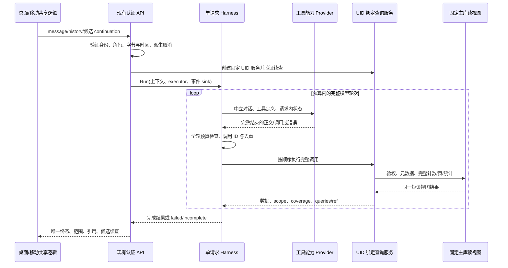

# Description

为 ezbookkeeping 桌面和移动端的当前登录用户提供完整有效账本的自然语言查询、精确统计及解释，替换现有 embedding、top-k 和历史窗口依赖。默认覆盖该 UID 的所有有效记账账户，包含隐藏数据；用户指定账户或期间时才收窄范围。运行预算限制单次执行，不改变可查询的账本范围。

任务已按授权完成 draft → todo → in-progress。2026-10-15 当前状态：原 14 步本地实现、五阶段独立审查、三库/100K/双端浏览器/隔离 SQLite 旧版本恢复及全部本地门禁已完成；新增 Docker 整应用构建、HTTP 和双页面 smoke/E2E 也已通过独立证据复核。真实主备模型七题财务验收仍待环境，尚不可发布。用户随后明确授权 commit/push，并通过 gh 向**当前 origin 仓库 `XueHua-s/ezbookkeeping` 的 `main`** 创建草稿 PR；这项授权覆盖早期“不自动提交/推送”的限制，不含生产部署或旧缓存表删除。

原始方案保持不变；原方案第 14 节的测试成绩是改造前基线，未作为新功能完成证据。源方案第 4—8、10、12、15、17 节是规范性契约，尤其第 15 节冻结值全部承接；本文件概括不放宽源契约。实际落地、阶段发现闭环和环境边界见[最终实施审查](../../analysis/harness-final-implementation-review.md)与[验收记录](../../../docs/ai-assistant-harness-verification.md)。

**Scope Included**

- 账户、分类、标签发现，任意历史有效账单搜索/详情，完整匹配范围统计、趋势比较、当前余额和有证据的数据建议。
- 单一只读执行循环、两条现有 API、Chat Completions/强制流式 Chat Completions/Responses、主备模型、取消和预算。
- 可靠的桌面/移动端进度、终态、范围、引用与分页续查；短期页面会话。
- 移除向量运行依赖，保留旧表兼容，配置升级与回滚、日志脱敏、数据库/协议/前端验证和技能文档同步。

**Scope Excluded**

交易写入和账户管理、附件内容识别、计划交易模板、已删除数据恢复、历史任意时点余额重建、跨币种自动换汇、密码/令牌读取、长期记忆、持久化运行恢复、多代理运行、独立 MCP 跳转、任意 SQL/脚本执行、旧缓存表删除及生产发布。本次计划不扩展外部 MCP 权限或重写识图路径。

**User Scenarios**

1. 用户问“去年餐饮按月花多少”，解析分类层级并对完整年份聚合，展示真实期间、分币种金额及查询证据；同名实体有歧义时先澄清。
2. 用户寻找五年前的大额交通账单，逐页定位并打开经鉴权引用；“继续”和“下一页”使用已验证游标，新问题不自动继承旧筛选。
3. 用户问全历史收支或当前余额，隐藏账户纳入，转账、退款、负债和余额调整口径清楚；历史余额不可用时明确能力限制。
4. 用户先问“只看支付宝”，再问“那上个月呢”，利用短期上下文解析指代并重新查询事实；summary 默认本月至当前时刻收支、上月同进度比较、本期分类分布和当前余额，用户明确期间优先；同比仍按去年同进度，不冒充完整月/年。
5. 空账本返回成功空集并允许一般知识问答；错误、超时、预算耗尽、供应商断流不得变成“无账单”或完成答案。
6. 用户取消、清空会话、离开页面或切换用户，停止本次工作并清理续查；旧回调不能覆盖新请求。
7. 提示词、备注或历史伪造 UID、工具结果、写工具调用均不扩大权限；混入其他用户 ID 时拒绝而非退化为全量。

参考：[原方案](../../../AI_ASSISTANT_HARNESS_PLAN.md)、[研究](../../analysis/research-ai-assistant-harness.md)、[代码分析](../../analysis/analysis-ai-assistant-harness.md)、[只读 Harness 研究技能](../../../.claude/skills/assistant-readonly-harness/SKILL.md)。研究与代码分析为计划支撑材料，不替代源方案冻结契约。 完整来源映射与本轮独立复核见[需求追踪总索引](../../analysis/harness-requirements-traceability.md)。

## Acceptance Criteria

以下保留原验收定义。各项本地实现/确定性测试均已具名映射并通过，真实模型相关 CK-12/18/19 仍有明确待环境项，不能把本地 PASS 扩大为发布通过；逐项状态见最终实施审查和验收记录。

**Checklist:**

| ID | Question | Category | Importance |
| --- | --- | --- | --- |
| CK-1 | 7 个只读工具是否全部可用，元数据/余额可连续分页，默认纳入隐藏有效实体且 ID 为字符串？ | hard_rule | essential |
| CK-2 | schema 与执行校验是否来自同一领域定义，并严格执行源 §15.1 的全部参数、默认值、null/空数组、重复键/未知字段、字节上限及字面关键词规则？ | hard_rule | essential |
| CK-3 | 所有主查询、关联、归属、游标、引用及用户分库是否绑定登录 UID，非法混合 ID 是否拒绝且无法调用写工具？ | hard_rule | essential |
| CK-4 | 明细是否可达五年以上及未来日期账单、静态数据分页无重漏，统计是否覆盖全部匹配集合而无 1800/top-k/历史或扫描上限？ | hard_rule | essential |
| CK-5 | 金额是否沿用 100 倍整数、任意精度累加和两位小数字符串，保留退款符号并按币种独立统计/排序/比较？ | hard_rule | essential |
| CK-6 | 转账是否先规范化再筛选分页，以转出 ID/time 为逻辑键，同侧联合匹配并只计一笔，流向分别统计且缺失/跨 UID 关联显式报错？ | hard_rule | essential |
| CK-7 | 时间是否使用请求时区及秒级半开区间，层级展开去重，比较按 ordinal/同币种同 flow 配对，有限时间补零且基期非正增长率为 null？ | hard_rule | essential |
| CK-8 | 当前余额是否来自有效叶子账户 signed_balance，负债 outstanding_balance 取负值，隐藏账户纳入且父节点不重复，分页不改变分币种总计？ | hard_rule | essential |
| CK-9 | 结果是否具有真实 scope/coverage/queried_at/计数及全量 totals，空集与错误明确区分，证据仅来自成功查询且引用最多 8 个去重逻辑 ID？ | hard_rule | essential |
| CK-10 | 游标/continuation 是否按源 §15.3 签名绑定 tool/UID/原始筛选/层级摘要/时区/排序/高水位/末键/时效，24 小时过期且每次重新验权，续查不自动执行？ | hard_rule | essential |
| CK-11 | harness 是否同一入口服务 JSON/SSE，整轮完整后按顺序执行工具，保留调用结果配对并按源 §7.2/15.3 扣减、去重和终止预算？ | hard_rule | essential |
| CK-12 | 三种 OpenAI 路径是否完整组装参数及结束信号，Responses 状态仅请求内保留，主备最多切换一次且发送正文/思考后禁止切换，不能无损转换时明确失败？ | hard_rule | essential |
| CK-13 | HTTP/provider/数据库是否真实传播取消及超时，同工具在同连接一致性读视图内执行，跨模型等待不持事务，三种数据库及主从策略符合 §15.4？ | hard_rule | essential |
| CK-14 | JSON/SSE 是否保留既有外壳与错误 context.assistant，只有一个终态，损坏/缺失终态不伪造 done，串行写入失败取消且无竞争？ | hard_rule | essential |
| CK-15 | 双端是否共享 requesting/completed/incomplete/failed/canceled 状态、范围/引用/续查，取消与会话清理可靠，文案国际化且 Markdown/链接安全？ | hard_rule | essential |
| CK-16 | 历史是否只允许 user/assistant、最多接收 20 条并实际使用最近 12 条，逐条校验与 Unicode 安全缩减，当前问题不截断，summary 的收支/上月同进度/分类分布/当前余额齐全，指定期间优先且同比口径正确？ | hard_rule | important |
| CK-17 | 是否移除 embedding 运行调用/缓存读写及旧配置密钥读取，旧段无效/旧密钥文件缺失仍可启动，新预算正数校验与客户端超时一致？ | hard_rule | essential |
| CK-18 | 是否记录完整测试、跨数据库/真实模型/GUI 未执行项及补测命令，10 万条性能证据不靠缩短范围，更新配置/迁移/提供商/两处技能及部署测试？ | hard_rule | important |
| CK-19 | 个人财务回答的关键金额、范围和调用轨迹是否对照独立真值，一般知识可无查询，实体歧义/能力不足是否明确说明而不编造？ | principle | important |
| CK-20 | 模块是否保持中立 provider 协议、薄 API、单一查询规则及共享前端状态，不引入 agent 框架，公共 context/识图/其他 provider/MCP 回归是否完成？ | principle | important |
| HR-1 | 是否保留旧缓存模型/schema/记录与用户改动，不擅自删表、部署或超出授权提交/推送，且任务状态如实记录？ | hard_rule | pitfall |
| HR-2 | 测试是否仅使用隔离临时测试库及专用测试用户，外部集成显式 opt-in；日志不记录完整财务正文、密钥、游标原文或 provider 私有状态；前端仅接收必要业务投影及认证请求/响应 body 中的游标，不接收密钥/provider 私有状态且 UI 不展示游标原文？ | hard_rule | pitfall |
| HR-3 | 是否遵循项目规范与实际 lockfile，保留数据迁移回滚兼容，明确区分本地代码完成、待环境验证与可发布，未运行不得计通过？ | hard_rule | pitfall |

**Regular Checks:**

- [x] 检查适用 AGENTS.md、当前 commit/工作区；差异不含无关 lockfile、密钥、生产配置、数据或依赖批量升级；原有用户文件哈希保持（HR-1、HR-2、HR-3）。
- [x] 65 个变更/新增 Go 文件格式检查通过；`BUILD_PIPELINE=1 go test ./...`、`go vet ./...`、要求的 race 包及 templates 均 exit 0，另跑 cron race 通过（CK-1—14、CK-17、CK-20）。
- [x] `npm run lint`、`npm run test`、`npm run build` 均 exit 0；17 个测试文件/38,714 项，无无关 lint 自动修改（CK-14—16、CK-20）。
- [x] SQLite/MySQL/PostgreSQL 隔离库同一契约及 100K 验证已实际执行；双端真实浏览器连接实际 API/模拟 provider 的 GUI smoke 通过，未冒称实体手机或真实模型（CK-18、HR-2、HR-3）。
- [ ] 真实主备模型按源 §12 的七问题核对财务真值/范围/调用轨迹；缺少真实凭据和专用部署/用户，补测命令已记录，未计通过（CK-12、CK-18、CK-19）。
- [x] 配置、迁移、技能双副本和验收文档复核；动态映射表名的拒访正向控制通过，无 embedding 网络/cache 访问；隔离旧二进制/SQLite 恢复通过（CK-17、CK-18、HR-1、HR-3）。
- [x] 新增用户要求：冻结源码的 Docker 整应用构建、实际认证/七工具/取消/错误 HTTP 验证及桌面/移动浏览器 E2E 全通过；独立于三库 Docker 测试，见[Docker报告](../../../docs/ai-assistant-harness-docker-verification.md)。

**Rubric:**

| Criterion | Weight |
| --- | --- |
| 财务完整性与精度 | 0.25 |
| UID 隔离与只读边界 | 0.20 |
| 执行与终态可靠性 | 0.20 |
| 双端可解释查询体验 | 0.15 |
| Project Guidelines Alignment | 0.10 |
| 验证证据与发布可追溯性 | 0.10 |

**Rubric Score Definitions:**

### 财务完整性与精度

依据完整集合、逻辑转账、精确数值、分币种与时期规则判断（CK-1、CK-2、CK-4—8）。

Anchors:
- score_2:
  ```text
  fixture=2500；aggregate scanned=1800；totals_coverage=all_matching
  ```
- score_4:
  ```text
  fixture=2500；aggregate scanned=2500；totals_coverage=all_matching
  ```
- contrast: 全量总计声明对应的实际扫描集合是否完整。

### UID 隔离与只读边界

依据登录身份绑定、严格输入验证、独立白名单及关联归属判断（CK-3、CK-10、HR-2）。

Anchors:
- score_2:
  ```text
  登录 A，account_ids=[A1,B1] → ok=true
  ```
- score_4:
  ```text
  登录 A，account_ids=[A1,B1] → ok=false，NOT_FOUND_OR_NOT_ACCESSIBLE
  ```
- contrast: 混入外部用户 ID 的请求是否被拒绝。

### 执行与终态可靠性

依据整轮执行、预算、取消、协议转换与唯一终态判断（CK-11—14）。

Anchors:
- score_2:
  ```text
  SSE EOF，terminalSeen=false → state=completed
  ```
- score_4:
  ```text
  SSE EOF，terminalSeen=false → state=incomplete
  ```
- contrast: 缺少成功终态的断流是否被识别为未完成。

### 双端可解释查询体验

依据范围展示、证据来源、会话/续查、歧义与能力边界判断（CK-9、CK-15、CK-16、CK-19）。

Anchors:
- score_2:
  ```text
  回答：去年餐饮合计 CNY 110.00。queries=[]
  ```
- score_4:
  ```text
  回答：去年餐饮合计 CNY 110.00。queries=[{queryId:q1,coverage:all_matching,scope:去年餐饮/CNY}]
  ```
- contrast: 财务回答是否附带实际查询范围的独立证据。

### Project Guidelines Alignment

依据深模块、唯一配置来源、双端共用行为及数据安全迁移判断（CK-17、CK-20、HR-1、HR-3）。

Anchors:
- score_2:
  ```text
  升级：停止 embedding 调用；自动 DROP ai_assistant_embedding。
  ```
- score_4:
  ```text
  升级：停止 embedding 调用；保留 ai_assistant_embedding schema 和记录。
  ```
- contrast: 首次升级是否保留旧缓存表的回滚兼容。

### 验证证据与发布可追溯性

依据独立真值、环境矩阵、性能/回滚记录及未验证项处理判断（CK-18、CK-19、HR-2、HR-3）。

Anchors:
- score_2:
  ```text
  PostgreSQL：本次未运行；状态=通过。
  ```
- score_4:
  ```text
  PostgreSQL：本次未运行；状态=待环境验证。
  ```
- contrast: 未执行的环境验证是否被如实标记。

**Test Strategy:**

Criticality: 高。涉及用户隔离、财务准确性、跨供应商协议与公共取消适配；确定性测试优先，真实模型 smoke 不替代权限/数值验证。以下用例均是待实施要求。

| Type | Size | Framework | Dependencies | Gate |
| --- | --- | --- | --- | --- |
| unit | 小 | Go testing/现有断言库 | 固定时钟、独立手算 fixture | 本地必跑 |
| integration | 中 | Go testing + 现有 xorm | SQLite 临时库；MySQL/PostgreSQL 显式测试库 | 三库发布必跑 |
| protocol | 中 | Go testing/httptest | 可控 mock provider、断流与取消夹具 | 本地必跑 |
| frontend | 中 | Vitest/现有 Vue 测试设施 | mock SSE/JSON/请求 | 本地必跑 |
| performance | 大 | Go benchmark/测试驱动 | 10 万条测试库、硬件及执行计划记录 | 发布必跑 |
| smoke | 中 | 专用部署集成测试 + 手工双端 | opt-in 真实主备模型、测试用户、GUI | 发布必跑 |
| review | 小 | 差异/文档审查 | 原方案、技能、当前工作区 | 每阶段 |

Test Cases to Cover

#### CK-1: 工具与元数据

- [integration] 逐一调用 7 工具；超过单页的账户/分类/标签/余额遍历完整；返回稳定 ID、父节点、隐藏状态和标签组。

#### CK-2: 严格输入契约

- [unit/integration] Step 04具名组合矩阵：tag any/all各自匹配、no_tags与非空tag_ids互斥、孤立tag_match拒绝；periods空/重名/缺边界、与filter时间同时出现、comparison未定义period拒绝。Step 07/08用同一多标签fixture验证合法组合结果一致、非法组合不执行查询。

- [unit] 覆盖 §15.1 全部默认值，未知/重复 JSON 键、嵌套额外字段、null/空数组、重复维度、页长 0/负数/201、金额/时间溢出、小数秒、32/96 KiB 参数限额。
- [integration] 三库 `%`、`_`、反斜线和大小写字面检索相同；非法 ID 集合不能退化为无筛选。

#### CK-3: 隔离与只读

- [integration] Step 04/07/08/09使用已删除交易/账户/分类/标签负例，确保有效范围列表、详情、计数、分组、余额均排除deleted，隐藏有效实体仍纳入；有效交易缺失必需关联必须明确报错，不能inner join静默漏计。

- [integration] A/B 同名实体，逐一攻击详情/列表/关联/聚合/余额/游标/引用、混合 ID、伪造 UID/SQL；结果无 B 数据，无写入。
- [protocol] 备注和历史注入写工具/system/tool 消息被拒绝；HR-2 日志捕获不包含完整财务正文、密钥、游标原文或 provider 私有状态。

#### CK-4: 全量与分页

- [integration] A 用户 2500 条跨五年以上，含未来账单；高水位来自实际最大次序；静态明细分页无重漏，聚合总计来自全部记录；修改期间明确非全会话快照。
- [performance] 10 万条验证全历史、分类/月分组、首/深页；记录内存、扫描行数、时延，不复制全部明细或缩短范围。

#### CK-5: 精确金额

- [unit] §15.7 六笔真值：逻辑数 6，CNY 收入 1000.00、支出 110.00、净额 890.00、转出 40.00、调整 200.00，USD 转入 5.00；费用 count=3/min=-20.00/max=100.00。
- [integration] 极大累计值、退款、跨币种拒绝混算，空 min/max=null；禁止科学计数法/NaN/溢出输入。

#### CK-6: 逻辑转账

- [integration] source/destination/either 与账户+币种+金额同侧联合匹配，双侧命中只计一笔，amount 排序需明确侧；转入详情解析为转出 ID，标签保留；缺失关联明确失败。

#### CK-7: 日期与分组比较

- [unit] 固定时钟覆盖月年边界、闰年、DST、秒级端点、日历夹取、ordinal 对齐、未配对桶、重叠期间并集计数、非正基数和两位舍入。
- [integration] 父子去重、无分类、有限时间桶分页补零、缺失分类比较补零，不构造笛卡尔积；全空且无币种时 totals 为空。

#### CK-8: 当前余额

- [integration] 资产 signed_balance=2000.00、负债=-300.00，净资产 1700.00；溢缴保留负 outstanding，父子不重复，隐藏叶子与分页前后总计一致。

#### CK-9: 结果与证据

- [integration] Step 08明确返回counts_additive=false；双侧命中转账的多个账户/flow组count和大于逻辑matched_count时仍保持去重逻辑数。指标asc/desc并列追加完整分组键，各币种独立排名；静态深页无重漏/totals不变，账本变更重算更新queried_at；未选metrics排序拒绝。

- [unit] returned_count 等于 data 长度、计数字符串、coverage=page 与 totals_coverage=all_matching 分离；空集与错误分离，错误码覆盖源 §4.4；异常单项超限 RESULT_TOO_LARGE 不截断。
- [protocol] 引用来自实际逻辑 ID，最多 8 条去重，无 similarityScore/存储路径/IP；聚合无卡片仍有 queries，错误工具不变成无记录。

#### CK-10: 游标和续查

- [unit] Step 04：cursor-only 合法；同时显式传参规范相等接受、实质不同拒绝；规范 JSON/HMAC-SHA256 固定向量与用途隔离正确；review 确认恒定时间 MAC 比较原语，不以耗时测试代替。

- [unit] 固定时钟验证 HMAC 用途隔离、64 KiB、24 小时、篡改/换 UID/换 secret/换条件/层级变更/过期拒绝；保留原始父级及展开摘要。
- [frontend] 多工具只保留最后可分页入口；点击下一页发送明确消息；新问题仅携带候选、不自动执行，清空/换用户清理；HR-2 游标仅通过认证请求/响应 body 传输，UI 不展示游标原文。

#### CK-11: 循环预算

- [protocol] Step 05/06：provider 自身 HTTP timeout 与 run_timeout 取较早截止，两种大小关系都停止上游；明确 context-window 错误产生预算未完成，保留成功证据与工具对，不删消息、不继续模型调用或切备。

- [protocol] 12 轮、24 调用、64 KiB 结果、128 KiB 模型请求、180 秒整体/30 秒单查询的边界；整轮额度不足不执行部分调用；连续相同错误 2 次退出、同 ID 异参报错、重复成功仅复用一次。
- [protocol] 工具配对不因裁剪被破坏、上游单事件/响应有界、超时返回未完成且不返回部分聚合总额；不持久化运行状态。

#### CK-12: Provider

- [protocol] Step 05：交错多 choice、相同 call index 的不同参数严格隔离，只选择一个候选；未选候选不污染正文或执行工具。Chat/Responses 与备用上下文序列化保留独立历史角色，文本中的 system: 不提升身份。

- [protocol] 三路径覆盖分片、多个调用、无效 JSON/未知工具/重复 ID、混合正文、截断、未结束；完整轮次后才执行，最终无工具轮正文才发送。
- [protocol] 主模型失败切备一次；状态事件不阻止切换，正文/思考已发则失败；Responses 私有状态仅请求内，中立上下文不能无损转换则 unsupported；识图结构化 JSON 不变。

#### CK-13: Context 与一致性

- [unit] XOrm 适配器委托 Deadline/Done/Err/Value，保留 SessionIDKey，nil 用 background；core 元数据在 handler 内捕获。
- [integration] 三库并发写夹具证明同一工具快照；MySQL/PostgreSQL repeatable read、SQLite 同连接读事务，主从不混用；取消长查询断言 session/连接释放且后续调用停止。
- [protocol] 客户端断连取消上游 HTTP；工具超时受剩余整体预算约束，不只检查错误文本。

#### CK-14: HTTP/SSE 终态

- [frontend] 非法 JSON、半截 UTF-8、合法尾帧无空行、CRLF、多行 data、未知事件、重复终态及 EOF 无终态；绝不 fallbackToDone。
- [protocol] 成功/错误 envelope、context.assistant/continuation 保留；单发送点、写失败取消、心跳不算正文；race 检查取消和写入竞争。

#### CK-15: 双端行为

- [frontend] 所有状态、唯一请求 ID、防旧回调覆盖、页面离开/清空/切用户取消；Markdown 注入和引用链接鉴权；run_timeout+10 秒客户端截止；HR-2 财务回答和必要业务投影正常展示，前端响应不含密钥/provider 私有状态。
- [smoke] 桌面/移动端分别操作追问、续查、引用、取消、断流和失败，检查范围/状态/国际化一致。

#### CK-16: 历史与摘要

- [protocol] Step 10：固定后端 now/请求时区/语言进入系统上下文，历史及当前问题独立 user/assistant 消息；不沿用角色字符串拼接。固定3月15日夹具证明默认摘要同时有收支、上月同进度、分类分布及当前余额四项证据；上月后半月900.00和去年同期之后800.00不能污染同期统计。手算本期100.00/上月40.00差60.00与150.00%，同比25.00差75.00与300.00%，分类60.00/40.00，当前净资产1700.00；完整年份/全历史指令覆盖默认期间，余额仍标当前，月底夹取另测。

- [unit] 问题 2048 字符、请求历史 20 条/实际 12 条、逐条角色与长度验证、256 KiB 请求体；Unicode 截断仅作用历史并标注省略，按完整交互裁剪。
- [frontend] 未完成 assistant 内容不作为可信历史，summary 本月至今/上月同期且指定全年优先。

#### CK-17: 替换与配置

- [integration] 无旧段、无效旧段、缺失 EBKCFP 旧密钥文件都可启动；新配置默认/负数/零/溢出/EBK 与 EBKCFP 覆盖表驱动测试；不存在 embedding 调用/缓存读写。
- [review] HR-1：旧 schema/表保留且回滚配置有说明；新样例移除旧 embedding 项；服务端设置不泄漏密钥。

#### CK-18: 交付证据

- [protocol/review] Step 01冻结内部观测接口；02提供DB操作耗时/应用实际读取行数；04统一记录工具耗时/最终序列化字节及结果记录数；06汇总实际轮次/执行次数/缓存命中/受控原因与总耗时、恰好一次终结；10仅回报首次成功status写入时间（JSON为null、心跳不算）。固定时钟捕获成功/空集/切备/缓存/预算/DB超时/取消/写失败，敏感canary全不出现；14归档字段口径和样例。不引入遥测框架，不向HTTP queries暴露内部记录。

- [protocol/review] Step 06负责工具名/耗时/计数/返回字节/错误码/request ID、模型轮次/调用次数/失败取消原因；Step 10负责首状态时间并回传runner汇总总时长；Step 14验证正常/缓存/失败/取消均有元数据且无财务正文、游标或私有状态，保存实际观测证据。

- [smoke] 源 §12.2 七个问题逐条核验真实主备轨迹、范围、金额；缺环境列命令及必要输入。
- [review] HR-1/HR-2/HR-3：文档记录实际环境、退出码、fixture、性能、未运行项、补测及回滚；测试库有 opt-in/标识检查和清理策略。任务保持 in-progress 以追踪环境项；提交/推送/草稿 PR 按最新明确授权执行，不自动发布生产。

#### CK-19: 财务回答

- [protocol/smoke] Step 10/14：净额890.00与当前净资产1700.00并存时不互称余额或可用资产；跨时区月边界对照页面，清楚说明请求时区与记录时区口径及实际范围。范围/金额都对独立fixture，不只检查工具调用成功。

- [protocol] 独立手算真值与最终关键数值对照；没有证据时不确认个人财务事实，知识问答/空账本可答；同名实体歧义及历史余额能力限制明确。
- [smoke] 同期比较、隐藏余额、“只看支付宝。那上个月呢？”与全历史按币种回答一致。

#### CK-20: 项目兼容

- [review] HR-3：Go 包无 llm→services 循环，API 不含 SQL/provider 解析，schema/配置只一处维护，无 agent 框架；双端共享逻辑、遵循现有依赖锁。
- [integration] 公共 context 对 datastore/services/API/定时任务回归，识图和其他 provider 行为以及独立 MCP 协议/写工具权限保持兼容。

**Definition of Done:**

- [x] CK-1—CK-20 与 HR-1—HR-3 均有对应实施证据或明确待环境状态；七工具和完整链路已落地。
- [x] 原计划所有可用本地检查及回归、独立真值、隔离、协议和前端用例通过；未复用改造前成绩。
- [x] 配置、提供商、迁移、技能双副本、部署验证入口和实际验证记录同步交付，保留旧缓存表和回滚路径。
- [x] 真实模型缺失输入、补测命令和未运行项明确记录为“待环境验证”；本地实现未因此提前停止，未宣称可发布。
- [ ] 仅当源 §12 全部必要验证完成才可标记“可发布”；实施报告分清代码及本地测试完成、环境验证待完成、可发布。实际生产部署仍需另外的授权。

## Architecture Overview

### 解决策略与证据基础

采用单一请求级执行器和独立七工具白名单，将模型协议、财务规则、数据库连接及页面状态分别收敛到现有层。直接复用现有数据库和依赖，不增加 agent 框架、向量库、运行状态表或外部 MCP 调用。源方案 §15 决定对外语义；[研究记录](../../analysis/research-ai-assistant-harness.md)确认 xorm/context 限制，[代码分析](../../analysis/analysis-ai-assistant-harness.md)提供现存符号和受影响文件，[可复用技能](../../../.claude/skills/assistant-readonly-harness/SKILL.md)约束只读、证据和失败处理。

以下保留实施前冻结的架构与接口设计记录；相应功能现已落地，实际符号/文件与验证映射见最终实施审查。实施按先契约、查询/协议，再替换助手入口和清理旧路径的顺序完成，最终无 RAG 双轨。共享协议在前置阶段固定，查询与 provider 未并发修改同一所有权文件。

### 模块边界与核心接口

| 模块 | 拟提供的最小接口与所有权 | 不承担的职责 |
| --- | --- | --- |
| `pkg/api` | 现有两个 handler；认证后构造 `AssistantRunInput`、绑定 UID 查询服务并调用 `Run`；将中立结果映射现有 JSON/SSE | SQL、供应商分片解析、财务运算 |
| `pkg/core` | 新 `NewAssistantContext(parent context.Context, requestID, locale, clientIP string) core.Context`；parent 来自 HTTP Request | 保存 Gin writer/context 或业务筛选 |
| `pkg/llm/data` | `ToolDefinition/ToolCall/ToolResult/ConversationMessage/TurnResponse`，只含中立数据；ToolCall 具有稳定 call ID、name、原始 JSON 参数 | 用户表结构、OpenAI wire 字段 |
| `pkg/llm` | 拟 `AssistantRunner.Run(c core.Context, input AssistantRunInput, executor ToolExecutor, emit EventSink) (AssistantRunResult, error)`；预算、完整轮次、请求级 fallback、证据集合 | 导入 services 或解释账务表 |
| executor 接口 | 拟 `Definitions() []data.ToolDefinition` 与 `Execute(c core.Context, call data.ToolCall) data.ToolResult`；服务实现固定 UID/时区，领域错误进入 ToolResult，取消使 runner 停止 | 模型提供 UID、动态注册 MCP 写工具 |
| provider 可选能力 | 拟 `RunToolTurn(c core.Context, uid int64, input ToolTurnInput, emit DisplayEventSink) (data.TurnResponse, error)`；同一接口可使用 JSON、强制流式 Chat Completions 或 Responses；完整终结前不返回可执行调用 | 打开数据库、决定权限、私自切备用 |
| `pkg/services` | 拟 `NewAssistantQueryService` 构造时固定 UID/时区/语言/时钟；唯一 schema+校验+统一 filter+逻辑交易+游标+精确统计 | HTTP handler、模型调用、整个 ORM 对象序列化 |
| `pkg/datastore` | 拟 `Database.WithAssistantReadView(c core.Context, fn func(AssistantReadView) error) error`；固定主库连接、数据库隔离/只读适配、取消、资源清理、占位符与标识符方言 | 模型参数、财政口径、会话记忆 |
| 前端共享层 | `services.ts` 传输/终态解析，`useAssistantPageBase()` 会话/请求 ID/状态/续查；两个页面只负责展示 | 执行工具、模型密钥、全局聊天 store |

`ToolExecutor`、`EventSink` 定义在 runner 所属包或其纯协议文件，services 以结构兼容实现，不导入 runner。依赖方向为 API→llm/services，llm→provider/data，services→data/datastore；禁止 llm→services。`EventSink` 返回发送错误，让 runner 取消；禁止回调自行开启无限 goroutine。provider 私有状态封装为适配器请求内状态，仅原适配器可解释，切换 provider 时丢弃私有状态并从中立已完成对话重建。

### 请求与数据流



一般知识允许无工具结束；个人财务结论必须有当前查询证据。存在工具的轮次正文不发送，只有完整且无工具的最终轮正文可经 `reply_delta` 输出；`status` 以及供应商允许展示的思考摘要可实时发送。查询服务关闭读视图后 runner 才回传模型，任何 LLM 等待都不占用事务。

### 固定连接一致性读的落地路线

现有 `Database.DoTransaction` 和 xorm `Session.Begin()` 使用 `BeginTx(ctx,nil)`，不满足显式隔离/主库保证；不能通过 `sess.Exec(SET...)` 再 Begin 假定同连接。已核查 xorm `EngineGroup.Master()`、`Engine.DB()` 及 `core.DB` 嵌入 `*sql.DB`，因此优先使用现有主库底层池，而非升级 ORM 或全局改隔离：

1. 查询服务沿用现有 UID→分库选择，取得相应 `Database`。datastore 内部从 `db.engineGroup.Master().DB().DB` 取得既有 `*sql.DB`，调用 `Conn(ctx)` 固定物理连接；不新建连接串或第二个连接池。
2. MySQL/PostgreSQL 在该 `*sql.Conn` 上以 `BeginTx(ctx, &sql.TxOptions{Isolation: sql.LevelRepeatableRead, ReadOnly:true})` 开启事务；所有归属、元数据、计数、明细和聚合均使用返回 `*sql.Tx`。驱动不支持或启动失败时明确失败，不能回落默认 READ COMMITTED。这是一条待实现并以真实驱动证明的路线，不能声称当前仓库已有该适配。
3. SQLite 使用同一 Conn 的读事务，首个业务 SELECT 建立读视图；不要假定 sqlite 驱动兑现 TxOptions.ReadOnly。拟在固定 Conn 上读取并保存 `PRAGMA query_only`，开启 query_only 后 BeginTx，结束后恢复原值；取消使恢复失败时以受控 `Conn.Raw` 返回 `driver.ErrBadConn` 将连接丢弃，不将带临时状态的连接还回池。初始化/恢复位于 datastore，使用有界清理 context；不全局修改 pragma。真实测试须确认 sqlite 事务和连接清理行为。
4. `AssistantReadView` 仅暴露参数化 `QueryContext/QueryRowContext` 和内部方言元数据；无公开写入/提交接口。SQL 执行器只接受服务内部静态模板/白名单标识符，模型参数永远作为绑定值。datastore 持有 Commit/Rollback/Close，异常路径及取消也清理资源；正常读事务完成后提交，失败回滚。直接 SQL 绕过 xorm hooks，适配器补充 request ID、耗时/计数等脱敏元数据，禁止记录参数和正文。
5. 服务查询使用 read-view-aware 内部 helper；原 `GetTransactionByTransactionId` 等会新建 session 的方法不能在此事务内调用。对现有领域规则抽取纯归一化/条件构造共用；需要共享数据读取时新增内部 read-view 参数版本，旧业务公开入口保持原行为。方言引用、表名前缀及 PostgreSQL `$n` 绑定转换集中在 datastore，不能在调用点拼方言。
6. 先以当前已安装 mysql/pq/sqlite 驱动证明固定连接、配置为 READ COMMITTED 的 MySQL/PostgreSQL 仍产生所需快照、事务内写保护、并发修改可见性、取消停止查询和连接释放。具体测试要求归 CK-13/HR-2；未能证明的实现不得接通全量查询路径，也不得用部分快照或全局配置变更规避。缺外部环境可完成其他本地工作，发布状态仍为待验证。

这条路线增加小范围 SQL 投影适配，但把连接/隔离差异收进 datastore，避免为助手改全部业务事务。SQLite 清理、底层池接口和驱动行为是实施时必须实测的技术风险；若真实驱动不支持上述 TxOptions，等价替代仍必须限定同一 Conn 并通过相同契约，禁止无声降级。

### 查询服务与财务数据模型

七个工具共享一个不可变请求作用域、一个强类型 `TransactionFilter` 和归一化入口。DTO 定义同时生成 provider schema 与服务校验信息；严格解码额外检查重复键、未知字段、null/空数组、金额长度范围和 JSON 大小。OpenAI strict 所需 nullable/required 改写只发生在 adapter，服务仍执行源 §15.1 默认值。

查询逻辑先形成规范交易：转出为逻辑 ID/time，转入通过同 UID `related_id` 校验；将 source/destination 金额、币种及账户一起形成可匹配侧。收入/支出/余额调整单侧，转账 either 任一侧命中但逻辑 count 去重，资金流分别产生 transfer_out/transfer_in。元数据批量读取并保留合法 null 分类；预期账户或转账关联缺失明确失败，不被 inner join 静默吞掉。元数据/余额按 ID 页，明细用规范 time/ID 或明确币种与侧的 amount/ID 稳定排序。

简单且已证明不会溢出的 SQL 计数/分组可下推数据库；涉及有符号金额累计、时区桶或复杂转账时，在同一读视图内按稳定键分批扫描并用 `big.Int` 累加。数据库 SUM 只有在对应驱动和数值边界被证明安全时才可替代；不能先 SUM 溢出再转 big.Int。内存保留当前批与分组状态，不保留完整明细；最终结果达到预算不能伪装 all_matching。分组规模大时需评估数据库分组与分页执行计划，单项超限报 RESULT_TOO_LARGE，超时清空未完成总计。

`totals`、逻辑 matched_count 与分组分页各自表达覆盖范围；periods 同一次读视图计算，采用 ordinal 对齐与精确差额/比例。余额独立读取叶子 signed_balance，不以收支重建。统一业务投影输出 hide_amount、附件数量和稳定实体 ID，排除对象存储路径/IP/鉴权信息。

游标 owner 04 支持 cursor-only 与显式参数规范相等校验，使用规范 JSON/HMAC-SHA256/恒定时间比较并以固定向量验证；游标由查询服务内部签发并验证，服务器 secret 派生用途隔离 HMAC；采用源 §15.3 全部绑定字段及 24 小时/64 KiB 限额。签名验过仍在新读视图重新检查归属与层级摘要；初始高水位来自完整范围实际最大次序，包含已存在未来账单，但不是数据库版本快照。continuation 只作为最新问题的候选上下文，不自动执行。无需新增游标表，原文不进日志或 URL。

### 执行器、Provider 与资源控制

API owner 10 使用可注入后端 now、请求时区/语言构造系统消息，历史按独立 user/assistant 角色传递；05保证各协议及备用重建不提升角色。摘要必须查询收支、上月同进度比较、本期分类分布和当前余额；指定历史范围覆盖收支/分类默认期间，余额仍是当前值。固定时钟及同期/全年/全历史夹具由10验证，避免把整个上月或去年全年当作同期。

05按 choice 隔离再按call/item组装，固定一个有效候选；保留 provider HTTP timeout，与整体context取最早截止。供应商明确上下文超限由05归一、06输出预算未完成且保留成功证据，不删工具对重试。01冻结内部观测约定，02提供DB耗时/应用实际读取行数、04统一测结果行数/字节/工具耗时，06汇总轮次/实际执行/缓存及受控原因/总时长并恰好终结一次，10只回报首次成功status时间（JSON null、心跳不计），14审计字段与敏感canary脱敏证据；不把读取数冒称优化器扫描数，不记录error.Error()原文。

`AssistantRunner` 是请求状态唯一所有者：当前 provider、是否已经发出正文/思考、已切换标记、轮次/调用额度、完整工具对、请求内缓存与证据。默认预算集中定义为 12 轮/24 调用/64 KiB 单工具/128 KiB 模型请求，配置仅暴露 180000ms run_timeout、30000ms query_timeout、max_rounds；超长历史按完整交互裁剪，当前问题不截断。模型重试和 fallback 都扣轮次；一轮调用超额则整轮不执行，成功重复无进展与连续两次相同错误按源规则终止。

Chat Completions 的 JSON 和强制 stream 走同一完整 `TurnResponse` 归一化，Responses 单独组装 item/call 及所需不透明状态；所有上游响应、单事件、参数拼装均有边界。保持旧 `GetJsonResponse/StreamTextResponse` 识图等接口不变，新增可选工具能力而非修改所有 provider 实现。助手模型最终输出 Markdown，移除旧 `AIAssistantResult` 强制结构化回复要求，HTTP 外壳由 API 生成。

fallback 从 container 暴露主/备用工具能力配置，由 runner 决策：仅在本请求未发正文/思考时，主模型失败最多切一次，随后固定备用；状态事件不阻止切换，取消/数据库权限/参数错误不触发。失败轮调用不执行，已完成工具对用于中立上下文重建，不透传 Responses 私有 ID；无法无损表示则明确 unsupported。工具轮完成、结果完整和任务回答完成三层状态不得混为一谈。

取消链固定为 `HTTP Request.Context → core 组合适配 → runner → provider HTTP / tool timeout → datastore Conn/Tx`；修复 `XOrmContextAdapter` 委托 Deadline/Done/Err/普通 Value 并保留 SessionIDKey，保护其他现有调用。所有退出路径停止 heartbeat、回调和 timer；数据库/网络取消不是仅让页面提前报错。

### API、前端与隐私边界

保留 chat/stream 路由、chat/summary 模式和 JSON `{success:true,result}`；SSE 继续直接 chunk，错误扩展 `context.assistant={state,queries,continuation}`。唯一串行发送点接受状态/文本/引用/终态，失败立即取消，15 秒注释心跳不占正文；客户端取消在本地记 canceled，不要求断开的 socket 收到终态。

`services.ts` 增量解析 UTF-8/SSE，不再存在 fallbackToDoneEvent；terminalSeen、EOF、重复终态和错误 context 保留由传输层负责。`AssistantPageBase` 管理唯一请求 ID、取消与历史筛选，两个页面使用同一状态；当前问题保持原文，历史 Unicode 安全裁剪和省略标记，未完成 assistant 文本不当作下一轮财务事实。server settings 仅公布运行预算，JSON/SSE 客户端截止均取 run_timeout+10 秒，代理文档同步。

queries 只含范围、完整性和读取时间等摘要；引用只由实际逻辑交易生成，最多 8 条且继续鉴权。前端正常接收必要财务投影和认证 body 游标，UI 不展示原始游标；日志不记录完整提示词、账单/余额/备注、游标、密钥或 provider 私有状态。共享 HTTP provider 原 io.ReadAll/debug 输出必须审查并对新助手路径加有界读取与脱敏，不改变其他业务协议。

### 兼容、迁移与取舍

| 决策 | 选择与理由 | 代价/限制 |
| --- | --- | --- |
| 查询与模型职责 | 全量统计由服务决定，模型只组织查询与解释 | 自由文本数字仍需真值比对，工具调用不自动证明回答正确 |
| 执行并发 | 首期一轮工具顺序执行 | 换取预算/取消/结果配对简单，可能增加多工具耗时 |
| 正文发送 | 完整无工具终轮后发正文 | 查询进度实时，正文不承诺逐 token 直播 |
| 事务读取 | 每工具固定主库短读视图 | 多轮数据可能变化，游标不承诺全会话快照 |
| 精确聚合 | 分币种整数/big.Int 与受控批处理 | 部分查询扫描成本较高，以执行计划索引改善而不裁范围 |
| 迁移 | 删除运行依赖，保留旧模型/schema/缓存 | 新库仍可能建闲置表，文档解释且后续清理需单独授权 |
| 依赖与边界 | 复用 xorm 底层池、jsonschema、现有 provider/Vue 结构 | 助手只读适配需要单独维护方言投影与测试 |

旧 `[llm_assistant_embedding]`/模型字段从新示例移除，旧段忽略且不触发 provider 校验或 EBKCFP 文件读取。保留主/备段和 AI 开关；配置 getter、初始化与 debug 脱敏同时清理。旧 embedding 服务仅在引用清零后删除；模型/schema 注册和真实缓存记录保留。上线/回滚文档说明关闭 AI 开关、回滚应用与旧配置密钥备份，不清理业务数据。此处仅设计迁移，不执行生产部署。

### Expected Changes

以下为文件责任清单，新增路径是拟创建位置；源代码中的真实符号与复用限制见代码分析。测试路径可随对应模块命名微调，不把不存在的测试入口宣称为可运行。

| 动作 | 路径 | 内容 |
| --- | --- | --- |
| 新增 | `pkg/llm/assistant_runner.go` 及测试 | 唯一执行循环、预算/去重/fallback/事件/证据 |
| 新增 | `pkg/services/ai_assistant_queries.go`、按复杂度拆分同前缀 filter/cursor/aggregate 文件及测试 | 七工具、DTO/schema、UID、投影、逻辑交易与精确统计 |
| 新增 | `pkg/datastore/assistant_read_view.go` 及测试 | 固定主库 Conn/Tx、三库方言/隔离/只读清理与脱敏观察 |
| 新增 | `pkg/core/context_assistant.go` 及测试 | HTTP parent 与请求元数据组合适配 |
| 新增 | `pkg/services/testdata/` 对应 fixture/规模生成器、前端 SSE/composable 测试、`docs/ai-assistant-harness-verification.md` | 独立真值、三库/性能/双端证据、准确补测命令 |
| 修改 | `pkg/api/large_language_models_assistant.go`、`large_language_models.go` | 两路薄组装，删除受限上下文准备和 embedding 注入 |
| 修改 | `pkg/llm/data/large_language_model_data.go`、`pkg/llm/provider/large_language_model_provider.go` | 中立 DTO、可选工具能力，先固定共享接口 |
| 修改 | `pkg/llm/provider/openai/` 两条链路及既有测试、`pkg/llm/large_language_model_provider_container.go` 及测试 | 工具协议完整轮、能力校验、向 runner 提供主备 |
| 修改 | `pkg/llm/provider/common/common_http_large_language_model_provider.go` 及 `pkg/httpclient/http_request_context.go`、`pkg/httpclient/http_client.go` | 助手上游有界读取、取消与日志脱敏 |
| 修改 | `pkg/datastore/query_context.go`、`database.go` | 父 context 委托，接入专用读视图，不改全局事务默认 |
| 按需修改 | `pkg/services/transactions.go`、`accounts.go`、`transaction_categories.go`、`transaction_tags.go` | 抽取共享纯规则/read-view helper，旧入口兼容 |
| 修改 | `pkg/models/large_language_model.go`、`pkg/utils/api.go`、`pkg/errs/large_language_model.go`、`cmd/webserver.go` | API 证据、错误 context、数字错误码、助手写失败取消 |
| 修改 | `pkg/api/server_settings.go`、`src/lib/server_settings.ts` | 暴露非敏感运行预算供客户端截止使用 |
| 修改 | `src/models/large_language_model.ts`、`src/lib/services.ts`、`src/views/base/assistant/AssistantPageBase.ts` | 可靠解析/状态/请求隔离/历史/续查/范围 |
| 修改 | `src/views/desktop/assistant/AssistantPage.vue`、`src/views/mobile/assistant/AssistantPage.vue`、`src/locales/` | 两端一致展示与国际化 |
| 修改 | `pkg/settings/setting.go`、`cmd/initializer.go`、`conf/ezbookkeeping.ini` 及设置/初始化测试 | 废弃配置忽略，新增预算及环境覆盖校验 |
| 修改 | `templates/prompt/personal_finance_assistant.tmpl`、`pkg/api/large_language_models_assistant_test.go`、`pkg/api/ai_deployment_integration_test.go` | 工具/证据规则，替换旧 embedding 断言，保留识图回归 |
| 修改 | `docs/ai-providers.md`、`docs/ai-storage-migration.md` | 工具能力、配置、代理超时、升级/回滚/缓存保留 |
| 修改 | `.codex/skills/ezbookkeeping-ai-integration/` 与 `skills/ezbookkeeping-ai-integration/` 的 `SKILL.md`、`references/ai-feature-map.md`；两处项目结构 references | 移除 top-k/embedding 运行约束，同步入口和实际命令 |
| 删除运行实现 | `pkg/services/ai_assistant_embeddings.go`、助手内旧 knowledge/embedding/hash/top-k/snapshot/similarityScore 生产路径及失效测试 | 新路径贯通且无引用后清理，无第二条 RAG 分支 |
| 保留 | `pkg/models/ai_assistant_embedding.go`、`cmd/database.go` schema 注册、现有表数据、MCP 对外协议、其他 provider/交易 API | 升级回滚与行为兼容 |

架构不增加独立的验收章节；相关行为和驱动前提统一映射到本文件 Acceptance Criteria，后续分解按这些接口与文件所有权形成可运行阶段。

## Implementation Process

本轮已获实施授权，任务为 in-progress；不得自动提交或部署。实施时，每步骤启动一个 general-purpose 代理，传入本任务完整路径与该步骤 Sub-Task File 路径，采用该步骤自己的 Model，只实施该步边界；满足依赖的 Parallel with 步骤并行执行，最多 3 个。每阶段完成后按其 Reviewer model 运行一次代码审查，集中处理反馈，不对每一步重复开展全阶段审查。阶段审查通过且可运行后再进入下一阶段。缺外部环境不停止其他可完成开发，但相关发布验收保持待验证。

模型映射：gpt-6.1-sol 为常规实现档（等效 sonnet），gpt-6-astra 为关键域/开放设计档（等效 opus）；不使用不可用的 Claude 模型或虚构 sdd 代理。各步骤 Note 给出按最高匹配规则选择的依据；共享契约、财务完整性、新子系统和并发状态设计优先命中 astra，不因字段已冻结降档。分布为 astra 11 步（01/02/04/05/06/07/08/09/10/11/14）、sol 3 步（03/12/13）。reviewer 全部用 gpt-6-astra：高于 sol，实现已用最高档时同档审查。按此分配实施，阶段评审后继续推进。

### Parallelization Overview

图中箭头为精确步骤依赖；阶段门禁另外要求前阶段全部完成。编号未在同一箭头中的输入见表，不暗示额外代码依赖。

```text
Phase 1: [01 契约] || [02 Context/读视图] || [03 配置]
         01+02 -> 04       01 -> 05       01+05 -> 06
Phase 2: [04 查询基础] || [05 Provider -> 06 Runner]
         04 -> 07,08,09
Phase 3: [07 明细] || [08 聚合] || [09 元数据/余额]
         03+06+07+08+09 -> 10       01+03 -> 11 -> 12
Phase 4: [10 API/SSE] || [11 前端共享 -> 12 双端 UI]
         10+12 -> 13 -> 14
Phase 5: [13 退役/迁移] -> [14 验收证据]
```

| Step | Phase | Model | Agent | Depends on | Parallel with | Sub-Task File |
| --- | --- | --- | --- | --- | --- | --- |
| 01 | 1 | gpt-6-astra | general-purpose | None | 02, 03 | [01-neutral-contracts.md](../../sub-tasks/ai-assistant-harness/01-neutral-contracts.md) |
| 02 | 1 | gpt-6-astra | general-purpose | None | 01, 03 | [02-context-read-view.md](../../sub-tasks/ai-assistant-harness/02-context-read-view.md) |
| 03 | 1 | gpt-6.1-sol | general-purpose | None | 01, 02 | [03-runtime-configuration.md](../../sub-tasks/ai-assistant-harness/03-runtime-configuration.md) |
| 04 | 2 | gpt-6-astra | general-purpose | 01, 02 | 05, 06 | [04-query-foundation.md](../../sub-tasks/ai-assistant-harness/04-query-foundation.md) |
| 05 | 2 | gpt-6-astra | general-purpose | 01 | 04 | [05-provider-tool-turns.md](../../sub-tasks/ai-assistant-harness/05-provider-tool-turns.md) |
| 06 | 2 | gpt-6-astra | general-purpose | 01, 05 | 04 | [06-assistant-runner.md](../../sub-tasks/ai-assistant-harness/06-assistant-runner.md) |
| 07 | 3 | gpt-6-astra | general-purpose | 04 | 08, 09 | [07-transactions-detail.md](../../sub-tasks/ai-assistant-harness/07-transactions-detail.md) |
| 08 | 3 | gpt-6-astra | general-purpose | 04 | 07, 09 | [08-aggregate-comparison.md](../../sub-tasks/ai-assistant-harness/08-aggregate-comparison.md) |
| 09 | 3 | gpt-6-astra | general-purpose | 04 | 07, 08 | [09-metadata-balances.md](../../sub-tasks/ai-assistant-harness/09-metadata-balances.md) |
| 10 | 4 | gpt-6-astra | general-purpose | 03, 06, 07, 08, 09 | 11, 12 | [10-api-sse-integration.md](../../sub-tasks/ai-assistant-harness/10-api-sse-integration.md) |
| 11 | 4 | gpt-6-astra | general-purpose | 01, 03 | 10 | [11-frontend-stream-state.md](../../sub-tasks/ai-assistant-harness/11-frontend-stream-state.md) |
| 12 | 4 | gpt-6.1-sol | general-purpose | 11 | 10 | [12-desktop-mobile-ui.md](../../sub-tasks/ai-assistant-harness/12-desktop-mobile-ui.md) |
| 13 | 5 | gpt-6.1-sol | general-purpose | 10, 12 | None | [13-embedding-retirement.md](../../sub-tasks/ai-assistant-harness/13-embedding-retirement.md) |
| 14 | 5 | gpt-6-astra | general-purpose | 13 | None | [14-verification-evidence.md](../../sub-tasks/ai-assistant-harness/14-verification-evidence.md) |

共享文件所有权：01 固定中立/HTTP/前端类型；02 独占 datastore/core；03 独占预算/settings；04 固定 services registry/filter/cursor/read helper，并在各自文件创建静态工厂骨架；NewAssistantQueryService 一次装配三个工厂，07/08/09 仅替换所属骨架体，无运行时全局注册也不改共享 registry。09 独占编写七名称 Definitions→Execute 集成测试，在 Phase 3 全部汇合后运行，不改变并行依赖；05 独占 provider/container，06 仅 runner。10 与 11/12 分属后端和前端，13 才清理交叠的旧 API/config 文件。若契约必须变化，暂停涉及它的并行编辑，由相应文件 owner 集中修改并重跑依赖测试。全部阶段有旧服务或新完整链路可运行；未实现工具挂点只能用于内部测试，不能提前暴露到用户 API。

### Phase Overview

#### Phase 1：可运行契约与安全基础

Steps: 01, 02, 03

Reviewer model: gpt-6-astra（关键域综合审查；不低于本阶段最高实现档）

可运行里程碑：新增契约/context/读视图/预算可独立测试；旧助手 API 继续运行，没有开半成品新入口。SQLite cancellation 与连接清理必须本地证明；MySQL/PG 缺环境明确待验证。

Acceptance Criteria that should be fulfiled:

Checklist items:

- HR-1、HR-2、HR-3；CK-13 的 context/read-view 基础（全链路在 Phase 4），CK-20 的兼容边界（最终回归在 Phase 5）。标明“基础”的项仅验该阶段已交付部分，完整验收在所指后续阶段。

Rubrics:

- Project Guidelines Alignment；UID 隔离与只读边界（基础）；执行与终态可靠性（取消/读视图基础）。

阶段验证：BUILD_PIPELINE=1 go test ./pkg/core ./pkg/datastore ./pkg/settings ./pkg/llm/data ./pkg/models；既有 API/provider 回归与前端类型检查；SQLite query_only 清理顺序/自动回滚竞态/坏连接丢弃必须有测试。

#### Phase 2：可独立运行的查询基础与模型循环

Steps: 04, 05, 06

Reviewer model: gpt-6-astra（关键域综合审查；不低于本阶段最高实现档）

可运行里程碑：查询校验/游标与 mock runner 可运行，三协议模拟上游通过；旧页面路由仍运行，新工具尚未对外接通。

Acceptance Criteria that should be fulfiled:

Checklist items:

- CK-2（schema/归一化）、CK-3（白名单/归属基础）、CK-10（签名基础）、CK-11、CK-12；HR-1、HR-2、HR-3；CK-20（依赖方向）。标明“基础”的项仅验该阶段已交付部分，完整验收在所指后续阶段。

Rubrics:

- UID 隔离与只读边界；执行与终态可靠性；Project Guidelines Alignment。

阶段验证：BUILD_PIPELINE=1 go test ./pkg/services ./pkg/llm/...；协议/runner race 测试；记录对最终7工具与跨请求续查尚未完成的部分，不能在此宣布 CK-1/CK-15 完成。

#### Phase 3：七只读工具完整服务

Steps: 07, 08, 09

Reviewer model: gpt-6-astra（关键域综合审查；不低于本阶段最高实现档）

可运行里程碑：不经 LLM 即可运行全部工具；SQLite 6笔/2500条全历史与隔离夹具可复核，旧应用继续运行。三库门禁保留到最终证据。

Acceptance Criteria that should be fulfiled:

Checklist items:

- CK-1、CK-2、CK-3、CK-4、CK-5、CK-6、CK-7、CK-8、CK-9（工具结果）、CK-10（工具分页）；HR-1、HR-2、HR-3。标明“基础”的项仅验该阶段已交付部分，完整验收在所指后续阶段。

Rubrics:

- 财务完整性与精度；UID 隔离与只读边界；验证证据与发布可追溯性（确定性工具证据）。

阶段验证：BUILD_PIPELINE=1 go test ./pkg/services ./pkg/datastore；独立真值、连续分页、七名称 Definitions→Execute 正式工厂贯通（不得残留 unsupported）、三库可用环境契约集与10万条benchmark初始结果。

#### Phase 4：JSON/SSE 与双端贯通

Steps: 10, 11, 12

Reviewer model: gpt-6-astra（关键域综合审查；不低于本阶段最高实现档）

可运行里程碑：两API及桌面移动共享新完整链路，真实取消/范围/续查/终态可运行；旧向量代码即使暂留死代码也不再参与请求。

Acceptance Criteria that should be fulfiled:

Checklist items:

- CK-9、CK-10、CK-11、CK-12、CK-13、CK-14、CK-15、CK-16、CK-19（mock真值与能力提示）、CK-20；HR-1、HR-2、HR-3。标明“基础”的项仅验该阶段已交付部分，完整验收在所指后续阶段。

Rubrics:

- 双端可解释查询体验；执行与终态可靠性；UID 隔离与只读边界；Project Guidelines Alignment。

阶段验证：BUILD_PIPELINE=1 go test ./pkg/api ./pkg/llm/... ./pkg/services；go test -race ./pkg/api ./pkg/llm/... ./pkg/services ./pkg/datastore ./pkg/core；npm run lint、npm run test、npm run build；桌面移动smoke环境可用则执行并记录。

#### Phase 5：迁移完成及可审计交付

Steps: 13, 14

Reviewer model: gpt-6-astra（关键域综合审查；不低于本阶段最高实现档）

可运行里程碑：无 embedding 配置也可运行完整应用，旧表保留；本地全部门禁与可用环境验收完成，缺外部输入明确待验证且不可宣称可发布。

Acceptance Criteria that should be fulfiled:

Checklist items:

- CK-1—CK-20（最终全部回归/证据闭环），特别 CK-17、CK-18、CK-19；HR-1、HR-2、HR-3。标明“基础”的项仅验该阶段已交付部分，完整验收在所指后续阶段。

Rubrics:

- 财务完整性与精度；UID 隔离与只读边界；执行与终态可靠性；双端可解释查询体验；Project Guidelines Alignment；验证证据与发布可追溯性。

阶段验证：执行 Acceptance Criteria 的全部 Regular Checks，并额外包含 datastore/core race；三库/真实主备/双端 GUI/10万条性能/回滚按源 §12、§15.7 记录实际退出码与未运行项；审查差异无无关用户文件。
