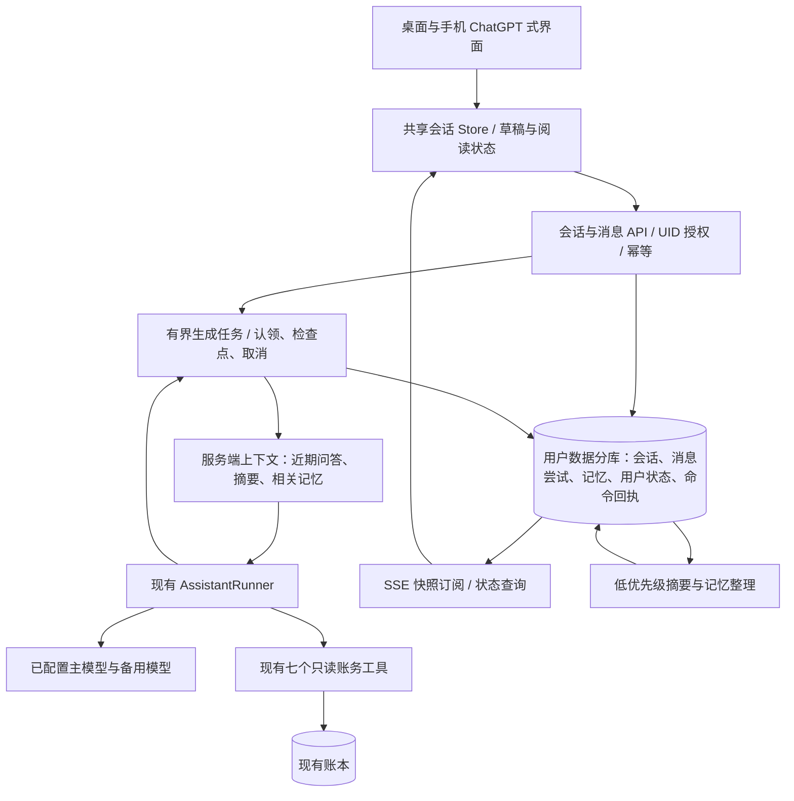
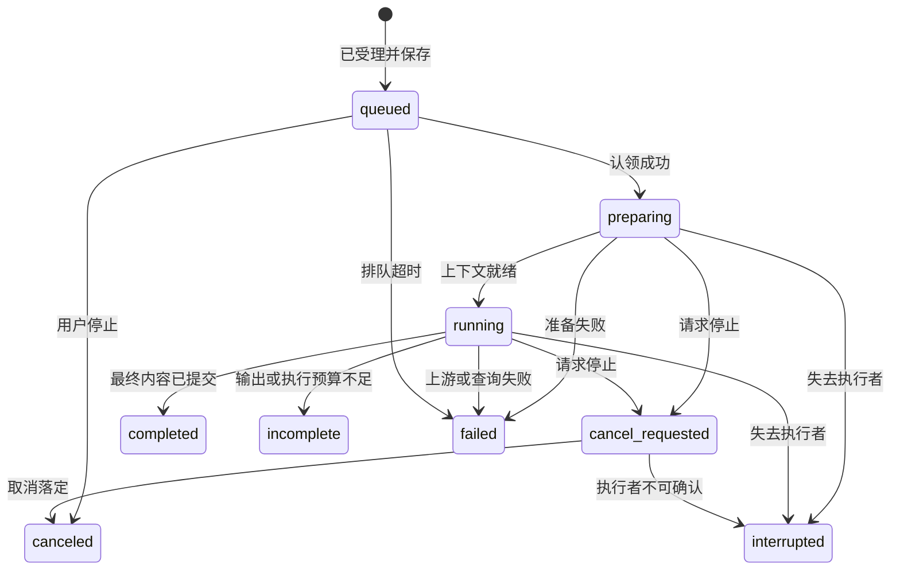

# AI 助手全链路产品与实施策划

版本：v2.1 · 日期：2026-10-15 · 状态：已完成第二轮交叉复核，待实施与验收。

代码核查基线：`1a21bc9bfd2b155a3ed9b8ac57caff7c76bbb293`。执行前核对工作区变化，不覆盖用户已有修改。

**本文件是本轮改造的唯一执行入口。** 面向后续实施 agents，包含产品决策、界面行为、数据与接口契约、容量、任务依赖和验收。旧简版 [docs/ai-assistant-experience-plan.md](docs/ai-assistant-experience-plan.md) 仅作为导读。原 [AI_ASSISTANT_HARNESS_PLAN.md](AI_ASSISTANT_HARNESS_PLAN.md) 的只读工具、财务准确性和用户隔离要求继续有效；其中页面级会话、离页清空、仅最近 12 条历史的限制由本文件替代。

建议阅读顺序：1–4 节明确产品；5–10 节明确实现；11–14 节按任务执行和验收。完成状态必须由实现与证据支撑，不能把本文中的计划当作已上线功能。

## 1. 目标、范围和确定的产品原则

用户期望：助手具有 ChatGPT 网页式使用体验，历史保存在 ezbookkeeping 服务器，能跨设备恢复；能理解长对话并记住用户认可的偏好；每条回复可复制原始 Markdown。

本期完整交付：云端多会话、历史管理、稳定生成与恢复、上下文整理、长期记忆、两端 ChatGPT 式布局、Markdown 复制、账单引用、重试/重新生成/编辑分支、配额和数据生命周期。

本期不增加语音、聊天附件、联网搜索、公开分享链接、多人共同会话、模型自主修改账单、任意插件或新的向量数据库；不绘制这些尚不可用的功能按钮。保留现有独立票据识别流程。ChatGPT 式是交互结构和阅读体验，不要求复制品牌和全部功能。

必须保持的规则：

1. **离页、停止、新建、归档、删除是五个不同动作。** 页面切换不删除内容、不取消服务器生成。
2. **保存记录与模型上下文分开。** 原始记录完整保存；摘要只减少模型输入，不替换用户历史。
3. **财务事实来自本次成功查询。** 记忆中的预算目标与真实支出/余额明确区分；会话容量不限制可查询账单的历史范围。
4. **服务器持有正式记录。** 浏览器不决定 UID、完成状态、上下文历史、配额或工具权限。
5. **失败可恢复，操作可理解。** 不伪装已保存/已完成，不静默丢消息，不自动重发有可能已受理的请求。
6. **两端行为一致、布局分别适配。** 不以手机返回清空、桌面返回保留等差异替代明确规则。
7. **最新指令优先。** 长期偏好不覆盖用户本轮明确要求；旧范围不自动套到无关的新问题。

## 2. 现状与遗漏核查

| 已确认问题或能力缺口 | 现有证据 | 本期处理 |
| --- | --- | --- |
| 离页直接清空消息、草稿和游标 | `src/views/base/assistant/AssistantPageBase.ts:68`；移动 `AssistantConversation.vue:58`；桌面同组件路由守卫 | 生命周期解耦，云端恢复与本地阅读状态 |
| 后端仅有无状态问答，无会话记录 | `cmd/webserver_api_routes.go:222`；`pkg/models/large_language_model.go` | 新增会话、消息/尝试、记忆及用户状态记录 |
| 上下文只有最近 6 轮，每条历史截到 2,048 字符 | `src/consts/assistant.ts`；`AssistantPageBase.ts:16`；后端 `assistantHistory` | 摘要、完整问答窗口、来源与记忆 |
| 流式生成绑定当前 HTTP 连接 | `pkg/api/large_language_models_assistant_harness_stream.go` | 持久化任务、独立订阅、明确停止 |
| 自动滚动无条件到底部 | `src/views/base/assistant/useAssistantAutoScroll.ts:9` | 底部跟随、锚点恢复、回到最新 |
| 输入没有前端长度校验，生成时不可编辑下一条草稿 | 两端 `AssistantComposer.vue`；后端当前 2,048 字符限制 | 统一有效限制、保留草稿、正确处理输入法 |
| 清空直接执行，没有新建/删除的语义区分 | 两端 `AssistantConversation.vue` | 新建作为主操作，删除二次确认 |
| 无复制、编辑分支、重新生成与版本选择 | 共享 `AssistantMessageList.vue` | 消息操作栏，Markdown 和代码块复制 |
| 失败原因主要短暂弹出，无消息内重试 | `AssistantPageBase.ts:134`；`AssistantMessageEvidence.vue` | 持久化可展示错误与关联重试 |
| 手机消息区固定高度，输入区留白和软键盘适配不足 | `AssistantMessageList.vue:39`；浏览器截图 | 可视高度布局和真机验收 |
| 查询依据、过程说明全部展开，正文层级不足 | `AssistantMessageEvidence.vue`；`AssistantMarkdownContent.vue` | 正文优先、依据摘要、细节折叠 |
| 摘要按钮在所有请求期间显示忙碌，分页操作脱离具体回答 | 两端 Conversation / Actions 组件 | 以当前操作和具体结果绑定状态 |
| 无历史分页、完整标签与长列表策略 | 两端 Composer、共享 MessageList | 分页、可访问性和性能约束 |
| 金额投影存在 Go int64 → JS number 精度边界 | `pkg/models/large_language_model.go:91`；`src/models/large_language_model.ts` 的 `sourceAmount: number` | 新链路采用精确十进制整数字符串，旧链路兼容过渡 |
| 测试将“离页清空”当成正确行为 | `src/views/base/assistant/AssistantPages.test.ts:177` | 替换错误断言，覆盖真实往返链路 |

复制之外还需明确：归档后是否继续生成、历史版本是否影响下次上下文、网络超时是否已发送、删除来源后摘要/记忆如何失效、功能关闭后能否查看旧记录。下面的决策表给出统一答案。

核查边界：已检查当前助手前后端与测试；既有只读工具和金额统计逻辑不重复重写。真实模型财务推理、物理手机软键盘及新持久化能力要在实施阶段另行验收。

第二轮另核对了现有路由、登录重置、流解析和 `src/sw.ts`。以下是对 v2.0 **计划契约**补齐的边界，不冒充尚未实施功能的实测缺陷：清空后从未受理过的迟到请求、重复清空误删新数据、刷新丢失待确认请求 ID、空闲页面无法发现另一设备的修改、正在生成时遗忘/删除来源、分支创建的中途失败、离线与浏览器缓存、慢订阅者及视觉验收。对应 R33–R40。

## 3. 用户旅程与产品行为

### 3.1 进入、历史与会话管理

| 用户动作/场景 | 确定行为 |
| --- | --- |
| 首次进入 | 显示欢迎语、3–4 个财务示例问题、固定输入框和历史入口；示例先填入输入框，用户确认发送。 |
| 再次进入助手 | 恢复当前设备上次访问的有效会话；若已删除则展示新会话并说明。带会话 ID 的 URL 优先于本机最近记录。 |
| 点击新建 | 进入空白草稿页，保留原会话及其草稿；首次发送成功受理时才创建正式会话，避免大量空会话。 |
| 会话标题 | 首次提问生成确定性的短标题，摘要会话用本地化标题；用户可改名，手动改名永不被后台覆盖。标题长度上限 100 个 Unicode 字符。 |
| 历史列表 | 最近活动优先，显示标题、时间、生成中/失败标记；流式每个字符不重新排序，按提交和终态等用户可理解的活动更新时间。 |
| 搜索历史 | 搜索标题与消息正文，结果定位到匹配消息；输入防抖，区分无结果和请求失败，保留上次结果；归档由明确开关纳入。默认不搜索过程说明。 |
| 切换会话 | 恢复该会话阅读位置和草稿，旧会话生成继续；列表显示运行状态，不把结果灌入新会话。 |
| 归档 | 从默认列表移出，内容、记忆来源和已有生成保留；归档页可查看。继续发送前通过“取消归档并继续”恢复。归档不释放配额。 |
| 删除会话 | 确认后立即不可访问，取消其任务、清理本机草稿、失效相关派生摘要/记忆；不删除其他会话自身消息。说明备份按部署保留策略清理。 |
| 清空助手数据 | 设置中的独立危险操作，确认包含全部会话、归档、记忆和相关本地缓存；与“新建”分离，不影响账单。 |
| 导出 | 支持当前会话 Markdown/JSON；默认导出当前选中版本，JSON 可明确包含全部尝试和依据。全部助手数据可分页/流式导出。 |
| 失效 URL、他人 ID | 统一展示不存在或不可访问，不暴露另一用户的标题；提供回到历史/新建入口。 |
| AI 暂不可用 | 历史、复制、导出、删除仍可用；发送区解释不可用原因并保留草稿，不将历史页面整体隐藏。 |

列表每页默认 30 段、最多 100 段；消息每页默认 30 条逻辑消息、最多 100 条，同时采用 256 KiB 响应内容预算，在完整消息边界结束并提供下一页。第一页从尾部加载，向上加载旧消息不跳动，搜索结果可直接加载目标所在窗口。历史默认只加载选定版本正文和最近 5 个版本的元数据，更早版本按需分页获取。

改名/归档遇到版本冲突时展示服务器现状并保留本次输入；删除/清空尚未获得服务器回执时显示“正在确认”，不宣称成功、不自动执行新的删除命令。导出可取消，失败可重试，下载文件名需过滤路径及控制字符。

### 3.2 输入、发送与草稿

- 桌面 Enter 发送，Shift+Enter 换行；中文输入法组合/确认键不触发发送。手机回车换行，由发送按钮提交。
- 以 Unicode code point 计数，最多 4,000 字符且最多 16 KiB UTF-8；保留原文空格和换行，只用 trim 判断是否为空。超限显示就地说明，不截断、不清空。
- 正在生成时输入框仍可编辑下一条草稿，发送按钮位置变为“停止生成”；当前会话不自动排队发送下一条。停止完成后再显示发送。
- 每份草稿按用户身份、会话/新建页和设备分开保存；新建后分配正式 ID 时迁移草稿键。退出登录、切换用户、删除会话清理对应缓存。浏览器存储不可用时降级内存并提示保存范围。
- 点击发送即展示带 `clientRequestId` 的本地发送项；服务器受理后更新同一项，不追加重复消息。受理前保留提交原文；失败恢复至草稿时不得覆盖用户后来输入的文字，提供“恢复这次提问”。
- 请求结果未知时显示“正在确认发送状态”，查询幂等结果，不自动生成新的请求 ID。用户可复制未送达文本或稍后重试相同 ID。
- 发出 HTTP 前保存待确认提交记录：原文、操作类型、clientRequestId、requestIssuedAt、expectedDeletionEpoch、目标会话/来源及上下文版本。刷新后先确认原命令结果，受理后以正式 ID 合并并清理该提交副本；不能仅把请求 ID 放在内存 Store。未取得结果的分支创建、删除/清空等命令也保留必要的无正文确认信息。
- 本机草稿与待确认记录使用统一存储适配器（需要事务时用原生 IndexedDB，不新增状态框架）；按 ownerScope 隔离，默认最多 20 份非空草稿、4 份未确认发送，正文与必要元数据合计最多 512 KiB。空草稿可回收；满额不能静默淘汰非空原文，提供复制/清理旧草稿，并明确当前内容是否仅在内存中。
- 同浏览器多个标签页编辑同一草稿时，用修订号及编辑实例区分；冲突保留两份可选文本，不能让后台标签页覆盖正在输入的内容。存储被禁用/写满时显示“仅本页保留，刷新可能丢失未发送内容”，只在确有未保存内容时拦截离开。
- 聚焦策略：桌面用户主动发送/编辑完成后保留输入焦点；手机进入或返回不自动弹键盘；弹层关闭将焦点还给触发项。
- 切换会话/查看账单不弹“未保存”确认，因为草稿已独立保存；只有无法保存且可能覆盖草稿时提示真实风险。

### 3.3 回复、复制、重试、编辑与版本

| 操作 | 确定行为 |
| --- | --- |
| 复制回复 | 复制**当前展示版本的原始 Markdown 正文**，保留标题、列表、表格、链接、代码围栏；不读取渲染 DOM 的纯文本。独立查询卡片、按钮和过程说明不混入正文。 |
| 复制反馈 | 按钮 tooltip/可访问名“复制 Markdown”；只有剪贴板写入成功才显示“已复制”，约 2 秒恢复。失败提供重试或可选中文本面板，兼容非 HTTPS 与权限拒绝。 |
| 生成中复制 | 有正文时复制点击瞬间快照，提示“已复制当前内容”；之后的增量不改变剪贴板。空回复禁用复制。 |
| 代码块复制 | 复制该代码块原始代码、不含 Markdown 围栏；保留缩进与换行。用户提问也有复制原文入口。 |
| 失败重试 | 原问题保留，只添加关联的新回答尝试；失败内容可展开查看。重试会重新查询账目，不伪装从模型中断位置恢复。 |
| 重新生成 | 对末尾问题生成新的回答版本，保留旧版本；显示版本切换，当前运行可停止。成功版本才可进入后续模型上下文。 |
| 选择旧版本 | 若末尾问题尚无后续提问，可设为下一轮使用版本；一旦发出后续提问，其上下文选择固定。历史版本切换仅查看，不偷偷改写后续回答的依据。 |
| 编辑未发送问题 | 正常修改草稿；不新增会话和调用模型。 |
| 编辑已发送问题 | 输入框进入带明确标签的编辑状态，可取消。提交采用“编辑并新建分支”，保留原记录，生成关联新会话；新会话只继承被编辑问题之前的上下文。 |
| 重新生成较早回答 | 通过“从这里新建分支”操作，继承对应问题前的上下文和该问题；后面的问答不传入新分支。 |
| 分支/续聊 | 显示来源与返回原会话入口；不复制巨量历史记录。保存限定范围的种子摘要及来源指针，来源删除时使派生摘要失效并提示。 |

第一版采用“会话间分支 + 单个问题的多个回答尝试”，不实现任意 DAG 编辑器。分支与续聊创建是幂等操作且占新会话配额；生成开始前清楚展示目标会话。编辑取消不会丢失原有草稿。

当前问题仍在生成时，先通过明确的停止动作终结，再编辑或重新生成；不能用“重新生成”隐式留下两个后台任务。复制写入 `text/plain`，不把 Markdown 作为 HTML 注入剪贴板。

若已有成功回答，重新生成失败时，下一轮默认继续使用最近一次用户选定的成功版本，并在版本操作区明确提示；不把失败的新版本当成成功历史。没有成功版本时，后续上下文跳过整个失败问答；用户本轮再次明确的条件仍正常处理。

### 3.4 账单、依据、摘要与分页

- 桌面优先只读账单侧栏或弹窗；手机使用详情页。账单编辑是详情中的明确操作，不因“查看”自动进入编辑状态。关闭/返回恢复会话、草稿、阅读锚点。
- 历史回复与账单引用保留当时查询时间；账单详情读取当前记录。已修改时可说明可能与旧回答不同并提供重新查询；已删除/无权限时显示不可用，不清空对话。
- AI 正文居首。账单卡片突出金额、币种、分类、账户、日期；查询依据显示范围/完整性/读取时间的简短摘要，其余细节折叠。涉及“不完整”或重要查询警告必须直接可见。
- 时间使用用户语言格式展示，详细信息可查看准确时区与边界；“该页明细”和“全部匹配统计”始终区分。跨币种不相加、转账两侧不混淆、金额隐藏规则沿用项目设置。
- 新接口金额使用十进制最小货币单位字符串，前端用项目 Decimal 工具格式化。Go int64 范围不等于 JS 安全整数范围，超出 `2^53 - 1` 的数不得先经 JS number 再转换回来。
- “查看更多账单/下一页”绑定具体回答与其可分页查询。默认只对当前末尾结果继续；对较早结果操作先明确“在新会话继续这次查询”，避免覆盖当前话题。
- 首版沿用 runner 给出的单个可继续目标，在服务器保存其 queryId/筛选范围并在按钮旁标明查询对象；同一回答的其他查询是依据，不生成误指向这个游标的分页按钮。sourceMessageId 指向具体回答版本，不能只按问题或当前全局游标猜测。
- 游标保存在服务器，不出现在 URL、Markdown、剪贴板或日志。沿用现有过期与权限校验；过期提示“重新查询”，使用已保存并重新授权的筛选范围执行首查，不能静默假装下一页。
- 与上一轮无关的新问题不继承旧筛选。分页请求在历史显示简短的用户动作“查看下一页”，不要插入冗长技术指令。
- “生成财务摘要”保留为快捷动作：可用自然语言指定日期，默认规则沿用现有四部分与日历口径。它是用户可见的账务分析，**不是内部用于压缩上下文的会话摘要**。
- 快捷摘要明确展示将采用的期间，发送前允许修改；未发送的草稿不被解释为已确认筛选条件，快捷操作也不覆盖它。
- 服务忙碌、缺少模型、无账单、查询失败四种情况使用不同文案；不能把查询失败呈现成“没有支出”。已有只读七工具注册表继续是账务权限边界。

### 3.5 多设备同步、离线与导航

- 进入、切换会话、重新登录、`online`、`visibilitychange`/`pageshow` 返回前台时先核对身份、删除 epoch、待确认命令和当前会话状态；合并请求，避免同一事件重复订阅。服务器拒绝过期写入，不能依赖 UI 已及时刷新来保证一致性。
- 页面可见时当前会话每约 15 秒做一次有抖动的轻量状态校验，历史栏展开时每约 30 秒刷新列表；发现另一设备的新任务才订阅它。后台页面暂停轮询，回前台立即同步。同浏览器可通过 BroadcastChannel 发“需要同步”的 ID/版本通知，不广播财务正文；不支持时仍能通过轮询恢复。
- 另一设备改名、归档、选版本、关闭记忆或删除后，在线页面下一次同步更新；当前会话已删除时退出该记录并清理其缓存，保留不属于该会话的草稿。同步不得覆盖本机草稿、强制抢滚动或把新回复灌入别的会话。
- 离线时显示“离线，草稿仅保存在本机”，可读本页已加载内容、复制并继续写草稿；不把离线草稿标成云端已保存，不建立自动发送队列。恢复网络先同步，由用户明确发送；HTTP 超时不能仅凭 `navigator.onLine` 判定未受理。
- 两端统一相对路由 `/assistant?conversationId=…`，定位消息可加 messageId/versionId；通过现有平台 router 生成实际 hash/base-path URL。选会话使用正常导航，首次受理将新建页 replace 为正式 ID，避免后退出现重复空白页。刷新、浏览器前进/后退、移动返回均恢复同一对象；没有有效返回栈时提供回到会话的入口。
- 浏览器 URL 只放对象定位信息，不放问题、搜索词、游标或 token。搜索请求正文承载关键词，默认检索用户提问与服务端选定回答，明确选择“包含历史版本”后才搜索旧尝试；结果返回 messageId/versionId 并定位正确版本。
- 服务器能阻止删除后的新读取，不能撤回用户已复制、下载或离线持有的旧内容；产品文案不承诺远程抹掉其它设备已有副本。重新联网后不得继续使用已失效缓存发送或生成。

## 4. ChatGPT 式 UI/UE 设计规格

### 4.1 布局和组件职责

| 组件/区域 | 职责与契约 |
| --- | --- |
| 路由页 | 读取/同步 conversationId；组合布局，不拥有会话数据或生成任务。 |
| ConversationShell | 接收共享会话状态，协调侧栏、消息区、输入区、详情和弹窗；两端外壳分别适配。 |
| ConversationHistory | 接收分页列表、选择/搜索/归档状态；发出 select/new/rename/archive/delete/export，不直接发模型请求。 |
| MessageList | 接收逻辑消息、版本、分页和阅读锚点；负责加载旧消息、滚动跟随及回到最新。 |
| MessageItem / MessageActions | 渲染一个问题或选定回复版本；复制、重试、重新生成、编辑分支和版本切换通过明确事件上交。 |
| Composer | 草稿双向绑定；计数、输入法、发送/停止、编辑状态和提示。草稿与运行状态分离。 |
| Evidence / BillReference | 显示必要范围、精确金额及来源状态；输出 openReference / nextPage，不持有全局游标。 |
| MemoryManager | 查看、编辑、删除、关闭记忆，展示来源和更新时间；对用户可解释。 |

```text
桌面： [可折叠历史栏] [会话标题 · 生成/同步状态 · 更多]
                     [        居中限宽的消息         ] [按需账单详情]
                     [      圆角输入框 · 发送/停止    ]
手机： [历史入口 · 会话标题 · 更多]
       [随可视区域伸缩的消息，向上加载历史]
       [始终可达的输入框 · 发送/停止]
```

- 桌面对话主列建议 760–840px，侧栏约 260px 且可收起；窄屏自动变抽屉。账单详情关闭后主列和阅读位置稳定。
- 用户消息为轻量气泡，保留原文换行；AI 回复采用清晰正文排版和轻量底部操作栏，减少嵌套卡片。模型技术 ID 放到次级信息，不抢占标题。
- 手机使用可视高度/flex 布局，处理动态地址栏、软键盘和 safe-area；不再采用固定 `100vh - 338px`。避免页面和消息区同时滚动，输入高度增长限制为合理行数后内部滚动。
- 对话只有一个可聚焦的输入框，空态和有消息状态不通过销毁重建丢焦点；示例问题不抢占手机首屏输入区域。
- 表格在自身容器横向滚动，长链接和连续字符不撑宽页面；金额用等宽数字，保留项目主题和现有字号设置。
- 思考/过程只显示供应商明确可展示的说明，默认折叠且可关闭；可展示的过程摘要以独立字段随回答有界保存（最多 4 KiB，计入单次总量），刷新后显示一致。超过此摘要上限可明确省略后续过程说明，不影响正文生成；不保存/暴露模型私有推理或加密状态。

### 4.2 滚动、可访问性与反馈

- 用户距底部约 80px 内才跟随新增内容；主动发送可滚到本轮。阅读旧内容、复制、选择文字或展开依据时禁止强制到底部。
- 保存 `messageId + 视口内偏移 + 是否跟随底部`，不是只保存 scrollTop。返回详情、加载旧页、异步 Markdown 排版、键盘收起均恢复锚点；底部空间不得遮住最后一条和焦点。
- 新回复到达但用户在上方时显示“回到最新”与未读状态；减少动作优先的用户不使用强制平滑动画。
- 输入框有明确 label/aria-label；图标按钮有名称、tooltip 和 focus-visible；触屏点击区域至少 44×44 CSS px，不能仅悬停显示关键操作。
- 生成状态使用节流的礼貌播报，不逐 token 朗读整段。读屏顺序与视觉顺序一致；抽屉/对话框管理焦点并支持关闭。
- 支持中英文、现有其他语言回退、RTL、深色模式、浏览器缩放及系统字号；不能只用颜色区分成功/失败。
- 全部异步区域覆盖 loading/empty/error/retry：历史列表、消息分页、搜索、账单详情、记忆、导出。旧数据可用时保留旧数据并就地提示刷新失败。
- 错误长期留在对应消息附近，包含下一步；toast 仅作为补充。原问题、已生成部分、草稿不会因为提示消失而丢失。

### 4.3 视觉基准与操作细节

- 采用简洁、安静的财务阅读界面，沿用项目字体/主题 token；正文默认约 16px、行高 1.6–1.75，尊重用户字号设置。消息间距约 24px，手机左右留白至少 16px，标题、正文、次要时间/依据形成稳定层级；不靠大面积装饰或高饱和背景区分 AI。
- 主操作位置稳定：输入区发送/停止共用位置；回复操作依次为复制、可用的重试/重新生成、版本、更多。手机和键盘焦点下始终可发现操作；按钮禁用时说明原因，不能只留下没有解释的灰色图标。
- 窄屏历史为抽屉；账单侧栏仅在保留至少约 640px 对话阅读宽度时并排，否则使用详情弹窗/页面。长标题省略但可查看全文，菜单不能超出视口，输入框增高不遮挡末尾回复。
- 普通文字对比度至少 4.5:1，大字与必要控件边界至少 3:1；按钮有 hover/pressed/focus/disabled 状态。使用语义化按钮和链接，正文链接可键盘操作，表格标题/表头可读屏；允许浏览器缩放，不用全局禁选中文字来处理触屏。
- 抽屉/弹窗关闭恢复焦点；删除确认默认聚焦取消，删除完成后聚焦邻近历史项或新会话入口。菜单和编辑态能用 Esc 退出，不能因此停止后台生成；移动返回优先关闭当前弹层，再返回会话。
- “排队/整理上下文/查询/回答/正在停止”使用真实状态，不编造百分比或估计完成时间；“已保存”只对应持久化检查点，生成与保存状态不能互相替代。空回复先给状态占位，不出现可复制的空白气泡。
- T09 先交付以固定 fixture 渲染的空态、普通回答、表格/账单、失败/重试、历史抽屉、记忆管理和容量提示；T10/T13 再复核真实应用同场景截图及键盘操作。视觉通过标准同时检查排版、密度、层级、两端一致性与操作可发现性，不能只以“有按钮、测试通过”代替体验验收。

## 5. 全链路架构与职责



| 层 | 应负责 | 不应扩散的细节 |
| --- | --- | --- |
| API | 身份、DTO、协议、错误映射 | 不拼 SQL、不运行长期 goroutine 绑定 Gin writer |
| 会话服务 | 历史、版本、配额、幂等、来源关系和删除 | 不掌握各供应商消息协议 |
| 任务服务 | 认领、取消、截止时间、检查点、终态 | 不计算财务金额，不依赖页面是否可见 |
| 上下文/记忆服务 | 历史选取、摘要、记忆来源和失效 | 不扩大账务工具权限，不把历史当最新账本 |
| 现有 runner/provider | 工具循环与模型协议 | 不负责聊天列表和草稿 |
| 前端共享 Store | 消息合并、订阅、路由恢复、动作状态 | 不伪造服务器历史和金额，不在各平台重复业务规则 |

尽量使用现有 Vue/Pinia、Go 服务、XOrm 和数据库。引入新依赖前说明必要性；不引入完整 agent 框架、Redis 队列或向量检索来解决当前有界需求。服务端任务可以用现有后台服务生命周期加数据库认领实现。

### 5.1 一次发送的顺序

1. 浏览器校验草稿，生成稳定 `clientRequestId`，显示一个本地待发送项。
2. API 验证 UID、幂等回执、删除 epoch、能力、revision、当前运行及配额；在短事务中创建/找到会话、保存用户问题、创建回答尝试、命令回执并预留容量。事务成功后才返回已受理。
3. 工作执行者认领尝试，按已保存的上下文版本构造输入，执行现有 runner。上下文整理也是有状态、有限时的准备过程。
4. 回复分段产生，按检查点规则保存，再发布新的 message snapshot；账务工具仍使用自己的短读视图，不能跨模型等待持有账本事务。
5. 保存最终正文、依据、状态、实际容量并释放预留后，再发完成事件。
6. 低优先级工作按配置整理已完成历史与记忆；不阻塞已完成答案显示。

任何失败都落到明确状态。订阅端断开不撤销已经受理的任务；新客户端查询数据库即可恢复，不依赖某个旧浏览器保存的 history 数组。

## 6. 数据模型、容量与生命周期

### 6.1 持久化记录

按现有 `UserDataDB(uid)` 选择数据库，表名使用引擎 mapper/prefix，不硬编码物理表名。新增四类业务记录及一类命令回执，共五类；用户级状态解决跨会话配额/设置并发，独立回执使无消息的分支、清空和记忆操作也能安全重试。

| 记录 | 必需字段/语义 |
| --- | --- |
| AssistantConversation | id、uid、title、archived/deleted、createdAt/activityAt、metadataVersion、contextVersion、nextTurnSequence、activeRunId、实际/预留字节、提问轮数、summary/summaryThrough/sourceVersion、seedContext/sourceConversationId/sourceMessageId、memoryMode |
| AssistantMessage | id、uid、conversationId、turnSequence、role、userMessageId、attemptNumber、原始 content、创建/完成时间、选定回答/前序回答指针、runState/progress/reasonCode、queries/references、临时 continuation 与到期时间、clientRequestId、snapshotRevision、owner/leaseEpoch/leaseExpiresAt/deadline、cancelRequested、输入来源/记忆版本/epoch 清单、实际/预留字节 |
| AssistantMemory | id、uid、规范化 key、正文、类型、状态、sourceMessageIds/来源版本、createdAt/updatedAt/可选 expiresAt、version、显式/自动来源、遗忘排除标记 |
| AssistantUserState | uid 唯一、used/reservedBytes、conversationCount、运行/排队计数、memoryEnabled/settingsVersion、memoryGenerationEpoch/排除边界、memoryUseEpoch、deletionEpoch、version；后台整理的有界状态可归于此处 |
| AssistantCommandReceipt | uid、clientRequestId 唯一、commandType、canonicalRequestHash、requestIssuedAt、expectedDeletionEpoch、受理结果/对象 ID、createdAt/expiresAt、tombstone；不保存问题、记忆正文或完整响应副本 |

实现可以把用户设置复用到现有云设置，但配额和清理 epoch 必须有可原子更新的服务器记录；不能靠前端累加或无锁 `COUNT + INSERT` 维护。

- ID 在 JSON 中使用字符串；时间为明确 UTC 时间/整数时间戳，显示时按用户偏好格式化。提问保存当次 locale/timezone，旧摘要中的“上个月”等保存已解析的绝对范围及原文。
- 用户消息不可原地改写；回答尝试各有 ID，同一 userMessageId 下 attemptNumber 递增。API 返回按 turnSequence 分组的逻辑消息和版本信息，历史分页不能切断同一问题的版本关系。
- `contextVersion` 仅随影响后续推理的动作变化；`metadataVersion` 管理改名/归档；`snapshotRevision` 管理某次回答的流式快照。流式每个片段不导致用户发送的 expectedContextVersion 连续冲突。
- 每条用户消息固定记录所接续的成功回答版本，保证旧回答的上下文可以解释。切换历史显示版本不重写已有后续消息。
- 以回执表唯一约束统一保证 UID 下的 clientRequestId 跨写命令不重用；消息表另约束同一问题的 attemptNumber。相同幂等键和同一请求返回原结果；相同键不同动作或内容返回冲突，不能覆盖。回执与业务写入使用同一用户分库事务。
- 索引至少覆盖：UID + 状态/归档 + activityAt + id；UID + conversationId + turnSequence；待执行状态 + lease/deadline；UID + memory key/status。搜索先使用有界、转义的文本查询，验收后有证据再引入数据库专有索引。
- `content`、依据、摘要分列存储并单独有界，避免把 2 MiB 整段会话塞进 MySQL TEXT。SQLite/MySQL/PostgreSQL 必须运行相同契约，SQLite 不依赖仅其他引擎支持的 `SELECT FOR UPDATE`。
- 结构化 JSON 记录 schemaVersion；损坏的历史项显示不可恢复说明，其他项仍可读，不把损坏内容传给模型。

### 6.2 统一容量规则

单位均为 UTF-8 字节，KiB=1,024、MiB=1,048,576。下面是本项目默认值，不是 Codex 限制。

| 项目 | 默认上限 | 计算与超限行为 |
| --- | --- | --- |
| 整段会话 | 2 MiB 或 200 次用户提问，先到为准 | 包含全部回答版本、依据、种子摘要和元数据；续聊新建关联会话，旧记录保留。 |
| 单条用户输入 | 4,000 Unicode 字符且 16 KiB | 前后端一致；超限保留原文并提示。 |
| 一次新提问及一个回答尝试 | 64 KiB | 包含问题、回复、依据和必要元数据；回复正文自身最多 32 KiB。子上限不表示可突破总上限。 |
| 重试/重新生成 | 每个新增尝试最多 64 KiB | 不重复插入提问、不增加“用户提问轮数”，但占字节和调用预算；全部版本计入总量。 |
| 会话头部/摘要/种子信息 | 合计最多 32 KiB | 会话总量内预留，增量更新后按实计量。不能让摘要绕过总量限制。 |
| 每用户助手总量 | 100 MiB，最多 1,000 段会话 | 含归档、版本及记忆等应用数据；删除可释放逻辑额度，归档不能。 |
| 长期记忆 | 50 条有效记录、单条正文 1 KiB | 先合并重复项；满额提示整理，不静默删已确认记忆。必要遗忘标记按来源生命周期保留。 |
| 运行与排队 | 同会话 1 个未终结任务；同用户最多 2 个执行中 + 2 个排队 | 额外请求明确提示稍后发送；保留草稿。工作进程默认最多并发 4 个，部署可配置。 |

配额采用固定字段投影的规范化序列化字节计数，避免转义、多个版本或独立字段不计入；数据库索引、压缩比和备份不计入用户展示的应用数据量，但运维另行监控真实磁盘。

应用正文、全部回答版本和业务元数据计入额度；维持幂等/删除所需的无正文回执与排除记录属于系统维护量，独立限频、过期清理和磁盘监控，不因用户额度已满而无法删除。记忆候选最多 50 条、最长保留 7 天，计入用户总量；失效记忆正文按删除清理规则移除，只保留必要无正文排除信息，不能把候选和历史版本变成无界存储旁路。

事务中检查 `used + reserved + 本次预留 <= limit`，新建会话还需预留头部空间并检查数量。同一用户跨会话也必须原子检查；完成/失败/取消/中断只结算一次，定期核对修复计数。客户端显示已用与运行中预留的区别。

每个已受理任务保存其容量/运行限制快照；管理员调小容量只影响新受理请求，已预留任务按原上限落定。权限撤销、账号/会话删除和明确关闭生成能力仍优先取消，不能借限制快照绕过这些动作。

80% 时提示接近容量，不能以存储告警打断每条消息。剩余容量不足预留时，在调用模型前引导续聊；用户总额度不足时提供导出/删除/联系部署管理员入口。降低配置不删除已有历史，只阻止继续增长。

200 轮按用户提问计数：普通提问、财务摘要、手动下一页各产生一条用户消息，均计一轮；自动整理和查看版本不计。达到该数量后不能再增加新提问，末尾问题的重试/重新生成在字节额度允许时仍可执行。达到字节上限则将重试引导到关联分支。2 MiB 用于容纳较长的文本财务讨论，200 轮约束短消息形成的长列表，100 MiB 用户额度约可容纳 50 段满容量会话；这些存储值不等于每次模型输入大小。

达到单轮输出上限时停止上游、保留已有内容并标记 `incomplete` + `output_limit`；不能静默截断数字或依据后标成完成。大结果通过原有分页/精确聚合处理，不以缩小账单日期范围规避容量。原始工具结果、私有模型状态和逐 token 日志不长期落库。

### 6.3 删除、账号与备份

- 单次删除先在短事务内设 tombstone/提升版本并请求取消，使所有后续读取和写入受阻；后台清理正文、引用、尝试和派生缓存，目标 24 小时内完成。删除确认以在线不可访问为准，不能声称已同时擦除历史备份。
- 清空助手/全部用户数据必须提升 deletionEpoch，并在同一事务内封住旧 epoch 的写入口和记录命令回执，再清理内容。即便旧请求从未被受理、没有对应 tombstone，也不能在清空之后新建会话；恢复操作需先取得新 epoch，由用户主动发出新命令。
- 派生摘要与记忆必须有来源。删除来源后立即失效；多来源内容只能用剩余有效来源重新生成，重建前不注入。续聊/分支自己的消息保留，已失效的 seed 不继续使用，来源入口显示已删除。
- “忘记”写入排除记录，旧来源不能在下一次后台整理中重新产生同一记忆。用户后来新的明确“记住”可以产生新版本；删除旧来源后无用排除记录才能清理。
- 退出登录只清理本机状态和订阅，不删除云端；前端不能把上一用户的缓存短暂显示给下一用户。服务器令牌失效时撤销订阅，已受理任务按原预算结束；账号禁用、删除或清空数据必须停止其任务并阻止再次写回。
- 接入 `pkg/api/data_managements_clear.go` 的全部用户数据清理与账号删除流程。仅清除账单不自动删聊天，但使涉及旧账本的上下文失效并明确提示；任何新的财务回答重新查询。
- 导出只包含有权访问的用户内容；不导出游标、token、内部 owner/lease、原始错误、供应商私有数据。Markdown 导出保留角色、时间、正文；引用作为单独的来源附录，与单条“复制正文”区分。
- 新表纳入备份、恢复和容量统计；恢复后过期运行任务转为中断，过期游标无效。备份中的删除保留期在部署文档公开，不能承诺不受部署控制的永久擦除。

### 6.4 写命令与重试的统一规则

- 所有会改变助手数据的请求携带固定 `clientRequestId + requestIssuedAt + expectedDeletionEpoch`；包括发送、重试、分支、改名/归档/会话记忆开关、版本选择、停止、删除/清空以及记忆保存/删除/设置。只读搜索和导出不需要写命令回执。正文、对象及预期版本都纳入请求摘要，身份来自认证 UID。
- 顺序为：校验身份/基本格式 → 查同 UID 回执 → 已存在则校验请求摘要并返回原受理结果 → 不存在则核验时间窗、当前 epoch、对象权限/版本和额度 → 业务变更与回执一并提交。重复的清空/删除/全部遗忘只返回原回执，不能再次删除后来新建的内容。
- 已受理请求的回执在对应对象存续期间保留；对象删除后以及无长期对象的管理命令，其最小无正文回执至少保留 48 小时。未知请求有效期只有 24 小时，因此回执清理后也不能重放旧请求。读取已删除对象的旧回执只能返回已删除/不可访问状态，不能恢复正文。
- 清空助手数据后保留用户状态的删除 epoch 和必要回执，不能把它们随正文直接删掉。账号永久删除遵循现有账号/凭据销毁流程；身份已失效时任何旧回执都不再可读。
- 管理操作结果未知时使用统一命令查询；确认存在后合并结果，确认未知时也只允许重试原命令。不能靠刷新页面或重新生成 UUID“修复”未知状态。前端从新状态继续操作时才使用新命令 ID 与 epoch。
- 回执证明的是原操作结果，不能把较旧回执中的版本/epoch 覆盖到当前状态；重获管理回执后重新核对 capabilities/对象状态，再按单调版本合并。

## 7. API 与前后端契约

路径以 `/api/v1/llm/assistant` 为前缀，沿用 `.json`、认证方式和现有 `{success,result}` / `{success:false,errorCode,errorMessage,context}` envelope。下面的动作与字段为冻结契约，实施时 Go/TS/测试同一批更新。

### 7.1 接口清单

| 方法与相对路径 | 输入/输出要点 |
| --- | --- |
| GET `capabilities.json` | 生成是否可用、历史/记忆能力、有效配额、输入限制、当前用户用量、serverTime、稳定的 ownerScope、deletionEpoch、settingsVersion；不返回密钥。即使模型不可用也可调用。 |
| GET `commands/get.json` | clientRequestId；返回该 UID 命令的受理结果/正式对象 ID、已删除或未知状态，支持无 run 的管理命令确认。 |
| GET `conversations/list.json` | cursor、limit、archived；返回条目、运行标记、下一页。 |
| POST `conversations/search.json` | query、cursor、limit、archived、includeVersions；返回匹配片段及 conversationId/messageId/versionId，关键词不放 URL。 |
| GET `conversations/get.json` | id、beforeTurnSequence 或 aroundMessageId、limit；返回元数据、逻辑消息/版本摘要、已选版本和活跃任务。 |
| GET `conversations/state.json` | id；返回轻量 metadataVersion/contextVersion、activeRunId/最新 revision、选定版本及当前权限状态；不重复传全部正文。对象删除统一不可访问。 |
| POST `conversations/update.json` | id、expectedMetadataVersion、title/archived/memoryMode；memoryMode=`inherit`/`off`，改变记忆使用规则还需 expectedContextVersion，并返回相应新版本。 |
| POST `conversations/delete.json` | id、expectedMetadataVersion；幂等删除并取消任务/失效来源。 |
| POST `conversations/clear.json` | 清空当前用户全部助手数据；客户端必须明确确认，服务器按 UID 和删除 epoch 执行。 |
| POST `conversations/branch.json` | sourceConversationId、sourceMessageId、expectedContextVersion、kind=`continue`/`edit`/`regenerate`；冻结合法前缀并建立带来源会话，返回目标 ID/版本；种子整理在首轮 preparing 内执行。 |
| POST `conversations/export.json` | id 或明确的 all、format=`markdown`/`json`、includeVersions；受认证的文件响应，流式输出大导出。 |
| POST `messages/send.json` | conversationId 可空、clientRequestId、expectedContextVersion、mode=`chat`/`summary`/`next_page`、content、sourceMessageId；返回正式会话、问题、runId、当前状态。 |
| POST `messages/retry.json` | conversationId、userMessageId、clientRequestId、expectedContextVersion、intent=`retry`/`regenerate`；创建新回答尝试，不重复创建提问。 |
| GET `messages/get.json` | assistantMessageId；读取指定可访问版本的完整正文/依据，供切换和复制。 |
| GET `messages/versions.json` | userMessageId、cursor、limit；版本元数据分页，默认 20 条、最多 100 条，并遵守响应字节预算，不一次传回所有版本正文。 |
| POST `messages/select_version.json` | conversationId、userMessageId、assistantMessageId、expectedContextVersion；仅末尾可更改未来上下文选择，历史选择只属客户端查看。 |
| GET `runs/get.json` | runId，或在发送结果未知时以 clientRequestId 查询；返回最新快照和正式 ID。 |
| GET `runs/stream.json` | runId、afterRevision；fetch + Authorization 订阅 SSE，重连先收到当前快照；不把认证 token 放 URL。 |
| POST `runs/cancel.json` | runId；幂等设置取消请求或返回已存在终态。 |
| GET `memories/list.json` | 有效记忆/候选、来源、版本、更新时间、memoryUseEpoch 和全局设置；不暴露别人的来源。 |
| POST `memories/save.json` | id 可空、expectedVersion、expectedMemoryUseEpoch、text、操作意图；手工添加/更正，来源声明由服务器验证。 |
| POST `memories/delete.json` | id + expectedVersion 或明确 all + expectedMemoryUseEpoch；删除并写入遗忘规则，不能由模型任意调用。 |
| POST `memories/settings.json` | enabled、expectedSettingsVersion；可清楚选择关闭使用与停止自动生成，已保存内容保留到用户删除。 |

正文搜索为用户显式操作，不能在每次模型请求中扫描该用户 100 MiB 全部聊天。中文与 `%`、`_`、反斜线均按文本正确匹配，搜索限时、分页，权限过滤先于结果返回。

实施契约补齐：`conversations/export` 可选 `viewedVersionIds: string[]`，仅用于当前会话导出，以便导出与用户当前查看的历史回答版本一致，而不改变后续模型上下文选择。服务器逐项核验 UID、会话和所属问题，每轮最多指定一个回答版本；`all=true` 不允许此映射；明确选择 `includeVersions=true` 时导出全部版本，不受临时查看选择限制。

实施契约补齐：`messages/send` 可选 `restartQuery: boolean` 仅允许用于 `mode=next_page`，且必须提供经服务器授权的 `sourceMessageId`。用户明确选择“重新查询”时，服务器用该来源保存的筛选范围执行首查，不复用过期游标、不扩大原查询范围。`sourceMessageId` 也可指向当前分支已经冻结且仍有效的合法来源；必须验证来源属于该用户且位于冻结前缀内，不能据此引用任意父会话后续回答。

所有写接口共用第 6.4 节的命令字段，不在表中重复列出。新建会话在 `messages/send` 第一次事务中创建；若已通过 branch 建立会话则使用它。分支编辑内容留在前端独立编辑草稿，用户发送时再次验证冻结前缀仍有效；不把尚未发送的编辑正文伪装成云端消息。

ownerScope 用于区分当前部署和稳定用户身份下的本地缓存，不是授权凭据；所有授权仍使用认证 UID。前端用 serverTime 校正请求时间偏差。settingsVersion 与配额变化分离，避免生成期间频繁计数更新导致记忆开关无意义冲突。

列表和搜索采用有界 keyset 游标；列表按 activityAt + id，消息按 turnSequence。翻页时合并同 ID 条目，期间更新后移到较新位置的记录通过顶部刷新呈现，不能把可变 offset 当成稳定历史。游标必须绑定 UID、筛选/排序、检索截止时间与有效期，不能借用其它用户的游标。无变化的数据集必须不漏不重；检索期间有改动时允许刷新重检，不宣称跨页强一致快照，也不把全部搜索结果永久落库。

### 7.2 发送与快照示例

```json
{
  "conversationId": "123",
  "clientRequestId": "a-client-generated-uuid",
  "requestIssuedAt": "2026-10-15T08:00:00Z",
  "expectedDeletionEpoch": 3,
  "expectedContextVersion": 8,
  "mode": "chat",
  "content": "按刚才的条件比较一下上个月"
}
```

服务端拒绝客户端提供 UID、系统提示、工具执行记录、完成状态、原始 history 或任意 continuation；`next_page` 通过 sourceMessageId 找到服务器保存且仍有效的游标。

所有写命令同时提交固定的 requestIssuedAt；新命令仅接受过去 24 小时内、未来偏差不超过 5 分钟的时间。重试原请求不得改变该时间、epoch 或正文。无正文的幂等/tombstone 元数据至少按第 6.4 节保留；过期未知请求先同步历史，由用户明确新发，不能换时间悄悄重播。时间窗、命令回执和删除 epoch 共同防止迟到请求复活内容，单靠时间窗或消息 tombstone 不足以覆盖从未受理的请求。

```json
{
  "runId": "456",
  "conversationId": "123",
  "userMessageId": "455",
  "assistantMessageId": "456",
  "attemptNumber": 1,
  "revision": 12,
  "state": "running",
  "progress": "querying",
  "content": "",
  "queries": [],
  "references": [],
  "reasonCode": null,
  "savedAt": "2026-10-15T08:00:00Z"
}
```

runId 使用回答尝试 ID，避免同一概念多套 ID。上例是 result/事件 payload，HTTP 外层仍用项目 envelope；reasonCode 为受控原因字符串，与外层项目数字 errorCode 区分。时间、decimal 字符串、状态枚举、金额字段与 schemaVersion 都定义在共享契约测试中。

新投影使用 `sourceAmountMinor` / `destinationAmountMinor` 字符串。旧接口添加可选精确字符串字段，新前端优先读取；旧 number 字段保留兼容。仅有旧字段时必须检查安全整数，超限显示“金额无法精确显示”并提供账单入口，不能显示舍入值。

### 7.3 SSE 与错误

- 新会话流采用 `message.snapshot` 与 `run.terminal`，内容为完整的最新有界投影，`id` 为 runId + revision；重复或较旧 revision 忽略，较新快照替换对应尝试内容，绝不重复 append。
- 每次重连先读取持久化快照；若已终结只发一个终态并关闭。缺失终态不代表失败或完成，先查询 run 状态；服务端没有永久 SSE 事件表。
- 心跳保持约 15 秒；浏览器取消订阅只 abort fetch，停止生成必须调 cancel API。连接错误采用 1/2/4/8/15 秒上限退避并在页面不可见时降低频率，online/重新进入触发同步。
- 持久化检查点默认合并约 500ms，最大正常滞后目标 1 秒，终态立即保存；不逐 token 写数据库。发送的是已保存快照，避免 UI 显示“已保存”而数据库没有正文。
- 输入/权限/容量错误在建立流前用 HTTP 错误 envelope；已建立流后的错误通过有界安全事件或 run 终态表达，不能追加第二个终态。
- 定义稳定业务错误：input_too_long、conversation_conflict、data_epoch_conflict、memory_conflict、context_changed、already_running、quota_exceeded、queue_full、subscription_limit、cursor_expired、context_limit、output_limit、empty_response、storage_unavailable、provider_unavailable、interrupted、not_accessible、queue_timeout、run_timeout、execution_limit、generation_unavailable。排队超时与排队容量已满分开；运行截止超时、模型轮次/调用预算耗尽与供应商故障分开；管理员/用户禁用生成使用 generation_unavailable。展示本地化原因和下一步，不把数据库/上游原始错误透出。
- HTTP 使用现有错误注册机制：校验 400、认证 401、无访问 404、并发/配额 409、速率/队列 429、暂不可用 503；正文超 HTTP 硬限制 413。SSE 内保留相同业务码，前端不能仅凭连接是否为 200 判成功。
- 新协议每帧最多 256 KiB **UTF-8 编码后的实际字节**，包含事件头与 JSON 转义开销；缓冲也有界，不能用 JS UTF-16 length 代替字节数。客户端验证 schemaVersion、对象 ID、revision 和终态一致性；超大、格式损坏或不支持的版本停止订阅并查正式状态，不破坏已保存记录。
- 同一 run 的序列化快照可共享；每个订阅者最多保留一份待发最新快照，慢客户端不能积压全部历史快照或阻塞生成。每用户默认最多 8 个订阅、每 run 最多 4 个；重复标签页超过限制时转状态查询，清理断开连接，写入超时只断开订阅。
- SSE 响应使用 `text/event-stream`、禁缓存和及时 flush，部署示例关闭该路径代理缓冲，代理空闲超时至少覆盖两个 15 秒心跳。连续 3 次无法建立/维持流但状态接口可用时，前端以 2 秒起、上限 15 秒的有界间隔查询同一 run；不回退成一次新的模型请求。遵守 429/Retry-After，401 走现有认证恢复，不无限重连。

### 7.4 分支与续聊的提交边界

- branch 只创建会话、固定来源前缀/回答版本并预留头部，不在普通 HTTP 请求中隐式调用模型。无现成合格摘要时，首轮 run 的 preparing 在既定预算内生成种子；失败保留目标会话和编辑草稿，可重试同一问答。
- 编辑、较早重新生成、容量续聊都明确显示目标；“创建分支 → 在该分支发送”使用两个各自稳定的命令 ID。中间断线先查回执并复用已创建的目标，不连续制造空分支。创建成功而用户尚未发送的分支标为待继续，可恢复或删除；取消编辑时不删除原会话。
- 分支冻结合法前缀的不可变消息/回答 ID 与来源依赖。来源正常追加消息或改标题不会让旧前缀失效；删除来源、权限失效、源内容被撤销才使派生种子失效。禁止在分支首次生成时重新拿父会话“最新全部历史”，以免带入目标之后的答案。
- 每段会话保存自足、有界种子及扁平来源依赖，不递归重放全部祖先会话；依赖也计入头部上限。超过预算时明确引导从新会话补充必要条件，不能静默丢掉来源校验。已经生成的独立正文保留，派生摘要/种子的失效则沿来源关系传播。

## 8. 任务状态、并发和恢复

### 8.1 状态机



前端本地另有 sending / confirming_delivery / unsent，不能冒充服务器任务状态。任一终态不可被迟到回调改回 running；重试使用新尝试 ID。

| 状态/事件 | UI 与执行规则 |
| --- | --- |
| queued | “排队中”，可停止；排队默认最多 30 秒，超时释放预留并允许重试。 |
| preparing | “正在整理上下文”，可停止，必要的摘要调用计入当前执行截止时间。 |
| running | 使用现有查询/计算/回答阶段，已保存正文持续可读。 |
| cancel_requested | “正在停止”，不能立即宣称上游已经停下；允许继续编辑草稿。 |
| completed | 最终正文/依据与终态持久化后显示完成，进入可用上下文。 |
| failed/incomplete/interrupted/canceled | 保留问题、可展示的部分内容和原因，允许重试；不将部分回复提炼成记忆。 |

只有工具结果、只有过程说明或空白正文不算 completed；输出长度截断、模型预算耗尽必须落为 incomplete。供应商拒答/不支持的问题要有明确、可读的解释，区别于网络故障，不自动重试消耗模型额度；拒答和没有有效回答的尝试不作为长期记忆来源。

### 8.2 一致性与工作执行者

- 同一会话一个非终态任务；多设备发送以 expectedContextVersion 和 activeRunId 条件更新保证。冲突时保留输入、同步新消息并让用户再次发送，不自动在改变后的上下文上提交。
- 幂等记录与用户消息同事务创建，键至少在该会话/记录生命周期内有效。超时重试相同键返回原对象；网络自动重连只读取/订阅，不创建新的回答。
- 使用数据库 owner + leaseEpoch + leaseExpiresAt 条件认领，跨实例不会同时合法提交同一任务。默认心跳 5 秒、租约 20 秒；过期已认领任务标记中断，不自动再次调用模型。尚未认领的 queued 可以被工作执行者正常认领。
- 旧执行者在失去租约、删除 epoch 变化或取消生效后不得再写正文/成功终态；条件更新是最终保障，本地 cancel map 只是加速手段。
- cancel 与 completed 竞争由事务顺序决定：完成先提交则返回 completed；取消请求先提交则不再允许 completed。取消接口幂等，重复点击无副作用。
- 对外模型调用不能承诺网络分区下绝对“恰好一次计费”；本方案防止双击、自动重连和已认领任务自动重放造成的重复调用。异常重试由用户明确发起。
- worker 从应用生命周期创建 context，捕获 UID、locale、timezone、requestId 等必要不可变信息；不持有 Gin context/ResponseWriter，不继承已结束 HTTP 连接的取消。
- 保留现有 run/query timeout、max_rounds 和主备切换约束；运行默认沿用 180 秒、查询 30 秒、12 个模型轮次，读取有效配置，不重新硬编码另一套值。
- 服务关闭停止认领新任务，取消/落定当前任务并有界等待；异常退出的任务由租约审计转为中断。备份恢复和滚动部署适用相同规则。
- 租约/配额/清理扫描遍历配置的用户数据分库，通过现有 `UserDataDBCount/ByIndex` 边界；用户请求仍按 UID 路由。读取任务与写入必须走一致的主库视图，不能用滞后副本误判没有受理。
- 存储失败：受理前不调用模型；运行中无法保存则停止上游并尽力落定错误。恢复后未完成的租约转中断；不先发布 completed 再尝试保存。

### 8.3 生成过程中更正、遗忘或删除来源

- run 保存输入依赖清单：deletionEpoch、使用的记忆 ID/版本与 memoryUseEpoch、会话记忆模式、种子/摘要的来源版本。清单只存有界 ID/版本，不另存一份完整 provider 请求。
- memoryUseEpoch 是重新核验信号：变化时在提交事务中复核实际使用的 ID/版本及开关；若只是无关条目变化，可以更新已核验 epoch 后继续原输入，不能无条件取消所有会话，也不能偷偷替换正在生成的模型上下文。
- 删除/清空来源、关闭长期记忆、会话改为不使用记忆、遗忘或更正已使用记忆时，同一用户分库事务使受影响的排队任务取消、运行任务进入 cancel_requested，并提升相应 epoch/版本。工作执行者在发起上游调用及提交检查点/终态时验证这些条件；迟到结果不能继续落为成功。
- 停止后保留已保存片段，说明“相关记忆或来源已更改，可重新生成”；不自动重新收费生成。没有使用被撤销来源的任务不必取消；单纯新增偏好在下一次发送生效。后台自动合并在用户没有前台运行任务时提交，避免整理过程中频繁打断回答。
- 已经送达模型的上下文不能撤回，已完成的聊天文字也不会因“忘记一条长期记忆”自动改写。管理界面说明“忘记”影响长期记忆的读取/再提取，原聊天仍存在；当前会话中的原文仍遵守会话上下文规则，需要移除原文时应删除相应会话。备份与已导出副本按第 6.3 节处理。
- 删除来源后派生 seed/摘要立即停止注入；其他会话自己已经完成的正文按原历史保留，不能把“保留正文”误解为允许后台从被排除的旧信息再次恢复已遗忘的长期条目。

## 9. 三层记忆与上下文策略

### 9.1 三层职责和默认开关

| 层 | 内容 | 默认与边界 |
| --- | --- | --- |
| 云端原始历史 | 问答与版本、状态、时间、必要依据 | 默认保存，直到用户删除；不为压缩删除原文。 |
| 当前会话摘要 | 已确认条件、绝对日期范围、指代、待解问题、来源位置 | 默认自动启用，仅整理上下文；不会把错误/中断回复当事实。 |
| 跨会话长期记忆 | 用户稳定偏好、明确目标和认可的背景信息 | 默认关闭，记忆入口说明后用户可开启；会话内连续理解无需开启它。用户“记住”时给可确认保存的明确操作。 |

长期记忆开启后，界面提供轻量状态与管理入口。会话可选择“不使用长期记忆”，该会话既不读取也不贡献长期记忆，但仍保存历史；文案必须说明，不能伪装成不保存的临时对话。

关闭长期记忆停止读取和自动生成，保留原记录便于用户管理；删除是单独动作。用户手工添加/更正立即生效，自动候选不覆盖用户手工确认的内容。

### 9.2 会话摘要的内容、版本与失败处理

- 结构化字段至少含 topic、confirmedConstraints、resolvedReferences、openQuestions、sourceMessageIds、coveredThrough、contextVersion、generatedAt。日期、账户/分类 IDs、币种和目标金额保持明确单位及来源。
- 只整理已完成且在当前上下文链上选中的问答，保留最新完整问答对；不得把回答和发起它的问题拆散，也不得摘要未完成的工具调用链。
- 摘要记录条件来自用户还是来自查询；账务金额只能作为带时点的历史描述，不证明当前余额/统计。当前用户纠正优先于旧摘要。
- 开始模型请求前选取“系统规则 + 相关长期记忆 + 有效摘要 + 最近完整问答 + 当前问题”，必要时按摘要来源从当前会话补取原始消息核对。检索不跨越用户或会话记忆关闭规则。
- 在历史可用预算约 75% 时触发整理；每次前台请求最多一次摘要模型调用，有独立可取消限时且不突破当前总 deadline。后台可提前整理，每个会话同时只允许一个整理任务。
- 用 contextVersion / coveredThrough 条件提交摘要；生成期间发生编辑分支、版本选择、删除或用户更正时，旧结果不能覆盖新状态。保留可追溯来源而不是把多次总结当不可验证事实。
- 摘要失败保留旧摘要及全部原文；还能容纳则使用完整近期问答继续，不能容纳则明确提示需要减少问题/建立续聊，不静默抛掉关键条件。低成本确定性保留用户明确条件可辅助降级，不声称已完成模型总结。
- 达容量创建续聊只带有限摘要、最近必要问答和来源指针；不携带已过期游标。分支继承内容严格截止到目标之前，不能把被放弃的未来答案泄露进新分支。

### 9.3 长期记忆生成与管理

- 采用“候选提取 → 校验 → 去重/合并 → 持久化 → 相关性选取”。来源必须是该用户已完成的问答，且所在会话允许贡献记忆；不要求用户额外“结束会话”。账单备注、模型猜测、工具返回字符串不能直接成为用户偏好。
- 可保存“希望回答简短”“每月餐饮预算目标 3,000 元”等明确表达；不自动记住推测的职业、身份、健康状况、银行卡号、密钥或流水明细。
- 用户纠正相同 key 时保存新版本；相互矛盾而没有明确更新意图时保留候选并简短询问，不把猜测写成事实。过期目标带 expiresAt，账号/分类被删除时重新验证引用。
- 空闲约 10 分钟后可批量处理；默认同用户每天最多 20 次自动提取/合并模型调用，低优先级，不占用前台所有执行槽。失败不无限重试；额度/超时/开关由服务端统一管理。
- 首版最多 50 条有效记忆，使用 key、显式优先级和相关性进行有界选取，不为此接入向量数据库。无关记忆不强行塞满上下文。
- 每条记忆展示正文、类型、来源、最后更新及编辑/删除；自动创建后可见轻量提示。自然语言“记住/忘记”给出对应的保存或管理入口，不让模型直接调用任意写入工具；点击确认后的服务器回执才允许显示已保存/已忘记。没有回执不得仅凭模型文本宣称动作已完成。
- 删除、关闭和数据清理使用 generation/deletion epoch 阻止正在运行的后台任务迟到写回。不可通过删除后再次分析同一批旧记录绕过遗忘。
- memoryUseEpoch 与后台 memoryGenerationEpoch 分开：前者阻止已撤销记忆继续参与前台生成，后者阻止旧整理任务写回。全局关闭优先于会话 inherit；off 会话永不贡献长期记忆。并发手工保存/全部遗忘也检查记忆 epoch，旧编辑页不能重新写回刚被遗忘的内容。

### 9.4 模型输入预算与财务权限

- 默认模型输入总预算上限 16,000 tokens；实际取配置预算与主/备模型可用窗口减去输出/协议预留后的较小值，同时遵守现有 128 KiB 请求硬上限。
- 系统提示、工具定义、当前问题、长期记忆、摘要、近期问答和本轮工具结果都计入总预算。摘要最多 2,000 tokens，长期记忆最多 1,000 tokens，剩余空间按完整问答与工具结果分配。
- 由 provider/计数适配层提供已知模型计数或保守预算；未知模型窗口必须使用明确配置与保守策略，不凭模型名字猜大窗口，不以“汉字数除以四”估算。配置无效时显示原因，仍允许读历史。
- 主备路径使用双方都能接受的有效窗口；主模型已输出后不得悄悄切备用模型重新回答。压缩/长期记忆调用也纳入可观测调用成本。
- 默认预留最多 4,096 个输出 tokens，同时遵守回复字节上限；实际值适配配置模型。前台摘要调用消耗本轮模型调用预算，不能在原 12 轮之外无限追加；自动后台摘要与记忆共享低优先级整理额度。
- 工具结果不能挤掉系统授权规则或当前问题；预算不足时调小可分页返回量或明确 incomplete，不截断精确统计结果后继续声称完整。
- 历史和记忆作为不可信数据放入独立上下文段，不能拼成具有授权效力的系统指令。现有七个账务工具仍是固定注册表；记忆的应用层保存与整理不赋予模型修改账本能力。

参考机制：Codex 的会话恢复、按 token 压缩、独立长期记忆；官方文档中的 CLI 记忆为本地状态，本项目对应实现为服务器持久化。供应商专用 compaction 可后续适配，不作为这次跨供应商功能的基础依赖。

## 10. 兼容、保护与运维

- 保留旧 `/chat.json`、`/chat/stream.json` 无状态语义供旧客户端，旧连接取消行为继续有效；新页面只用会话 API。共享同一 runner 和账务服务，不维护两套财务规则。
- 旧 2,048 输入限制在新接口提升至本方案值；旧端点可以保持旧限制并通过 capabilities 区分。新前端遇到不支持会话能力的旧后端，显示需要升级，并可提供明确标注“不会云端保存”的旧模式，不展示虚假的历史功能。
- 历史 API 的注册与模型配置解耦；模型不可用不等于用户数据不可读。新建生成按现有用户访问规则和功能限制执行，不因为掌握会话 ID 放宽权限。
- 管理员关闭生成能力时停止认领新任务，未开始任务落定为不可用；运行中的任务有界取消并保留已保存内容。后台摘要/记忆停止新调用，历史和手工记忆管理继续可用。模型短暂故障不删除任何用户记录。
- 旧版本没有保存到服务器的历史无法自动回填；升级文档提醒用户先复制仍在旧页面中的必要内容，不生成伪造历史，不把新记录能力描述为能找回已丢失的旧聊天。
- 每条消息、记忆、来源、游标、导出、cancel 和 stream 均以认证 UID 校验。跨 UID 返回统一不可访问。客户端 history、来源 ID、memory key 均不能改变身份。
- 新增表采用可重复升级，仅新增必要结构和索引；不删除/复用旧 embedding 表，不访问旧 embedding 缓存。数据库回滚保留新会话表，旧二进制可忽略它们；备份后验证三库升级及恢复。
- Markdown 继续使用现有安全渲染，不直接 `v-html` 未清理内容；外链限制危险协议，另开页使用安全属性；模型返回的外部图片不自动加载泄露阅读请求，默认转为明确的外链/占位。精确账单入口只接受经过授权的本地记录 ID。
- 不能因为现有 Markdown 库有“安全”描述就略过验证：直接测试原始 HTML、自定义 think 标签、事件属性、SVG/data URL、危险链接及流式未闭合语法。显示用修复和转义不能改写落库原文/复制内容；复制入口只取独立正文，不从拼有过程说明的 displayContent 取值。
- 复制原始 Markdown 是用户明确动作；页面显示的金额隐藏设置不能伪装成模型生成内容也必然隐藏。提示区说明副本包含当前回复正文，受遮蔽的结构化引用不通过复制卡片泄露；隐私设置与工具结果投影保持一致。
- 日志记录受控 ID、状态、用量、延迟、预算原因，不记录原始问题、账务正文、记忆、游标、token 或供应商私有状态。存储助手表的 SQL 参数日志必须脱敏；普通请求日志也不能通过导出 URL 记录内容。
- 助手 API/导出使用私有、禁止落盘缓存的响应策略（`Cache-Control: no-store`）；`src/sw.ts` 的静态资源/地图规则不得匹配助手 API。只持久化明确约定的草稿和待确认提交，不把整段云历史、记忆或认证信息新增到 CacheStorage/离线数据包。登录切换、退出和清空要清理 IndexedDB、内存、跨标签通知及页面恢复入口；bfcache 返回时在身份核对前不闪现旧用户内容。
- 首次使用以轻量说明告知“对话保存至本服务器，生成时发给已配置的模型服务”，并提供数据/记忆管理入口；不增加每次发送确认。模型不可用时仍保留历史入口，不能只在助手路由内处理、却被外层菜单或权限布局完全隐藏。
- 接入现有请求限频并区分生成、搜索/导出、状态查询；服务端扫描/任务认领/导出均限批次、时长和并发，不能一次把全体用户的排队任务载入内存。后台整理不能挤占全部前台槽，用户额度检查和拒绝写入不能阻断停止、删除及读取已存历史。
- 运行指标至少包括受理/首快照/完成延迟、失败和停止原因、重连恢复、幂等命中、配额预留异常、摘要调用与失败、记忆使用/删除、数据库写入频率；不能为指标记录财务文本。
- 所有新参数有服务端单一权威、配置示例、边界校验和能力输出；不向普通聊天界面暴露租约、token 窗口等实现细节。
- 依赖变更应说明理由并维护现有锁文件；实施测试只使用隔离数据。真实用户数据迁移与生产发布不在本期 agents 的默认交付动作内，生产启用依照项目发布流程进行。

## 11. Agents 实施任务与依赖

下面各任务卡是交接单位。协调 agent 先冻结 T01，再分派有明确文件边界的任务；同一工作区禁止两个 agents 同时修改契约、路由注册或相同组件。可以用独立 worktree 并行，按依赖合并；每个阶段安排未主写该阶段代码的 reviewer 核对验收证据。

| 任务 | 角色 | 依赖 | 主要产出 | 需求覆盖 |
| --- | --- | --- | --- | --- |
| T01 | 协调 / 契约 | 无 | DTO、状态/错误、能力与配置、固定测试数据、接口契约 | R12 R14 R20 R21 R22 R24 R29 R30 R33 R38 R39 |
| T02 | 后端 / 数据 | T01 | 五类记录、迁移、索引、原子配额和命令回执 | R02 R12 R20 R22 R25 R33 R36 |
| T03 | 后端 / 会话 | T02 | 历史管理、版本与来源、分支、搜索/导出、状态/命令 API | R02 R03 R09 R10 R13 R15 R25 R31 R33 R35 R39 |
| T04 | 后端 / 运行 | T03 | 持久化执行者、取消、检查点、租约、依赖撤销和恢复 | R08 R11 R12 R20 R23 R28 R36 R38 |
| T05 | 接口 / 传输 | T04 | 新 SSE/状态查询、幂等确认、旧接口兼容与金额投影 | R11 R14 R22 R24 R29 R30 R34 R38 |
| T06 | 后端 / 上下文 | T03 T04 | 会话摘要、预算、完整问答、来源失效、容量续聊 | R10 R16 R17 R19 R20 R21 R31 R36 R39 |
| T07 | 后端 / 记忆 | T06 | 长期记忆与管理、后台整理、纠正和遗忘 | R18 R19 R21 R22 R26 R28 R36 |
| T08 | 前端 / 状态 | T01 T05 | 共享 Store、本机待确认记录、路由/草稿、同步与订阅 | R01 R02 R04 R08 R11 R12 R24 R29 R31 R33 R34 R35 R37 |
| T09 | 前端 / 通用 UI | T01 | ChatGPT 式结构、消息/输入/操作、Markdown 复制、滚动 | R04 R05 R06 R07 R09 R27 R40 |
| T10 | 前端 / 两端集成 | T07 T08 T09 | 两端历史、详情往返、状态、记忆与导出入口 | R01 R03 R05 R08 R13 R14 R18 R27 R31 R35 R37 R40 |
| T11 | 全链路 / 产品 | T06 T07 T10 | 分支/版本、重试/分页/摘要/续聊的完整用户流程 | R03 R09 R10 R15 R16 R17 R18 R20 R21 R33 R34 R36 R39 |
| T12 | 数据生命周期 / 保护 | T02 T03 T04 T07 T11 | 清理/遗忘闭环、备份回滚、缓存/日志、无障碍复核 | R19 R22 R25 R26 R27 R29 R30 R33 R36 R37 R38 R40 |
| T13 | 独立验证 / 交付 | T01–T12 | 回归、真实模型/三库/E2E/性能报告、文档同步 | R01–R40 |

推荐并行：T02 与 T09（契约完成后）；T06 与 T08（各自依赖完成后）；T07 与 T08/T09 的独立剩余工作。不要为了并行提前改未冻结的 DTO，T10 的最终联调须等待记忆服务，T11 必须等待真实后端和两端状态就绪。

### T01 — 冻结可执行契约

- 输入：本文件第 3–10 节、既有 runner 与 JSON/SSE 契约。
- 文件：`pkg/models/large_language_model.go` 及新增会话 DTO；`src/models/large_language_model.ts`、`src/views/base/assistant/types.ts`、`src/consts/assistant.ts`；`pkg/settings/setting_ai.go`、`pkg/api/server_settings.go`、`src/lib/server_settings.ts`、`conf/ezbookkeeping.ini`。
- 工作：确定新旧 DTO 分离、版本字段、字符串金额、事件与错误码、服务端有效配置；冻结统一命令字段/删除 epoch、前台记忆撤销、响应字节边界、分支前缀和功能协商；为新页面提供脱敏 fixture。
- 验收：Go/TS 字段一致；旧 JSON/SSE 兼容；所有默认值只有一个服务端权威；未知/过大/非法字段拒绝；大小与 Unicode 边界测试可执行。

### T02 — 数据、迁移与配额

- 文件：新增 `pkg/models/ai_assistant_conversation.go`、消息/记忆/用户状态/命令回执模型；`cmd/database.go`；`pkg/services` 对应持久化实现；复用 `pkg/datastore` 和 `pkg/services/base.go`。
- 工作：持久化、唯一键/索引、计数/预留/结算、状态 CAS、来源版本与各 epoch；实现统一回执和业务数据同事务、无正文回执清理、模型无关的初始化和迁移。所有用户数据落在正确分库。
- 验收：三数据库并发提交不突破容量，失败回滚无半条问题，重复结算不减成负数；边界字段可存取；已有账单和 legacy embedding 原样保留；升级可重入。

### T03 — 会话服务与管理接口

- 文件：新增 `pkg/services/ai_assistant_conversations*.go`、`pkg/api/large_language_models_assistant_conversations*.go`、`cmd/webserver_api_routes.go`。
- 工作：实现第 7 节历史/消息/版本/分支/管理/命令查询/轻量状态接口；统一写命令幂等和删除 epoch，已发送原文不可修改，搜索定位，归档/删除语义，导出和来源授权。为后续任务提供服务器上下文读取接口；分支创建与首轮生成边界明确。
- 验收：用户 A 无法读取/修改 B 的任意 ID；版本分页和消息分页不漏重；中文搜索与特殊字符正确；删除源后来源不可再被注入；分支不继承目标之后的内容。

### T04 — 有界任务执行与恢复

- 文件：新增 `pkg/services/ai_assistant_runs*.go`；现有应用启动/停止接线；按需调整 `pkg/core/context_assistant.go`；复用 `pkg/llm/assistant_runner*.go`。
- 工作：queued→认领→执行→检查点→终态，应用级 context、租约 fencing、输入依赖撤销、多实例取消、过期审计、配额释放；有界认领/调度，空回复与截断不标假完成；保持账本查询 read-only 和现有预算。
- 验收：双击/重连不会二次调用 provider；两工作执行者只有合法 owner 能提交；服务重启不自动重放已开始模型调用；取消和终态竞争确定；存储故障不发布假完成。

### T05 — 新流协议与兼容

- 文件：新增会话 API stream/status handlers；`src/lib/services/ai.ts`、新会话流解析模块及测试；保留 `src/lib/assistant_stream.ts` 的旧协议语义。
- 工作：带认证的 snapshot SSE、afterRevision、心跳、命令/状态确认；按实际字节限帧，慢订阅者合并/限额与代理/轮询降级；旧接口保持有效；精确金额字段端到端传输并检查旧数字安全范围。
- 验收：乱序/重复/半截/非法帧不破坏历史；缺终态会查询正式状态；新订阅能恢复已有任务；旧模式取消仍取消旧 upstream；字符串金额在 JS 中不失真。

### T06 — 会话摘要与上下文预算

- 文件：新增上下文/摘要服务，现有 prompt 与模型适配接口；将 `AssistantPageBase.ts` 中浏览器独自拼接历史的逻辑迁往服务器。
- 工作：成功版本链、条件/日期/指代来源、最近问答与摘要预算、种子摘要、接近容量续聊；摘要 CAS、扁平依赖和失败降级，首轮 preparing 构建分支种子；保留财务摘要与会话摘要的区别。
- 验收：6 轮以上追问不直接遗忘；多次摘要/版本切换/分支后条件正确；原文没有被缩写替换；删除来源立即失效；主备模型都不越窗；完整工具轮次不被截断。

### T07 — 长期记忆

- 文件：新增记忆服务/API/整理任务；共享服务端用户设置；记忆提示模板与 schema；不改七工具权限边界。
- 工作：默认/会话开关、候选提取、确认/手工修改、来源、合并、过期、纠正、忘记、整理用量控制；前台 memoryUseEpoch 与后台 generation epoch 分离，手工并发保存不能绕过全部遗忘；候选/失效正文也有数量和清理限制。
- 验收：稳定偏好可跨会话使用；不保存流水为偏好；“关闭”“忘记”“删除来源”可验证；旧候选迟到不能复活；本轮新要求优先；未收到保存回执不能显示保存成功。

### T08 — 前端共享状态

- 文件：新增 `src/stores/assistant.ts`、统一本机存储适配器及少量功能 composable；`src/views/base/assistant/*`；`src/router/desktop.ts`、`src/router/mobile.ts`；`src/stores/index/session.ts` 与授权生命周期接点。
- 工作：会话/尝试状态、接口适配、草稿/待确认命令持久化和阅读状态、版本合并、离页仅退订、明确停止、认证失效、跨标签/跨设备同步、前台恢复和能力变化。限制本机存储与内存缓存，解决并发草稿冲突，URL 不携带正文。
- 验收：移动生命周期、Vue unmount/deactivate、两端路由往返均不清空服务器历史；切用户无串数据；同一 requestId 的本地项能正确合并；过期异步结果不污染其他会话。

### T09 — ChatGPT 式通用界面与复制

- 文件：共享 `src/components/common/assistant/*`、`AssistantMarkdownContent.vue`、`AssistantMessageEvidence.vue`，两端 Composer/Actions；`useAssistantAutoScroll.ts`；新增文案。
- 工作：第 4 节组件边界、一个输入框、Markdown/代码块复制、消息操作栏、正常/错误/空态、锚点滚动、表格长文、键盘与触屏支持；按第 4.3 节交付可审查的视觉状态矩阵。
- 验收：原始 Markdown 字节内容/换行保留；复制失败无假成功；IME 不误发；上下滚动不抢位置；不重复挂载输入丢焦点；深色、RTL、缩放和读屏有实际证据。

### T10 — 桌面与手机集成

- 文件：两端 `AssistantConversation.vue` / `AssistantPage.vue`，新增历史栏/抽屉、管理入口和引用详情接线。
- 工作：把共享状态与界面连接，桌面详情默认只读、手机返回恢复；动态可视高度与软键盘，菜单/确认/导出/记忆入口，离线及其它设备更改反馈。生成与保存状态对用户真实可见；检查外层菜单在 AI 关闭后仍可进入历史。
- 验收：宽屏、窄屏、iOS Safari/Android Chrome 的关键操作可达；所有列表/详情/搜索失败可重试；“AI 不可用”仍能访问历史。不能仅以组件 stub 截图代替应用路由验证。

### T11 — 完整产品流程闭环

- 工作范围：联调末尾重试/重新生成、版本选定、历史编辑分支、财务摘要期间、逐回复分页与过期重查、容量提示与续聊、长期记忆管理；覆盖分支创建后断线、清空后迟到命令、生成过程中遗忘来源和刷新后的命令确认。
- 责任边界：协调前后端，不另写第二套 Store/状态机。缺失契约回到 T01 修订并同步实现，不在某一平台打补丁。
- 验收：第 3 节每一项操作有对应 UI、服务器动作和恢复行为；分支/续聊来源正确；配额不足在调用模型前拒绝；导出/复制选定版本一致；没有空按钮和未接通菜单。

### T12 — 生命周期和发布兼容

- 文件：用户数据清理/账号删除接点、后台清理、备份与迁移文档、`src/sw.ts`/登录和页面恢复接点、日志投影、能力开关及安全渲染测试。
- 工作：清空/删除/前后台生成竞争、派生来源失效、在线清理与备份边界、回执保留、三库回滚、浏览器/代理缓存和日志脱敏、错误分类，历史功能与生成开关解耦；复核 UI 视觉/无障碍验收。
- 验收：删除后 UI/API/上下文均不可再读内容；后台不复活；清账单与清全部数据有不同语义；旧二进制回滚不毁新表；没有凭证或正文日志泄漏。

### T13 — 独立验收与交付

- 输入：所有前置任务的代码、实际运行记录和本文件第 12–13 节。
- 工作：重跑要求中的关键回归、实际路由 E2E、三库与真实模型/主备测试、性能和截图审查；修复阻断问题后出最终验证报告。
- 产出：`docs/ai-assistant-experience-verification.md`，记录环境/命令/结果/截图/未通过事项；同步配置与 AI skill/reference 的实际入口说明，两个副本保持一致。
- 验收：不再把“离页清空”写成成功测试；不能用未运行、跳过或 mock 的结果代替真实验证；剩余发布阻断要明确列出。

### 阶段完成条件

| 阶段 | 任务 | 可验收里程碑 |
| --- | --- | --- |
| A 契约与数据 | T01 T02 | 契约测试和三库保存/并发/迁移通过 |
| B 云端可靠性 | T03 T04 T05 | 真 API 完成发送、断线、恢复、取消、去重、历史管理 |
| C 记忆与界面 | T06 T07 T08 T09 | 摘要/记忆服务和通用 UI 各自通过，接口可连接 |
| D 用户流程 | T10 T11 T12 | 两端实际路由、分支/复制/详情往返/删除闭环通过 |
| E 交付 | T13 | 全部验收、真实模型与性能证据齐全，报告准确 |

任务提交模板：完成的行为；修改文件；执行的验证与结果；已知问题；依赖是否满足；下一任务所需的契约/fixture。不能只写“已实现”或以截图代替存储/并发证明。

## 12. 需求—验收追踪表

每一行都要落到自动测试或明确手工步骤，并在验证报告标记 PASS / FAIL / NOT RUN；NOT RUN 不能计作 PASS。以下是执行的最小必测集合，不是限制 agents 修复新发现的问题。

| ID | 场景与通过标准 | 验证方式 |
| --- | --- | --- |
| R01 | 两端提问→查看账单→返回，消息、草稿和阅读锚点不丢，继续追问仍在原会话 | 实际路由 E2E + 生命周期回归 |
| R02 | 刷新、重新登录、另一设备读取相同正式历史；未受理消息不伪装已保存 | API/数据库 + 双客户端 E2E |
| R03 | 新建、搜索定位、改名、归档、取消归档、删除、导出均符合决策表；空态/失败有出口 | API + 两端浏览器 |
| R04 | 4,000 字符/16 KiB 边界、中文 IME、换行、草稿隔离/恢复、发送失败不覆盖新草稿 | 单元/组件 + 浏览器 |
| R05 | ChatGPT 式侧栏/抽屉、限宽正文、底部输入与手机键盘正确；无双重页面滚动 | 截图 + iOS/Android 实机或可靠设备环境 |
| R06 | 中文、链接、表格、嵌套列表、代码围栏的复制与原始 Markdown 一致；代码复制保留缩进；失败与流中快照正确 | Clipboard mock + 真浏览器权限/手动复制场景 |
| R07 | 阅读旧消息不被输出拉走，旧页加载/详情返回/Markdown 变化保持锚点；回到最新工作 | 浏览器 E2E + 长会话 |
| R08 | 每个运行状态有明确显示，停止是显式动作；取消完成竞争可重现且终态不回退 | 可控 provider/数据库屏障测试 + UI |
| R09 | 重试不重复提问，重新生成保留旧版本；失败新版本不污染后续上下文 | API + Store + 两端 UI |
| R10 | 编辑/较早重新生成建立关联分支，仅继承合法前缀；版本选择不重写已有后续问答 | 上下文断言 + 用户流程 E2E |
| R11 | 断网、刷新、401、返回前台、发送结果未知能恢复；不自动新发模型请求 | 故障注入 + 双客户端 |
| R12 | 双击、相同幂等键不同内容、两设备并发、过期重试、删除后迟到请求均有确定结果 | 并发/竞态/时间控制测试 |
| R13 | 已修改/删除/无权限账单明确提示，历史读取时间不被更新为现在；详情关闭恢复上下文 | API + 详情 E2E |
| R14 | 有符号金额、跨币种转账、隐藏金额、超过 JS 安全整数的引用精确；范围/时区/完整性不失真 | 独立数值 oracle + 前后端序列化测试 |
| R15 | 下一页绑定正确消息，不自动继承无关查询；游标过期或账目变化可重查，不循环错误 | 游标/API/两端 E2E |
| R16 | 财务摘要保持四部分、日历进度、用户明确期间；不把内部会话摘要呈现成财务回答 | 现有财务回归 + 真实模型 |
| R17 | 30 轮以上、多次压缩仍保留预先设定的关键条件；摘要失败、改版本、删除时不写错摘要 | 固定长对话 fixture + 真实模型复核 |
| R18 | 长期记忆开关、会话禁用、明确来源、手工更正/确认、过期目标、相互矛盾候选正确 | 服务/管理 UI + 真实模型 |
| R19 | 忘记/删来源/关闭发生在整理中，迟到结果不复活；来源删除后派生上下文停止使用 | 并发屏障与来源验证 |
| R20 | 单轮/会话/用户/数量配额、预留与结算、80% 提示、续聊均正确；Unicode/版本不能绕过 | 三库边界/并发 + UI |
| R21 | 系统/工具/历史/摘要/记忆/输出均有预算；主备小窗口和摘要失败不会无提示截掉条件 | provider 请求检查 + 有界性测试 |
| R22 | A 用户任意引用 B 的会话、消息、run、记忆、来源、导出都被拒；换用户不闪现旧数据 | UID 越权矩阵 + 双用户 E2E |
| R23 | 重启/租约过期/旧 owner/排队超时/多实例取消不遗留永久 running，不重放已开始请求 | 三库 + 两执行者/进程故障 |
| R24 | SSE 重复、乱序、断流、非法/超大帧、已完成重连只同步同一尝试；无假 done | 传输单元 + 真 HTTP 测试 |
| R25 | 新表迁移/回滚/备份恢复/清理/导出覆盖全部数据；旧账本和 embedding 行不变 | 三库与旧版本隔离演练 |
| R26 | Markdown/XSS、危险链接、外部图片、提示注入、SQL/错误/日志敏感字段得到正确处理 | 负面用例 + 脱敏 canary |
| R27 | label、焦点、触屏、键盘、RTL、缩放、暗色和各语言回退可用；状态不逐 token 扰民 | 自动可访问性检查 + 手工读屏/键盘 |
| R28 | 长会话分页可用，内存不随翻阅所有会话无限增长；延迟、成本、预留与后台任务可观测 | 固定性能 fixture + 指标检查 |
| R29 | 禁用生成/无 provider/功能设置变化时，历史/复制/导出/删除仍可用；不新发后台模型调用 | 配置切换 + 两端 UI |
| R30 | 旧客户端/旧接口仍正常；新前端可识别旧后端并说明保存能力；回滚不误删新数据 | 兼容矩阵 + 部署演练 |
| R31 | 服务端是上下文与完成状态权威，平台组件保持薄层；保存失败、旧回调和损坏记录不会伪装成功 | 服务/Store/结构审查 |
| R32 | 真实模型、真实 API/数据库、两端路由与全部要求的质量门通过；记录与结论一致 | 独立最终验收报告 |
| R33 | 清空后从未受理的旧请求不能新建内容；重复清空/全部遗忘不删除新内容；所有写命令跨对象统一去重与 epoch 校验 | 三库并发屏障 + 时间控制 + 管理命令确认 |
| R34 | 发送/分支结果未知时刷新仍保留原命令 ID、时间、epoch 和原文；存储失败可见，草稿冲突及满额不静默丢内容 | 真浏览器刷新/关页重开 + IndexedDB 故障注入 |
| R35 | 空闲会话能发现另一设备更改/删除；标签页不互相覆盖草稿；前进/后退/深链/离线恢复无错会话及自动重发 | 双设备/双标签 E2E + 受控时钟/网络 |
| R36 | 前台生成已使用的记忆被更正/关闭/忘记或来源被删除后不能成功提交旧上下文结果；后台候选也不能复活 | 模型调用/提交屏障 + 来源/epoch 断言 + 管理 UI |
| R37 | 助手正文不进 HTTP/SW 离线缓存；退出/切用户/bfcache 恢复无旧用户闪现；清空后待确认本地记录不能重放 | 浏览器 CacheStorage/IndexedDB 检查 + 认证恢复 |
| R38 | UTF-8 帧字节、慢读者/订阅限额、代理缓冲、429 和轮询降级均有界；不会阻塞 worker 或另发模型请求 | 真 HTTP/代理/慢连接测试 + 内存/调用计数 |
| R39 | 分支建立成功但首轮发送失败仍可恢复同一目标；冻结前缀不包含后续答案，父会话正常追加不误失效，祖先依赖受限 | API 故障注入 + 上下文检查 + 两端流程 |
| R40 | 第 4.3 节的排版、对比度、操作顺序、菜单/焦点与全部关键状态有真实两端视觉证据；无死入口和无解释禁用操作 | 状态截图矩阵 + 未主写界面的 reviewer 走查 |

## 13. 验证策略、质量门和交付证据

### 13.1 自动验证

1. **单元/契约**：状态机、序列化、Unicode/字节计数、金额、消息选择、摘要来源、记忆排除、SSE、幂等及 Markdown 复制。只写有行为价值的测试，不用快照数量代表质量。
2. **服务与数据库**：SQLite/MySQL/PostgreSQL 同一套保存、授权、额度、CAS、删除和认领测试；使用隔离数据库。原有全量账单、余额、货币、退款和时区回归继续运行。
3. **故障注入**：受理提交前/后断线、provider 首 token 前/后失败、数据库中途失败、取消和完成竞争、旧 worker 回调、服务重启、前台生成/后台摘要过程中遗忘或删除来源、重复点击和刷新。必须暂停一条从未受理的创建请求，完成清空后再释放它；还要重放旧清空回执，证明不会删除新数据。
4. **前端**：共享状态测试 + 真实 Vuetify/Framework7 组件 + 实际应用路由；替换旧的离页清空断言，保留旧协议取消回归。不能只用组件 stub 证明移动端导航正确。
5. **安全与数据**：UID 负面矩阵、Markdown/链接/外部图片、注入文字不越权、金额和隐藏数据、脱敏日志、旧表不访问与数据回滚。检查 HTTP/SW/IndexedDB 与 bfcache，验证用户切换、清空和离线恢复。
6. **同步与传输**：双标签页/双设备空闲状态同步、草稿写冲突、待确认命令跨刷新、慢订阅者、代理缓冲、帧字节上限及 SSE→状态轮询降级；计数 provider 调用，证明恢复没有重新生成。

实现阶段要求运行：

```sh
BUILD_PIPELINE=1 go test ./...
BUILD_PIPELINE=1 go vet ./...
BUILD_PIPELINE=1 go test -race ./pkg/api ./pkg/services ./pkg/llm/... ./pkg/datastore ./pkg/core ./pkg/settings
npm run lint
npm run test
npm run test:browser
npm run build
npm run test:production
git diff --check
```

对实际修改 Go 文件运行 gofmt；遵守 `npm run check:source-lines` 的源文件 500 行上限，本文 Markdown 不在源代码上限之内。lint 有 autofix 时检查差异，不能夹带无关格式化。三库集成和真实模型需要按现有文档启用，跳过不算通过。

### 13.2 实际场景与性能

- 桌面至少覆盖宽屏/窄屏，手机覆盖约 390px 宽和小屏、横竖屏、软键盘开合；截图包括空态、正常回答、账单/依据、失败与重试、历史/搜索、记忆管理、配额续聊、深色。
- 屏幕测试使用可控假数据；真实模型使用专用隔离账号与人工/独立脚本算出的账本 oracle。覆盖收支、同比环比、分类、余额/净资产、多币种、退款、空结果和不支持的问题。
- 记忆 fixture 至少 30 个用户轮次，包含最初的账户/期间/目标、两次纠正、无关新问题和已删除来源；经历两次以上压缩后核验关键条件。再开新会话验证长期记忆的开启/关闭/更正/忘记。
- 所有真实模型测试检查财务数值、范围、引用与记忆来源，不能让被测模型自己裁定正确。主/备服务都测；供应商不可用时诚实记录 NOT RUN，并保留发布阻断。
- 性能 fixture：用户总历史接近 100 MiB、1,000 段会话、单段 200 轮、接近 2 MiB、多个回答版本。消息读取必须受条数和字节双限制；滚动时不一次挂载全部正文。
- 建议验收环境目标：本机/低延迟隔离环境下历史首屏 API p95 ≤300ms、关键词搜索 p95 ≤1s，明显超标需定位索引/全量扫描；记录硬件和数据规模，不能把模型推理时延算作历史接口时延。
- UI 连续输入无明显卡顿，复制/停止按钮始终可用；持续生成不造成无界内存和每 token 全列表重算。达不到目标时提供测量与优化，不能通过删历史或减少可查询账单规避。
- 增加本机 20 份草稿/4 份未确认发送、存储拒绝/配额耗尽、用户快速切换；跨设备同步需在声明的前台周期内收敛。慢 SSE 接收端和多用户排队压力下，检查服务端待发快照、扫描批次、订阅数及导出内存均有上界。
- 视觉报告按第 4.3 节同一组状态对比桌面/手机、浅色/深色，注明屏幕尺寸与缩放；独立 reviewer 逐项记录布局与操作可发现性问题，不用缩略截图掩盖正文密度、遮挡和不可触达的操作。
- 观测前台总调用和后台整理开销，检查配置实际生效；对真实模型给出首响应/完成延迟与 tokens/调用次数，避免凭“保存大小”推断推理成本。

### 13.3 文档与发布检查

- 更新 `docs/ai-providers.md`、`docs/ai-storage-migration.md`、新验证报告及前端功能说明；旧验证报告注明新增能力的覆盖边界。
- 同步 `.codex/skills` 与 `skills` 下 AI feature map / project structure 的对应副本，删除“page-local session / 离页清空”的过期指导；业务代码继续遵守只读查询要求。
- 升级顺序：备份 → 新增表/索引 → 支持新旧接口的后端 → 新前端 → 启用能力并观察；混合版本窗口明确，能力探测不能造成循环刷新。回滚先切旧前端/停新任务，再回旧后端，保留新表以便重新升级。
- 所有 R01–R40 均有结果与证据；剩余阻断列清楚。代码完成、隔离环境通过、真实模型通过、可发布是不同状态，不可相互代替。

## 14. 交接说明与方案复核记录

执行 agent 可使用以下任务说明：

> 先完整阅读根目录 AI_ASSISTANT_EXPERIENCE_PLAN.md（v2.1）。只实施分配的 Txx 任务及其验收；遵守前置依赖和冻结契约，保留无关用户修改。任何改变产品语义、容量或接口的必要调整，先记录原因并更新主方案和相关契约，避免平台各做一套。完成后报告修改文件、实际运行验证、遗留问题和可交接产物。最终由独立 reviewer 核验 R01–R40，不把未运行检查写成通过。

本轮策划复核已补齐：

- 查看详情、离页、刷新、换设备与草稿/锚点恢复的区别。
- 复制 Markdown/代码、版本选择、失败重试、重新生成、编辑分支及其上下文边界。
- 新建、归档、删除、清空、导出、来源失效和遗忘不能复活的语义。
- 发送结果未知、幂等过期、并发提交、取消竞争、存储故障、进程恢复和多执行者 fencing。
- 全部版本、种子摘要、元数据的容量计量；近期历史、摘要、记忆与模型窗口分别受控。
- 金额精度、时区、当前数据与历史答案、旧游标、财务摘要/会话摘要的区别。
- 能力关闭、旧前后端兼容、无障碍、真机、性能、三库、真实模型、迁移与回滚证据。

v2.1 第二轮新增闭环：

- 统一命令回执、删除 epoch、清空后从未受理的迟到请求、重复清空/全部遗忘及旧管理回执。
- 待确认提交跨刷新恢复、本机存储容量/故障、双标签草稿冲突、离线不自动发送。
- 空闲页面跨设备同步、正式 URL/前进后退、身份切换、HTTP/SW/bfcache 缓存边界。
- 前台生成使用过的记忆/来源撤销、后台候选数量/清理、遗忘与删除原聊天的区别。
- 分支两阶段提交、冻结前缀、正常追加不误失效、祖先依赖有界、分页目标和轮数计量。
- UTF-8 实际帧字节、慢订阅者、订阅限额、代理设置、轮询降级、空白/截断回答状态。
- 字号/行高/间距/对比度、统一操作顺序、弹层焦点、真实状态反馈及独立视觉走查。

复核方式：对照用户旅程与现有代码，交叉检查接口—数据—状态—任务—验收映射；文档校验覆盖 13 个任务的依赖无环、R01–R40 的实施责任、JSON 样例、链接及格式。此次仅修改策划文档，新增场景均须在实施后提供测试证据。

目前实测依据仅用于确认现状：2026-10-15 在上述基线上运行助手状态/页面/SSE 81 项测试，以及真实平台组件浏览器 2 项测试，均通过并查看两端截图；测试模型使用替代服务。这不代表本方案的新功能已经实现。当前交付仅为策划与交接文档。

不能用一句“保证绝无未知问题”代替验收。本方案已把当前范围内的已知遗漏、产品决策与边界逐项落实到任务和验收；后续若发现新问题，必须记录并补充对应产品规则、测试与主方案，不能只修某一端表象。

参考资料：

- [Codex CLI 会话恢复](https://developers.openai.com/codex/cli/features/)
- [Codex 自动压缩与记忆配置](https://developers.openai.com/codex/config-reference/)
- [Codex Memories：独立记忆、后台整理与用户控制](https://developers.openai.com/codex/customization/memories)
- [OpenAI 上下文 Compaction](https://developers.openai.com/api/docs/guides/compaction)
- [现有 harness 验证记录](docs/ai-assistant-harness-verification.md)
- [现有三库与 Docker 验证补充](docs/ai-assistant-harness-docker-verification.md)
