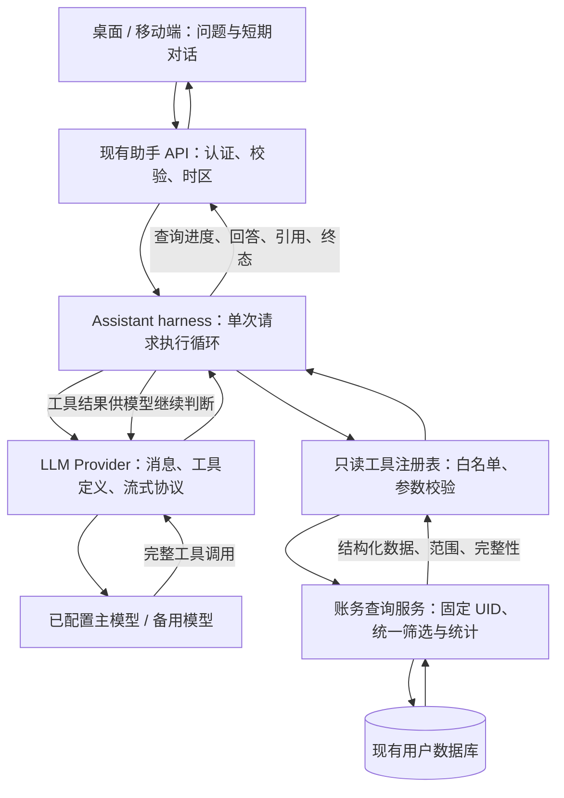

# AI 助手全量账务查询改造计划书

版本：v1.1（执行交接审查版）  
日期：2026-10-14  
状态：已完成基于现有代码的执行交接审查，待实施；本文不表示功能已经上线。  
阅读顺序：先读第 1、3、11、15、17 节，再按实施阶段查阅契约和验收章节。第 15 节冻结执行细节，第 16 节列出本次发现及修订；实施时以本文 v1.1 的统一约定为准。

## 1. 目标与最终决策

移除 AI 助手对 embedding 向量检索、相似度 top-k 和账单向量缓存的运行依赖，改用**扁平化只读工具 + 模型自主选择查询 + 后端受控执行循环（harness）**。

用户可以通过自然语言查询当前登录用户的全部有效账务数据，包括所有记账账户、全部历史账单、分类、标签和当前余额。模型根据问题按需查询，服务层负责精确计算，模型负责解释数据、总结和提出建议。

“当前账户”在权限上指当前登录用户（UID），不是仅指页面选中的某个银行卡或钱包。默认覆盖该用户的所有记账账户；用户指定支付宝、某张银行卡等条件时才缩小范围。

“没有限制”的产品定义：

- 没有“最近两年”“最多 1,800 条”“只召回 18 条”等数据可达范围限制。
- 任意历史时间范围都能查询，明细可连续分页，统计覆盖完整匹配集合。
- 隐藏账户、隐藏分类和隐藏标签仍属于该用户的有效数据，默认纳入，返回隐藏状态。
- 单次返回大小、执行时间和模型调用预算是运行保护，不得悄悄缩短日期范围或截取账单后声称已经完成全量统计。
- 用户隔离与只读权限始终有效。用户不能通过提示词、工具参数或历史消息扩大权限。

本期交付覆盖账务问答、当前余额、账单搜索、收支统计、趋势比较和基于数据的建议。交易修改、账户管理、附件内容识别、计划交易模板管理、历史任意时点余额重建，以及用户密码、令牌等非账务信息不在工具权限内。查询不到已删除数据符合现有业务语义；“全部历史”指全部有效账单，不含回收已删除记录。

## 2. 已核查的现状与改造原因

| 现状 | 代码位置 | 影响 |
| --- | --- | --- |
| 最多加载 1,800 条账单，读取到当前年份减二的年初附近停止 | `pkg/api/large_language_models_assistant.go` | 更早或更大量的账单无法进入助手上下文 |
| 对上述账单做 embedding，再选择 top 18 | 同上 | 语义相似不代表满足精确筛选，也不能证明完整性 |
| 财务快照来自上述受限集合 | `buildAIAssistantFinancialSnapshot` | 总额和历史对比可能缺少数据 |
| embedding 请求失败会阻断回答 | `prepareAIAssistantPromptContext` | 查询账本依赖额外模型服务 |
| 向量缓存位于 `ai_assistant_embedding` | `pkg/services/ai_assistant_embeddings.go` | 需要处理缓存一致性、密钥和模型迁移 |
| 当前对话保存在页面内存，最多携带最近 12 条消息 | `src/views/base/assistant/AssistantPageBase.ts` | 并没有独立的长期对话记忆数据库 |
| 服务层已有按 UID 查询、筛选、计数、余额和统计能力 | `pkg/services/transactions.go`、`accounts.go` 等 | 可复用账务规则与数据访问，无需另建数据源 |
| 已有 MCP 查询工具，也注册了新增账单工具 | `pkg/mcp/` | 可借鉴领域逻辑，但不能把整个 MCP 注册表开放给助手 |
| 部分 MCP 输出仅给名称、过滤隐藏账户 | `pkg/mcp/query_all_accounts_tool_handler.go` | 无法原样满足稳定 ID 和完整覆盖要求 |
| 普通助手走 Chat Completions，流式助手走 Responses | `pkg/llm/provider/openai/` | 两条传输链路都需要适配真正的工具调用 |
| XOrm context 适配器丢弃 Deadline、Done、Err | `pkg/datastore/query_context.go` | 仅把请求 context 传入数据库服务并不能取消正在执行的 SQL |
| 流尾 JSON 解析失败可能被转换成 `done` | `src/lib/services.ts` 的 `parseRawStreamEvent` | 断流或损坏响应会被误判成功，必须修复 |
| `WebContext` 嵌入 Gin context，未发现全局启用 ContextWithFallback | `pkg/core/context_web.go`、`cmd/webserver.go` | 必须显式从 HTTP request 派生取消与超时，不能假定包装器自动传播 |

Embedding 可用于语义模糊的文本查找，但不是完整账务查询的必要基础设施。本期直接移除该依赖，不保留并行 RAG 分支，也不为了替代它增加第二套数据库。

## 3. 整体调用链与模块边界



职责分配：

| 层 | 负责 | 边界 |
| --- | --- | --- |
| API | 登录身份、请求校验、语言时区、HTTP/SSE 输出 | 不编写 SQL，不解析供应商工具协议 |
| `pkg/llm` harness | 工具循环、消息状态、预算、取消、结束条件 | 不理解账户表结构，不做财务计算 |
| LLM Provider | 工具定义与消息协议映射、流式组装、错误识别 | 不访问数据库，不决定用户权限 |
| `pkg/services` 助手查询服务 | 工具定义和执行、ID 归属、筛选、精确统计、结果投影 | 不调用模型，不依赖 HTTP handler |
| 现有领域服务 / 数据访问 | 账户、分类、标签、交易、用户分库选择 | 维持 UID 与 deleted 条件 |
| 前端共享逻辑 | 提交问题、展示进度、取消、引用和终态 | 不执行工具，不持有模型密钥 |

采用单个助手执行循环，无多代理、无任务规划树、无独立 MCP 服务跳转。工具平级注册，模型直接选择。助手无需开启外部 MCP 功能即可运行；外部 MCP 现有协议和权限保持独立。

## 4. 工具接口设计

### 4.1 首期工具清单

| 工具名 | 输入概念 | 输出与用途 |
| --- | --- | --- |
| `list_accounts` | 名称关键词、分页 | ID、名称、父账户 ID、账户类型、币种、隐藏状态；包含全部有效账户 |
| `list_categories` | 收支类型、名称关键词、分页 | ID、名称、父分类 ID、类型、隐藏状态；支持完整层级解析 |
| `list_tags` | 名称关键词、分页 | ID、名称、标签组 ID、隐藏状态 |
| `query_transactions` | 统一筛选条件、排序、游标、页大小 | 账单明细、匹配总数、下一页游标、实际范围 |
| `get_transaction` | 账单 ID | 单笔完整账务字段、转账关联账户、标签、备注、附件数量；不返回附件存储密钥或文件内容 |
| `aggregate_transactions` | 统一筛选条件、分组、分组排序、游标 | 完整匹配集合的精确总额、笔数、分组统计 |
| `get_account_balances` | 可选账户 ID 集合、分页 | 当前余额、资产/负债语义、币种、查询时间、完整范围的分币种总计；账户明细可分页，父子账户避免重复汇总 |

首期以原币种分别统计，不自动换汇。当前余额直接查询已有账户余额，不用“收入减支出”推算。历史余额问题应明确说明当前工具的能力，不用当前余额冒充历史余额。

不为“上月餐饮”“今年交通”“最大一笔”等每个问题创建专用工具，这些组合由通用筛选、排序、分组覆盖。同比、环比可通过一次聚合查询返回两个完整期间的数据，再由服务层根据同币种的精确值计算差额和变化率；计算辅助逻辑留在汇总能力内，不另造任意脚本执行工具。

### 4.2 统一筛选结构

`query_transactions` 和 `aggregate_transactions` 使用同一个强类型筛选结构及同一套归一化规则：

| 字段 | 语义 |
| --- | --- |
| `start_time` / `end_time` | RFC 3339 时间，起点包含、终点不包含；均可为空，无默认历史截断 |
| `types` | income、expense、transfer、balance_modification 枚举集合 |
| `account_ids` | 字符串 ID 数组；父账户由服务层展开为有效子账户，展开结果写入返回范围 |
| `category_ids` | 字符串 ID 数组；父分类展开子分类 |
| `tag_ids` / `tag_match` / `no_tags` | 标签集合及 any/all 匹配方式；`no_tags=true` 与非空标签集合互斥 |
| `currency` | 可选币种；按匹配的账户侧判断，转账规则见第 6 节 |
| `transfer_side` | source / destination / either，默认 either；只影响转账账户侧的筛选和聚合，规则见第 15.2 节 |
| `amount_min` / `amount_max` | 十进制金额字符串；在币种明确时使用，按同一账户侧金额比较 |
| `keyword` | 备注文本检索，参数化且转义 SQL 通配符，不解释为 SQL 或指令 |

ID 在工具 JSON 中一律使用字符串，避免 JavaScript 大整数精度损失。拒绝未知字段、无效枚举、重复 JSON 键、非法时间与不合法金额；工具 JSON schema 和后端校验同时生效。

同名账户或分类先查询元数据，通过 ID 和层级定位；存在实质歧义时向用户澄清。找不到实体时返回明确错误，禁止把空 ID 集合误解成“查询全部”。

### 4.3 分页与排序

- 明细默认按交易时间倒序，稳定次序使用逻辑交易规范化后的内部时间与 ID 组合；支持金额排序，必须在单币种范围内，包含转账时还须明确 source 或 destination 侧。
- 使用游标分页，建议默认 50 条、单页最多 200 条。限制的是单页，不是总条数；不设置最大页数和历史年限。
- 游标绑定当前 UID、规范化筛选、排序、查询时间边界和最后一条记录位置，签名防篡改，不能跨用户或更换条件复用。
- 元数据工具也支持分页，不能因为账户、分类或标签较多而截断列表。
- 聚合分组可分页，但总计始终来自完整匹配集合。第一页的分组不能被当成全部分组。
- 明细页达到字节预算时减小实际页长并提供下一页；单笔详情完整返回。现有备注上限为 255 字符，无需新增文本分段读取工具；若异常记录单项即超过预算，返回 `RESULT_TOO_LARGE`，不能截断后伪装完整。

### 4.4 结果契约

所有工具采用一致外壳，以下为形状示例，具体字段按工具能力精简：

```json
{
  "ok": true,
  "query_id": "request-local-query-id",
  "scope": {
    "start_time": "2025-01-01T00:00:00+08:00",
    "end_time": "2026-01-01T00:00:00+08:00",
    "timezone": "Asia/Shanghai",
    "currency": "CNY",
    "includes_hidden": true,
    "excludes_deleted": true
  },
  "matched_count": "2537",
  "returned_count": 1,
  "has_more": true,
  "next_cursor": "opaque-signed-cursor",
  "coverage": "page",
  "queried_at": "2026-10-14T10:00:00+08:00",
  "data": [
    {
      "transaction_id": "1234567890123456789",
      "time": "2025-12-31T12:00:00+08:00",
      "type": "expense",
      "amount": "35.00",
      "currency": "CNY"
    }
  ],
  "warnings": []
}
```

上例为每页一条的明细示例，`data` 的实际长度必须等于 `returned_count`。大整数计数使用字符串。

- 明细返回 `coverage=page`，即便这一页成功，也不意味着它代表全部匹配记录。
- 聚合额外返回 `totals_coverage=all_matching` 和 `groups_has_more`，分别表达总计完整性与分组分页状态；`matched_count` 计数的是逻辑交易，不能把转账的两条存储记录算成两笔。
- 数据为空时为成功、计数零、无下一页；查询错误不能转换成“没有账单”。
- 金额以现有金额规则转换成十进制字符串，附带币种；不得使用浮点 JSON 金额作为计算源。
- 结果只包含回答所需的业务字段，不将整个 ORM 对象直接序列化给模型。

错误外壳包括 `code`、面向模型的简短 `message`、`retryable`、必要的字段纠正信息；不返回 SQL、连接串和其他用户是否拥有某 ID 的信息。定义至少覆盖 `INVALID_ARGUMENT`、`NOT_FOUND_OR_NOT_ACCESSIBLE`、`QUERY_TIMEOUT`、`CANCELED`、`BUDGET_EXHAUSTED`、`PROVIDER_UNSUPPORTED`、`UPSTREAM_FAILED`、`RESULT_TOO_LARGE`、`INVALID_CURSOR`。这里是工具错误字符串，不替代现有 HTTP API 数字错误码。

### 4.5 聚合与比较参数

`aggregate_transactions` 在统一 `filter` 外接受以下参数：

- `group_by`：从 `day`、`month`、`year`、`category`、`account` 中选择分组维度。时间维度互斥；币种和资金流类型始终独立，不允许跨币种混算。资金流类型包含 income、expense、transfer_out、transfer_in、balance_modification。
- `metrics`：首期支持 `count`、`sum`、`min`、`max`，计算均基于完整集合。收支净额由精确的收入和支出总额派生。
- `periods`：可选的具名时间区间数组；指定后替代 `filter` 内的起止时间，二者同时出现报错。可在同一次一致性读取中计算本期、上期及去年同期，返回每个区间的实际边界。
- `comparison`：可选的本期/基期名称，必须引用 `periods` 中已定义的区间；服务返回同币种同分组的差额与变化率。时间分组按区间内相同的日/月/年序号对齐，不把 2025-01 与 2026-01 当成不相交分类；具体边界和舍入规则见第 15.2 节。
- `order_by`：白名单统计指标及升降序，同值时按完整分组键稳定排序；不同币种分别排名。
- `cursor` / `page_size`：仅分页返回分组，不改变总计覆盖范围。新请求中重算聚合可能因账本修改导致分组排名变化，必须返回新的读取时间。

例如“去年餐饮按月花了多少”先定位餐饮分类 ID，再传入该年份范围、`types=[expense]`、`group_by=[month]`、`metrics=[count,sum]`。返回完整年度总额及各月分组；没有交易的月份在指定有限时间范围内补零。对比问题中一侧缺失的同币种分组同样按零处理，避免漏掉新增支出分类。

## 5. 用户隔离与数据访问链路

每次请求按以下顺序执行：

1. 复用现有认证中间件，API 从登录态读取 `GetCurrentUid()`。
2. 创建仅本次请求有效的助手查询服务，构造时固定 UID、请求 context、时区和语言。
3. 工具 schema 不包含 UID、数据库名、表名、任意 SQL、服务器路径或外部 URL。
4. 严格解析工具参数；模型传入 `uid` 等额外字段直接拒绝。
5. 账户、分类、标签、账单及游标分别校验归属；混入一个外部用户 ID 的集合不能被静默放宽为全量查询。
6. 服务使用当前 UID 选择用户分库，并在每个主查询、关联查询、子查询和统计查询中保留 `uid = ?` 与有效记录条件。
7. 只读工具白名单独立注册。即便外部 MCP 注册了新增账单工具，助手也不能访问该工具。
8. 引用和返回链接只由实际查询结果构造，前端打开账单时仍经过现有鉴权。

不依赖提示词承担权限控制。备注、账户名称、分类名、历史用户消息和历史助手回复均是非可信内容，不能更改系统指令、工具定义或身份上下文。

默认不持久化工具结果。请求内的元数据缓存和重复查询缓存属于单个已认证请求，严禁跨用户共享。日志记录工具名、耗时、计数、错误码和关联请求 ID，默认不记录完整账单、完整提示词、余额、备注或密钥；需核查现有 provider debug 日志并对助手链路做脱敏。

## 6. 完整性与财务计算规则

### 6.1 全量统计与数据库执行

服务端对完整筛选集合执行统计，不让模型遍历几页账单后自行声称“合计”。

- 简单的计数、同币种总额、分类分组优先使用参数化数据库聚合，分组字段必须从白名单映射。
- 时区、转账或金额溢出规则无法直接由现有数据库查询可靠表达时，使用服务端分批读取与精确累加，直到读取完成；不能设置扫描条数上限后返回成功。
- 复用现有领域规则，但不要原样复用“先把全部交易放入内存再统计”的路径；内存随批大小和分组数增长，而非随交易数增长。
- 核查 SQLite、MySQL、PostgreSQL 的 SUM、整数溢出、日期分组和精度行为。使用项目现有整数金额、`big.Int` 或精确十进制运算，不使用 float64 累加。
- 同一个工具结果中的计数、明细与总额应在同一数据库读视图内产生；多语句统计需要短生命周期的一致性读事务。不能在等待 LLM 期间持有数据库事务。
- 多轮工具调用各自读取当前数据，`queried_at` 仅表示读取时间，不宣称整个会话是数据库快照。需要严格对比的多个期间放进一次聚合执行中计算。
- 明细初始游标的高水位取本次完整筛选下实际存在的最大交易次序，不用当前时间代替用户未指定的截止时间，因此不会遗漏已存在的未来日期账单。高水位不能阻止回填或历史编辑；文档和结果需明确分页期间修改数据可能导致结果变化。不得把游标时间当成数据库版本号。

超时或取消时不返回冒充完整总额的部分累加值。可以返回明确未完成状态和可重试建议。若基准数据上的全历史汇总无法在合理时间内完成，先优化查询及索引；不能通过缩短查询范围满足性能验收。

### 6.2 日期、转账、分类与余额

| 项目 | 规则 |
| --- | --- |
| 相对时间 | 基于后端提供的当前时间及客户端时区解释“本月”“去年”，将实际范围写入结果 |
| 时间区间 | 统一为 `[start, end)`；适配现有内部交易时间和包含式边界时集中转换，避免重复或遗漏最后一秒 |
| 全历史 | 未指定起止时间时不添加历史窗口；年度/月度总结须明确展示选用期间 |
| 分组时区 | 首期统一使用请求时区；与采用交易记录时区的页面比较时注明口径差异 |
| 转账明细 | 同一转账只返回一笔逻辑交易，保留来源与去向账户及双方金额 |
| 收入/支出 | 转账不计入收入和消费；余额调整单独展示，不计入普通收支 |
| 退款/冲销 | 保留数据库有符号金额；负支出冲减支出，负收入冲减收入，不取绝对值、不自行改分类 |
| 账户现金流 | 转入/转出分别计算；查询某账户时匹配其账户侧，单币种金额筛选也作用于该侧；双方均匹配时交易笔数仍只计一次 |
| 多币种 | 按币种独立汇总、排序和比较，不把 CNY、USD 直接相加；本期不声称具备历史汇率换算能力 |
| 父子层级 | 选择父分类/父账户时统一展开，返回展开后的范围；同时选父子项时去重 |
| 标签 | 默认不提供按多标签直接求可加总占比的分组，避免同一笔多次计入；标签作为过滤条件 |
| 当前余额 | 读取账户现有余额和负债语义；多子账户父节点只作结构或汇总展示，不与子账户重复计入净资产 |
| 比较比例 | 同币种同口径比较；基期不为正时返回“无可定义的增长率”，不产生无限大或误导百分比 |
| 收支净额 | 收入减支出不等于余额或可用资产，回答中区分这些概念 |

## 7. Harness 执行与模型协议

### 7.1 执行状态机

`校验请求 → 构造上下文 → 请求模型 → 接收完整工具调用 → 校验并执行工具 → 回传结果 → 再次请求模型 → 输出最终回答 → 结束`。

任意阶段均可进入取消或失败终态。使用一个执行入口同时服务普通 JSON 和 SSE 路由，防止两条链路使用不同数据能力。

提供 provider-neutral 的 `ToolDefinition`、`ToolCall`、`ToolResult`、`ConversationMessage`、`TurnResponse` 数据结构，统一放在 `pkg/llm/data`；harness 接收工具执行器和流事件回调，不引用账务服务类型。服务层可以依赖这些纯数据定义，`pkg/llm` 不反向 import `pkg/services`，API 负责组装，避免 Go 包循环依赖。Provider 的工具能力采用独立接口，不强迫识图和普通文本生成实现不需要的方法。

每轮流程：

1. 系统上下文提供当前日期、时区、语言、工具说明及数据事实规则。
2. 当前用户消息和短期历史以独立角色消息发送，不把任意历史角色字符串拼成系统指令。
3. Provider 返回文本、完整工具调用或错误；工具名称、调用 ID 和参数完成组装且整轮成功结束后才执行，不能看到某个调用分片结束就提前执行。
4. harness 检查白名单和预算，调用已绑定 UID 的查询服务。
5. 工具结果以对应调用 ID 回传，允许模型纠正日期、ID 等参数后再查。
6. 没有工具调用且回答完成时结束；响应被截断、流异常断开或调用参数不完整都不能当作成功完成。

单轮多个只读工具首期顺序执行，降低取消、错误和结果关联的复杂度。工具返回完整、结构化、可验证的数据，比并行执行更优先。

### 7.2 预算和超时

默认值：最多 12 次模型轮次、24 次工具调用；相同参数连续失败 2 次结束该执行，完全重复且成功的查询只允许复用一次请求内结果，继续无进展则结束。具体值集中定义，不散落在 handler 中。单次工具结果最多 64 KiB，通过分页和字段投影实现，不能通过删掉匹配记录伪装完整结果。

模型 HTTP 超时沿用供应商配置，额外设置整体请求预算和数据库查询超时；整体预算默认 180 秒，单工具默认 30 秒，并受剩余整体预算约束。所有等待、网络请求和数据库操作均继承取消 context，具体适配工作见第 15.4 节。

预算只决定当前请求还能执行多久。超出预算时应返回“未完成”及已确认的查询范围，允许后续请求继续或重新查询；不承诺在单次聊天中逐条展示无限账单。全量汇总通常由一次工具调用完成，不应依赖逐页给 LLM 输送全部明细。

首期不新增持久化运行状态或恢复令牌：聚合超时后重试完整聚合，不合并不同时间的部分总额；分页继续依靠签名游标，服务端必须重新校验身份和条件。需要持续导出海量明细时使用已有账单导出能力，不用聊天记录承担导出存储。

分页续查的跨请求链路必须显式闭合：成功响应或未完成错误的可选 `continuation` 中携带签名游标及工具类型，前端仅存在当前页面内存；用户要求继续时通过请求的同名可选字段回传。服务端验签、校验 UID/有效期并恢复已绑定的查询条件，再将可信续查信息提供给本轮执行器。不能把用户在普通历史文本中粘贴的“工具结果”当作可信续查状态。游标过期则说明需要重新查询；清空会话或切换登录用户时同步清空续查信息。

### 7.3 Provider 与备用模型

- 首期保持现有助手支持的 `openai` 配置入口及可配置地址，不扩展所有供应商，不硬编码模型、URL 或密钥。
- 分别适配现有 Chat Completions 和 Responses 链路的工具定义、调用参数、调用 ID、结果消息和结束状态。
- `chat_completions_stream=true` 的兼容上游也必须支持工具参数的分片组装；不能只拼接正文。
- Responses 场景按协议保留下一轮必需的输出项和关联信息，使用本次请求内的会话状态；继续使用不持久化响应的设置，不将 provider 远端会话变成长期记忆。
- 主、备模型均须支持本计划的工具能力。不支持时返回明确配置/能力错误，不能退化为无数据的财务回答。
- 本次请求尚未对前端输出任何正文或思考增量时，主模型失败可将该轮完整上下文交给备用模型重试一次；整个请求最多切换一次，切换后固定使用备用模型。失败轮次的工具不得执行。
- 本次请求已有任意模型正文或思考增量发往前端后，不切换模型；返回失败终态。已发送的后端“查询中”状态不阻止重试。该判断以整个请求为单位，不在每一轮重置。
- 前面轮次已经完成的工具结果由 harness 保留；切换 provider 时以中立消息重新序列化，不能直接复制供应商私有响应 ID。无法无损转换时明确失败。
- 客户端取消、数据库权限错误和参数错误不触发模型供应商切换。

### 7.4 证据与防止编造

提示词要求：回答用户个人财务事实前查询工具；总额来自全量聚合；引用来自实际明细；数据不足说明不足；一般记账知识可以直接回答。空账本也允许问答，不再在 API 层提前阻断整个助手。

harness 在最终输出中附带独立的查询证据元数据：实际查询范围、结果完整性、查询时间、查询 ID，以及由服务生成的账单引用。引用不依赖模型自行编造 ID。原 `similarityScore` 字段停止产生。

这些机制不能机械证明自由文本的每一个数字都正确，因此验收必须比较回答中的关键金额与确定性查询真值；不能仅以“模型调用过一个工具”作为准确性证明。

## 8. 前后端交互与短期上下文

保留入口：

- `POST /api/v1/llm/assistant/chat.json`
- `POST /api/v1/llm/assistant/chat/stream.json`

请求继续支持 `mode=chat|summary`、`message`、`history`，新增可选 `continuation` 仅用于第 7.2 节的签名分页续查。服务端只接受 user/assistant 历史角色，限制消息长度与总上下文大小；客户端不能提供可信 tool/system 消息。

默认保留最近 12 条短期消息，页面内存管理，不新增向量记忆和长期对话存储。历史用于消解“那上个月呢”等指代；历史金额不是本轮数据库事实。有必要时重新查询。

摘要模式默认查询本月截至当前时间的收支、上一月相同进度期间的对比、分类分布和当前余额，并在回答中写清范围；月度完整比较与同期比较不得混淆。用户指定全历史或指定年份时遵从用户范围，不使用默认摘要窗口替代。

SSE 事件约定：

| 事件 | 行为 |
| --- | --- |
| `status`（新增） | 展示“正在查询账单”“正在统计收支”等简短状态，内部工具名及参数不直接展示 |
| `thinking_delta` | 仅转发供应商明确提供的可展示摘要；不为了 UI 生成或暴露内部推理 |
| `reply_delta` | 回答文本增量 |
| `references` | 来自实际查询的账单引用；展示数量限制不改变查询范围 |
| `done` | 成功终态，包含完整回答、查询范围/完整性元数据，以及可选的 `continuation` |
| 现有错误封装 | 失败终态；按需扩展范围和 `continuation` 字段；保留已经显示的正文并标记未完成，不再发送成功 `done` |

后端工具调用参数在未组装完成时不能发送给前端，也不能执行。前端断流而没有收到成功终态时，应标记“回答未完成”。用户取消后立即中止后端循环与上游请求，不继续后台消耗模型调用。

新增状态、查询范围和终态处理放在 `AssistantPageBase.ts` 与共享服务中，桌面和移动端使用一致行为。普通 JSON 响应复用相同完成结果，只是不输出中间事件。所有产品提示走现有国际化资源。

## 9. 实施文件与复用策略

以下新增文件名为实施建议，最终可按现有命名规范微调；职责不得拆散到重复实现中。

| 文件或目录 | 实施内容 |
| --- | --- |
| `pkg/api/large_language_models_assistant.go` | 删除向量准备、固定知识窗口及快照路径，改为认证后的薄编排；保留语言和模式处理 |
| `pkg/api/large_language_models.go` | 移除助手 embedding 服务依赖注入，接入请求级只读查询服务 |
| `pkg/services/ai_assistant_queries.go`（新增） | 工具白名单、schema、执行入口、结果契约和固定 UID 上下文 |
| `pkg/services/transactions.go` | 复用/补齐统一过滤、稳定分页、计数与全量精确统计；保持既有调用兼容 |
| `pkg/services/accounts.go`、`transaction_categories.go`、`transaction_tags.go` | 复用归属校验和层级查询，补齐工具需要的结果投影 |
| `pkg/datastore/query_context.go`、`database.go` | 真正传递取消信号；提供同一连接/读视图的只读查询执行入口，不跨 LLM 轮次持有事务 |
| `pkg/core/` 的请求上下文适配（按需新增） | 从 `c.Request.Context()` 派生 deadline，保留 request ID / locale / client IP；不在 `WebContext` 增加字段 |
| `pkg/llm/assistant_runner.go`（新增） | 唯一模型工具执行循环、预算、取消、事件与证据汇集 |
| `pkg/llm/data/large_language_model_data.go` | 中立工具协议类型；避免把 OpenAI 字段直接暴露给领域服务 |
| `pkg/llm/provider/large_language_model_provider.go` | 增加可选工具能力接口 |
| `pkg/llm/provider/openai/` | Chat Completions / Responses 的工具轮次及流式解析 |
| `pkg/llm/large_language_model_provider_container.go` | 工具能力校验和主备轮次策略 |
| `pkg/models/large_language_model.go` | API 查询证据、状态和完整性字段 |
| `templates/prompt/personal_finance_assistant.tmpl` | 去掉预置财务快照和检索知识，改为工具使用与证据规则 |
| `src/models/large_language_model.ts`、`src/lib/services.ts` | 状态事件、范围元数据、可靠终态、取消传播 |
| `pkg/utils/api.go`、`cmd/webserver.go`、`pkg/errs/large_language_model.go` | 错误 context 和单终态写入、写失败取消、必要数字错误码；保留其他路由行为 |
| `pkg/api/server_settings.go`、`src/lib/server_settings.ts` | 向前端暴露助手请求预算，设置 JSON 请求超时；不返回供应商密钥 |
| `src/views/base/assistant/AssistantPageBase.ts` | 当前会话上下文、查询进度、未完成状态和引用 |
| `src/views/desktop/assistant/AssistantPage.vue`、`src/views/mobile/assistant/AssistantPage.vue` | 对齐状态、范围展示和引用交互 |
| `src/locales/` | 新增提示的翻译及回退 |
| `pkg/settings/setting.go`、`conf/ezbookkeeping.ini` | 废弃 embedding 配置；集中管理确需运维调整的执行预算 |
| `cmd/initializer.go`、相关测试 | 旧配置忽略与日志脱敏兼容 |
| `pkg/services/ai_assistant_embeddings.go` | 停止运行时使用，移除无调用的向量缓存服务 |
| `pkg/models/ai_assistant_embedding.go`、`cmd/database.go` | 首次发布保留旧表模型及 schema 同步兼容，后续再做显式清理 |
| `docs/ai-providers.md`、`docs/ai-storage-migration.md` | 新配置、兼容要求、升级/回滚和旧表处置 |
| `.codex/skills/`、`skills/` 中对应项目技能与引用 | 更新旧 top-k、缓存和配置说明，避免后续开发恢复已废弃设计 |

外部 MCP handler 不直接调用助手 harness；助手也不通过 HTTP 回调自身 MCP 接口。确有重复的查询规则下沉到领域服务共享。现有 MCP 的写工具、认证方式和返回协议不因本次改造自动变化。

## 10. 配置、数据迁移与回滚

### 10.1 配置兼容

1. 保留 `[llm_assistant]`、`[llm_assistant_fallback]` 和 AI 总开关。
2. 停止解析和使用独立 `[llm_assistant_embedding]` 中的 provider、地址和密钥；允许旧配置段存在但忽略，不再因旧 embedding 模型为空或 provider 不支持而启动失败。
3. `openai_embedding_model_id` 不再参与助手逻辑，从新配置示例和文档中移除。若其他功能仍引用相关公共字段，先确认用途再删除，避免误伤。
4. 忽略旧配置时可输出一次不含值的废弃提示。旧的文件密钥环境变量不应再被主动读取，防止删除旧密钥文件后启动报错。
5. 在主 `[llm_assistant]` 增加 `run_timeout`（毫秒，默认 180000）、`query_timeout`（毫秒，默认 30000）、`max_rounds`（默认 12）。均为正数，0 不代表无限；配置无效则明确报错。剩余工具次数、结果字节数、游标有效期使用集中常量，预算属于助手运行配置而非备用模型配置。

### 10.2 旧表处理

首期停止对 `ai_assistant_embedding` 的所有读取、写入、重建和过期清理。已有表及记录保留，不自动删除；新请求中不会再调用 embedding 接口。无需把向量迁移成新数据，账本数据库继续是唯一事实来源。

首次发布保留旧模型和 schema 注册以降低升级风险；新库可能仍创建一张闲置表，应在文档中明确。待回滚窗口结束后，另做显式迁移移除 schema 注册，并提供管理员可执行的旧缓存清理步骤。业务账单、附件和账户不参与该清理。

### 10.3 上线与回滚步骤

1. 在测试库备份数据库、配置及附件存储，部署工具版本。
2. 使用无 embedding 配置、旧 embedding 配置、缺失旧 embedding 密钥文件三种情况验证启动与助手请求。
3. 执行隔离、统计、协议和前端验收矩阵，再进行主/备用模型的真实接口验证。
4. 使用包含超过 1,800 条和跨多年数据的测试用户核对回答；确认没有 embedding 网络请求和缓存表写入。
5. 生产发布时按已验收的 schema 更新步骤应用必要的增量索引，再观察查询错误率、耗时和取消情况；无需向量预热。实际发布由交接任务的部署授权决定，代码实施本身不包含自动修改生产环境。
6. 若有问题，先关闭 AI 助手开关，再回滚应用与配置。首期无破坏性数据迁移，旧版本可以继续使用保留的缓存；升级前保留旧 embedding 配置/密钥备份供回滚恢复。

## 11. 分阶段实施计划与完成条件

依赖顺序：`P0 → P1 / P2 → P3 → P4 → P5`。P1 和 P2 的接口必须先在 P0 对齐；该顺序描述工作依赖，不要求启动多个代理。

| 阶段 | 工作 | 完成条件 |
| --- | --- | --- |
| P0：冻结契约 | 明确工具 schema、金额/日期/转账口径、运行状态、测试数据和 provider 能力矩阵 | schema、示例及错误码一致；全量和隔离验收样例可确定期望结果 |
| P1：账务工具 | 请求级 UID 绑定、元数据工具、明细/详情、当前余额、全量聚合、签名游标 | 不经过 LLM 即可完成全部正确性与越权测试；超过 1,800 条仍正确 |
| P2：模型执行循环 | 中立协议、两种 OpenAI 传输适配、分片组装、预算、取消、备用模型 | 用模拟模型完整走通多轮调用、纠错、失败与流式终态；识图等旧功能不回归 |
| P3：API 与 UI 接通 | 普通和 SSE 路由共用执行器、系统提示词、进度/引用/范围、短期追问 | 桌面和移动端能完成同一问题；取消后后端停止；断流不显示完成 |
| P4：替换与迁移 | 去除向量运行依赖，废弃配置兼容，更新文档、技能和部署验证测试 | 不需要 embedding 即可运行；旧表不被读写；无隐含 top-k 或时间截断 |
| P5：发布验收 | 全量质量门禁、数据库矩阵、数据量基准、真实模型 smoke、回滚演练 | 第 12 节必测项通过；结果与限制记录可复核 |

不把“先接一个查询工具、其余仍走旧检索”作为最终交付。必须贯通认证、模型调用、工具执行、统计、回答证据、前端终态、配置和回滚。

## 12. 验收矩阵与质量门禁

### 12.1 确定性数据与权限验证

构造两个用户 A/B，各自有账户、分类、标签、同名实体、账单和转账。A 至少有 2,500 条跨五年以上的账单，包含隐藏账户、月/年边界、多币种、余额调整、空备注、长备注和多标签；另准备空账本用户及 10 万条以上的性能数据集。

| 测试 | 必须达到的结果 |
| --- | --- |
| 五年前一笔账单 | 可定位并打开，不能受旧窗口影响 |
| 超过 1,800 条的年度合计 | 与确定性基准一致；不能只汇总最新 1,800 条 |
| 全历史统计 | 覆盖全部有效记录，返回完整范围与币种 |
| 明细连续分页 | 无静默最大页数；静态数据下无重复和遗漏；游标篡改拒绝 |
| 跨请求继续查询 | 前端携带签名续查信息，后端验证后继续；过期、切换用户或变更条件均不能复用旧游标 |
| 隐藏账户与父子分类 | 默认完整纳入，明确范围且不重复计数 |
| A 请求 B 的各种 ID | 无 B 数据；详情、列表、统计、余额、关联表、引用和游标均覆盖 |
| A 混入 B ID、伪造 UID 或 SQL | 拒绝非法参数，不能退化为无筛选查询 |
| 转账与余额调整 | 不冒充收入/消费；逻辑交易计数和账户侧现金流正确 |
| 多币种与极大金额 | 分币种统计，精确且无溢出；跨币种金额排序明确拒绝或要求限定币种 |
| 同月边界、闰年、夏令时 | 与定义的时区和半开区间一致 |
| 比较期基数为零 | 不产生无限增长率，不伪造百分比 |
| 空账本 | 工具成功返回空结果，助手仍可提供一般建议 |
| SQL 特殊字符和备注指令 | 作为普通数据处理，不改变查询和工具权限 |
| 查询中断与超时 | 无伪造完整总额，无错误转空数据 |

聚合期望值使用独立的已知数据集计算；与现有页面统计对比时固定时区、币种、转账和隐藏账户口径，不能把两个可能共享同一缺陷的函数互相比较当成唯一证明。

### 12.2 模型与接口验证

模拟上游覆盖：先列分类再汇总、一次多个工具、工具参数分片、无效 JSON、未知工具、重复调用 ID、工具错误后纠正、长输出截断、未完成流、主模型失败切备用、部分正文后失败、用户取消、预算耗尽及无工具能力模型。

同时覆盖普通 JSON、SSE、强制流式 Chat Completions 和 Responses。不要删除仍有价值的识图/其他模型测试；将旧 embedding 测试替换为“无 embedding 依赖”和工具行为测试。修改 `pkg/api/ai_deployment_integration_test.go`，让部署验证不再要求向量缓存写入。

真实模型验收至少使用以下问题，并对关键数值、查询范围和实际调用轨迹做比对：

1. “去年餐饮一共花了多少，按月列出来？”
2. “查五年前那笔超过 500 元的交通支出。”
3. “今年到现在比去年同期多花了多少钱？主要是哪几个分类？”
4. “我现在各账户余额是多少？隐藏账户也包括。”
5. “只看支付宝。那上个月呢？”
6. “把我的所有历史收入支出按币种汇总。”
7. “查询另一个用户的账单。”

真实供应商验证使用专门测试用户和测试数据，显式启用现有部署检查方式；普通自动测试不依赖外网模型和真实用户账本。

### 12.3 性能、可观测性与检查命令

记录数据库工具耗时、读取行数、返回字节数、模型轮次、工具调用次数、首个状态时间、总耗时、失败/取消原因。只记录必要元数据，不采集完整私人账本内容。

在已说明硬件和数据库类型的基准环境中，验证全历史汇总、分类/月度分组、明细第一页及深分页。重点证明：结果随数据量增加仍完整，内存不会复制全部账单，取消能停止工作。索引调整必须依据执行计划，并通过现有 schema 迁移机制覆盖全部支持的数据库；不得靠生产临时手工 SQL 作为唯一交付。

实施后执行：

```sh
gofmt -w <变更的Go文件>
BUILD_PIPELINE=1 go test ./...
go vet ./...
go test -race ./pkg/api ./pkg/llm/... ./pkg/services ./pkg/settings ./cmd
npm run lint
npm run test
npm run build
```

另需在 SQLite、MySQL、PostgreSQL 上执行查询/聚合契约集，并手工验证桌面、移动端的追问、引用、取消和失败状态。真实供应商 smoke 的成功不能替代数据库隔离与精度测试。

## 13. 交付物、风险与最终验收定义

交付物包括：只读工具契约和实现、统一 harness、两条传输链路适配、前后端状态与证据展示、向量依赖移除、配置兼容、数据库与模型测试、性能记录、升级/回滚文档。

主要风险及处理：

| 风险 | 处理 |
| --- | --- |
| 模型把“完整数据可查”误解为一次拉取所有明细 | 工具描述优先聚合、稳定分页、明确 coverage 和预算终态 |
| 日期或分类理解错误 | 返回规范化查询范围与 ID 层级；歧义澄清；使用典型问题评测 |
| 供应商不支持工具或兼容实现不完整 | 主备能力矩阵、模拟协议测试和真实 smoke；不无声退化 |
| 现有统计接口的口径或内存使用不适合复用 | 复用规则，补齐统一查询服务；独立基准验证金额和覆盖 |
| 用户在多轮查询之间修改账本 | 每个工具使用一致性读并返回读取时间；跨期比较在一次聚合中完成 |
| 旧 embedding 配置继续触发启动校验或密钥读取 | 测试旧段、无效旧段、旧密钥文件缺失三种升级路径 |

完成标准：用户通过一次普通问题或追问能让助手定位任意年份的有效账单，并对完整匹配范围给出可核对的统计；不再存在 embedding 调用和人为历史截断；所有访问严格限定当前登录用户；任何失败、截断或预算耗尽均明确呈现，不冒充完整回答。

按软件设计原则评估，现有方案对本项目需求的适配约为 4/10，本方案设计目标为 9/10。进一步达到 10/10 的依据应是隔离、精确统计、协议兼容、性能及真实问答均得到验证，并在实施中删除重复逻辑；不能仅凭文档宣布已经达到。

## 14. 方案编写时的环境基线

此前已完成 `npm ci --no-audit --no-fund`、`go mod download` 和 `go mod verify`。前端 12 个测试文件、38,604 项测试通过；后端 `pkg/api`、`pkg/llm/...`、`pkg/settings`、`pkg/services` 测试通过。以上是改造前基线，不是新工具方案的验收结果。

本计划书只新增根目录 Markdown 文件，不修改业务代码、部署配置或数据库；工作区原有的未跟踪 `pnpm-lock.yaml` 保持原状。

## 15. 执行细节冻结：实施 agent 不需要重新猜测的约定

### 15.1 工具入参、默认值和 schema

所有工具的对象 schema 均为 `additionalProperties=false`，嵌套对象同样限制。一个领域定义同时生成 provider schema 和执行端校验，避免两个地方分别维护规则。兼容严格工具协议时，将可省略字段表示为可空字段并列入 required；解码后 `null` 与未提供统一归一化。真正必填字段仍拒绝 null。不要用 `omitempty` 或 JSON Schema 的 `default` 代替执行端默认值。

| 工具 | 冻结的参数键 | 默认行为 |
| --- | --- | --- |
| `list_accounts` | `keyword`、`cursor`、`page_size` | 空关键词返回全部有效账户，按 ID 稳定升序，返回父节点和隐藏状态 |
| `list_categories` | `type`、`keyword`、`cursor`、`page_size` | type 为空包含 expense/income/transfer，按 ID 升序；返回 parent_id |
| `list_tags` | `keyword`、`cursor`、`page_size` | 按 ID 升序；同时返回标签组 ID/名称，不另建标签组工具 |
| `query_transactions` | `filter`、`order_by`、`cursor`、`page_size` | filter 为空表示全部有效逻辑交易，包含余额调整及未来日期；默认时间倒序 |
| `get_transaction` | `transaction_id` | 必填正整数字符串；转入 ID 解析为规范转出 ID 后读取，不接受任意字段名 |
| `aggregate_transactions` | `filter`、`group_by`、`metrics`、`periods`、`comparison`、`order_by`、`cursor`、`page_size` | 空 group_by 表示仅按币种和资金流类型汇总；metrics 默认 count/sum；filter 为空不限定历史或类型 |
| `get_account_balances` | `account_ids`、`cursor`、`page_size` | 覆盖所有有效叶子账户；分页返回余额明细，同时返回完整范围的币种总计 |

共同分页默认 50、最大 200；0、负数或超限返回 `INVALID_ARGUMENT`，不静默修正。`filter` 的键就是第 4.2 节所列字段；`types` 未指定表示全部四种逻辑类型。ID/type 数组显式传 `[]` 报错，未指定或 null 表示未施加该条件；去重后校验每个元素。`tag_match` 默认 any；只提供 `tag_match` 而没有 tag_ids 报错。非空 period 数组中的 name 唯一、时间必填；group_by 可为空，但禁止重复维度或多个时间维度。

`order_by` 采用 `{ "field": "time", "direction": "desc" }` 结构。明细 field 仅允许 time/amount；聚合仅允许 group_key 或所选 metrics，默认 group_key 升序。任何排序都追加稳定唯一键。所有金额边界是包含式；负数合法，min 大于 max 报错。备注与名称关键词默认不区分大小写的字面包含匹配，必须使用数据库适配层的一致转义方式测试 `%`、`_`、反斜线，不能直接复用旧 `%keyword%` 拼接的通配语义。

时间解析精度为秒，拒绝小数秒以避免静默取整；检查 `start < end` 和内部 `unixSeconds * 1000` 的范围，防止溢出。未指定时间用可空值表示，不能用数字 0 假装“无限范围”。数据库条件使用 `>= start*1000` 与 `< end*1000`；兼容旧包含式 helper 时上界为 `end*1000-1`。使用 `pkg/utils/datetimes.go` 的转换规则，但先做范围检查。

工具入参除 cursor 外序列化后最多 32 KiB，包含 cursor 的总大小最多 96 KiB，与第 15.3 节的游标上限配套。该限制控制请求大小，不限制账本规模；超过限制报参数错误，不能截取 ID 列表。模型不允许手写跨用户标识或动态字段表达式。

### 15.2 金额、转账、比较与返回字段

**金额与负数：** 现有 `pkg/utils/converter.go` 以 100 倍整数表示金额，工具继续沿用这一事实，不根据 ISO 币种另改数据库缩放。输入允许可选负号与最多两位小数，不接受科学计数法、千分位、NaN/Inf。先校验长度和范围再解析，防止现有 `ParseAmount` 末尾乘 100 溢出。累计值使用任意精度，输出固定两位小数字符串。min/max 按有符号值比较；空集合 count/sum 为 0，min/max 为 null。

**转账的规范化：** 在过滤、计数、分页之前建立“逻辑交易 + 账户侧金额”的统一表示。转出记录的 transaction_id/time 为逻辑 ID/排序时间；转入记录通过 related_id 找到同 UID 的转出记录。关联缺失或跨 UID 是数据一致性错误，不能把它静默忽略成完整统计。账户/币种/金额条件在同一侧联合判断：source 检查来源侧，destination 检查去向侧，either 任一侧满足即可。

- 明细无论几侧匹配都只返回一条，包含 source/destination 两套账户、金额、币种及 `matched_sides`；只有命中侧参与账户范围的资金流统计。
- 聚合将命中来源侧记为 transfer_out、命中去向侧记为 transfer_in，各自用该侧币种金额；不产生含义不明的单一“转账总额”。普通收入/支出/余额调整只有一个账户侧。
- `matched_count` 对逻辑交易去重；各账户/资金流分组的 count 是组内笔数，不能再相加作为总交易数。返回 `counts_additive=false` 的场景要明确标注。
- 金额排序包含转账时必须给出 source/destination，避免两侧金额不同而排序不确定。该限制不影响转账时间排序和完整查询。
- 转账标签/备注引用规范逻辑交易；详情与统计使用相同关联条件，不能因从转入账户查询而丢失标签。

**聚合结果：** `data` 为本页分组，分组键包含 period（使用 periods 时）、所选维度的稳定 ID/时间桶、currency、flow。名称仅用于展示，不作为聚合主键。另有 `totals` 数组，独立返回每个期间/币种/flow 的完整统计；`matched_count` 是各期间匹配交易的并集笔数，各 period 返回自己的笔数。`comparison` 结果按同币种、同 flow、同非时间维度 ID、同时间桶序号配对。使用 periods 时不额外给出把重叠期间重复相加的“总和”。

**比较规则：** 差额为 current - baseline；baseline > 0 时百分比为差额 / baseline × 100，四舍五入到两位小数。baseline <= 0 时返回 null 并附原因，不用负基数制造误导增长率。月份长度、闰年和同期截止点由服务按请求时区的日历运算处理：不存在的日期夹到目标月最后一天；不使用固定 30 天或 365 天偏移。时间桶显示真实起止点，并附 ordinal。两段期间的桶数量不同时返回未配对项，不将其伪装成有可比基期的增长率。

**余额规则：** 叶子账户返回数据库 signed_balance、资产/负债类型和 currency；负债的 outstanding_balance = -signed_balance，保留负数表示溢缴。分币种净资产为全部叶子账户 signed_balance 之和。资产余额、负债余额各自完整汇总，隐藏账户默认纳入。分页只影响明细数组，不能影响总计。

**输出字段：** 明细和详情都给出规范 transaction_id、内部排序标识（仅在游标内）、RFC3339 时间、记录原始时区偏移、逻辑类型、源/目标账户 ID 与名称、双方金额币种、分类 ID/名称、标签 ID/名称、备注、hide_amount 和附件数量。内部排序标识不作为用户可编辑字段。创建 IP、鉴权字段及附件对象存储路径不返回。`hide_amount` 是现有展示属性，不改变该用户自己的统计权限，也不静默剔除该交易；引用卡片仍沿用隐藏金额展示习惯。

余额调整等合法无分类记录采用 null category_id 和“无分类”显示，不把领域允许的空关系当成越权或损坏数据。有效交易若缺少本应存在的账户/转账关联则明确报告数据一致性错误；不能利用 inner join 悄悄漏掉这些交易后声称统计完整。关联元数据在当前工具读视图内批量加载，避免每条账单单独查询造成 N+1。

**零值分组：** 明确且有限的时间范围按页生成缺失时间桶，sum/count 补零；不一次生成跨数千年的所有空桶。只有至少一个期间出现过的非时间维度组合才参与比较补零，不构造账户×分类的巨大笛卡尔积。未指定币种且完全无数据时返回空 totals，不凭空推断某币种金额。

### 15.3 游标、续查和预算契约

工具层使用 snake_case；对浏览器的 API 延续现有 camelCase。新增 HTTP 字段固定为 `queries`、`continuation`。每个 `queries` 项包含 queryId、tool、scope、coverage、queriedAt、warnings；这是工具结果的简洁摘要，不把全部账单再次发给浏览器。

`continuation` 采用 `{ "tool": "query_transactions", "cursor": "..." }`，只允许携带一个当前结果的续查入口；多工具都有下一页时，取最后一个可分页查询，并显示其范围。前端可将当前入口作为候选上下文随请求携带，后端验签后交给模型按最新问题决定是否使用，不自动执行；这样自然语言“继续”无需客户端猜测意图。用户点击“下一页”时发送明确的续查用户消息。新问题不得自动沿用候选游标的筛选，模糊续查由模型根据范围澄清。续查游标是可验证的查询参数，不是可免鉴权的授权令牌。

游标契约：版本号、tool、UID、规范化原始筛选（包括父账户/分类选项）、时区、排序、高水位/末键、签发时间、过期时间，JSON 规范编码后使用用途隔离的 HMAC-SHA256 签名；用已有服务器 secret 派生专用签名用途，不复用登录 token 类型。有效期 24 小时，最大 64 KiB，恒定时间验签；secret 变更后旧游标自然失效。验证通过后仍按当前用户数据校验全部参数及实体归属，不信任游标中的任何外部数据或计数。父子层级重新展开后若结果与原游标记录的集合摘要不同，返回 `INVALID_CURSOR`，要求从头查询。

游标查询允许省略其他参数；若同时传入必须与游标绑定的规范条件相等。签名不提供保密性，因此不得记录游标原文或放到 URL；仅在已认证请求 body / 响应中传输。不得为了游标另建业务表。

预算细化：

- 调用次数在执行前扣减；一轮有 N 个调用而剩余额度不足 N 时，整轮停止，不执行部分工具。修正参数和切换备用模型的请求都计入模型轮次。
- 任一模型请求中的完整消息、工具 schema 和必要 provider 状态，JSON 序列化后默认最多 128 KiB；另外尊重供应商明确返回的上下文限制。超出时返回预算终态，不任意删除尚未配对的工具调用/结果，也不把部分统计删去后继续声称完整。
- 单页因字节限制缩短时 `returned_count` 与实际长度一致、游标指向真实最后一项，绝不跳过未输出行。分页游标预算与结果预算分别检查。
- 每次完整工具结果可在本请求内按规范参数复用，重复调用 ID 如果内容完全相同不再次执行，ID 相同但参数不同属于协议错误。模型连续无进展地重复成功结果同样触发预算终态。
- 提示词、历史和工具状态只在请求内存在。过长历史按“完整 user/assistant 交互”从旧到新移除，当前问题不得截断；预算配置和终态绝不成为账本时间范围或扫描条数限制。

继续沿用当前问题 2048 字符及请求历史最多 20 条的业务校验，实际使用最近 12 条。增加逐条历史校验（显式循环或正确的嵌套 validation），不能只验证数组长度。前端对超长历史消息按 Unicode 字符安全截取到既有限额并标注省略，保留当前问题原文；历史仅帮助指代，禁止从被截取的历史恢复财务总额。请求体限制为 256 KiB，足以容纳历史和单个游标；模型响应及流式单事件也应有独立有界缓冲，不能仅限制出站请求却无界读取上游。

### 15.4 Context、事务与数据库兼容

这是已确认的实施阻断点，必须在 P1/P2 接通前修复：`pkg/datastore/query_context.go` 目前的 `Deadline()`、`Done()`、`Err()` 不委托调用方。仅写 `WithTimeout` 而不改适配器无法达成取消验收。

实施顺序：

1. API 从 `c.Request.Context()` 派生整体 deadline。以一个小型 `core.Context` 适配器组合该 context 和现有 request ID、locale、client IP；元数据在 handler 内捕获，不能把 Gin writer/context 交给异步任务随意读取。
2. XOrmContextAdapter 保存父 context，委托 Deadline/Done/Err/普通 Value，同时保留现有 SessionIDKey；nil 父 context 使用 background。为这项公共改动补传递 deadline、取消、日志值的回归测试。
3. 工具 context 由整体 context 派生 query_timeout。Provider HTTP 请求使用同一父 context；日志 context 包装不能丢失取消。
4. 同一工具需要多个 SQL 时使用同一个 session/连接，先开启一致性只读事务，再做归属与元数据读取、计数、分页或累加，最后提交/回滚并 Close。禁止在事务内再调用会新建独立 session 的旧 helper。
5. MySQL 使用可重复读、PostgreSQL 使用 REPEATABLE READ（默认 READ COMMITTED 不满足多语句快照）、SQLite 使用同连接读事务。优先通过已安装 xorm/驱动能力实现；需要数据库专有语句时放在 datastore 内部适配，并覆盖集成测试。
6. 配置了主从库时，同一次工具固定同一连接和数据源；账务问答优先主库，避免刚新增账单在从库尚未可见。不得把主库计数与从库明细拼成一份结果。
7. 查询超时/取消立即中断批次、关闭 session；验证驱动确实停止操作，不只验证 HTTP 提前返回。全历史查询所需索引依据执行计划评估。

改动公共 context 适配器后重跑 datastore、services、API 及定时任务相关回归。不得为助手全局改变所有业务事务的隔离级别或全部路由的超时。

### 15.5 Provider 流式语义、证据和结束状态

第一版优先保证完整工具轮次：缓冲每轮 assistant 正文，直到确认该轮完整结束且没有工具调用时，才通过 `reply_delta` 输出该最终轮正文；有工具调用的轮次，其临时正文不当作最终答案发给用户。`status` 可实时发送，供应商可展示的思考摘要可实时转发。这样 SSE 有实时查询进度，但最终正文可能在该轮完成后才出现；不要把它宣称为始终逐 token 的正文直播。

Provider 的分片组装按 choice/item/call ID 或 index 区分，首期只取一个有效候选；部分参数不能 JSON 解码成功就先执行。必须收到该协议的有效结束标记且没有截断/错误，才能把完整 tool_calls 提交给 harness。正文和工具混合的轮次先执行工具，后续再生成最终回答。

Responses 在不持久化模式下，要在请求内保留协议要求的 reasoning/output items，包括需要的不透明状态；这些状态不能放进前端历史或日志。跨模型/协议不能原样透传私有推理状态：备用模型使用系统消息、原始对话、规范化的已完成工具调用及结果重建上下文。适配器若不能表达该中立上下文，明确返回 unsupported，不丢失工具结果后重试。

原有结构化 JSON 识图路径继续使用现有接口。助手最终模型回复统一为普通 Markdown，外层 API 再包装 JSON；移除旧助手 `ResponseJsonObjectType=AIAssistantResult` 与提示词“不要包装 JSON”的冲突，不让模型同时承担最终 HTTP 外壳序列化。

严格区分三种状态：模型轮次完成、单个工具结果完整、整个用户任务回答完成。总计完整性由服务返回，不由模型自报；最终回复只包含已成功工具的 queries/ref。工具错误不得被下一轮解释成“查无记录”。对纯知识问答允许无 queries，对个人财务回答没有可用证据时提示无法确认，不伪造账单。

引用数量默认最多 8，按实际读取的逻辑交易 ID 去重，只代表“本次查询涉及的账单”。需要精确声明“这段解释引用了哪笔”时才引入模型引用选择与服务端集合校验；首期不把所有读过的账单说成每项结论的证明。聚合回答可以没有账单卡片，但必须有完整范围的查询证据。

### 15.6 HTTP/SSE 与前端具体改动

保留现有成功 JSON 包装 `{success:true,result:...}`。SSE 继续使用当前每个 `data:` 中直接放 chunk 的格式，不再额外嵌套 success/result。错误沿用 `{success:false,errorCode,errorMessage,path,context}`；新增详情放 `context.assistant = {state, queries, continuation}`，state 为 failed/incomplete。HTTP 数字错误码从 `pkg/errs/large_language_model.go` 当前空闲范围分配，前端不硬编码新的数字分支。

- 一个请求只能出现一个终态：成功 done，或错误 envelope；客户端主动取消时不强求已关闭连接收到终态，前端本地标记 canceled。
- 必须移除 `src/lib/services.ts` 的 `fallbackToDoneEvent` 伪成功逻辑；跟踪 terminalSeen，EOF 时没有终态则失败。非法 JSON、半截 UTF-8、合法尾帧但无空行、CRLF、多行 data、未知事件与重复终态都有测试。未知非终态事件可忽略，损坏数据不能伪造成功。
- `AssistantPageBase.ts` 保留错误 context 和 continuation，不再只转成 `{message}` 丢失元数据。消息增加 requesting/completed/incomplete/failed/canceled 状态；未完成的 assistant 文本不作为可信事实拼进下一次历史。
- 使用唯一请求标识防止取消后的旧回调覆盖新消息。清空会话、退出页面、切换用户时取消请求并清理上下文；桌面/移动端共享 composable，使用现有 Vue 3 Composition API，不另建全局聊天 store。
- `run_timeout` 通过 server settings 提供给客户端，普通 JSON 请求超时取该值加 10 秒；SSE 设相同整体客户端截止时间。代理的读超时文档同步说明，不误用原固定 `DEFAULT_LLM_API_TIMEOUT` 提前切断合法执行。
- 后端 SSE 写入由单个发送点串行处理，写失败触发 cancel；现有 WriteEventStreamJsonSuccessResult 只 Abort 的行为不足以停止上游，需要助手级可感知写失败的封装。每 15 秒可发送 SSE 注释心跳并 flush，注释不作为正文或成功事件。
- heartbeats、状态更新、模型回调不能并发写 Gin response writer。结束后停止定时器和回调，race 测试覆盖取消与写入竞争。
- Markdown 沿用现有安全渲染方式，备注里的 HTML/链接不能绕过过滤；引用卡片只使用服务确认的当前用户账单链接。

### 15.7 可执行的最小财务真值集与环境门禁

除大数据集外，测试必须包含独立可手算的小集合，全部同一个用户、同一期间：

| 逻辑交易 | 金额 | 预期归属 |
| --- | --- | --- |
| 普通支出 | CNY 100.00 | expense |
| 退款，以负支出存储 | CNY -20.00 | expense |
| 普通收入 | CNY 1000.00 | income |
| 跨币种转账 | 来源 CNY 40.00，去向 USD 5.00 | 一笔交易，两个资金流 |
| 余额调整 | CNY 200.00 | balance_modification |
| 隐藏账户支出 | CNY 30.00 | expense |

预期逻辑笔数 6；CNY 收入 1000.00、支出 110.00、收支净额 890.00、转出 40.00、余额调整 200.00；USD 转入 5.00。费用分组 count=3、min=-20.00、max=100.00。转账两条存储记录不能令逻辑笔数变成 7。选中目的 USD 账户后，只统计转入 5.00，但详情仍指向规范逻辑交易。单独余额夹具设置资产 signed_balance=2000.00、负债 signed_balance=-300.00，验证净资产为 1700.00 且父节点不重复计入。

SQLite 自动测试使用临时独立数据库，复用 schema 初始化；MySQL/PostgreSQL 使用专用临时测试库或容器，每次运行独立数据库名并在测试结束清理。测试夹具不得连接或清空生产库；集成测试需显式 opt-in 与测试库标识检查。新增的测试启动方式和所需环境变量写入文档，不能只写一句“手工测试数据库”。

相对日期、游标有效期及超时测试固定时钟，使用可注入的 now 函数或现有测试方式，避免随真实日期变化。断流和取消测试使用可控 mock 上游及长查询夹具，明确断言调用次数停止、连接/session 释放，而非仅检查返回了错误文本。新增配置默认值与格式校验使用表驱动测试，覆盖负数、零、溢出、未知废弃字段以及 EBK/EBKCFP 覆盖。

未具备 MySQL/PostgreSQL、真实模型配置或 GUI 环境时，执行 agent 应继续完成所有可运行的实现和自动测试，把对应项明确标为“待环境验证”并列出可执行命令及缺少的输入；不得把跳过计为通过，也不能因此提前停止其余开发。代码可进入审核不等于发布验收已完成，生产发布仍以第 12 节全部必要验证为门禁。

## 16. 本次交接审查的发现与修订记录

| 编号 | 原计划缺口/冲突 | 已落实的决策 | 验证位置 |
| --- | --- | --- | --- |
| R01 | DB context 适配器明确不传播取消 | 补父 context 委托、HTTP request 派生及驱动级取消验证 | 第 15.4 节 |
| R02 | 默认事务不能保证所有数据库多语句快照 | 固定连接、明确隔离级别与主从选择 | 第 15.4 节 |
| R03 | 损坏流尾可伪造 done，错误 context 会被丢弃 | 明确 parser、终态、错误上下文和前端状态修改 | 第 15.6 节 |
| R04 | 双向转账金额筛选/计数/排序含义不确定 | 规范逻辑 ID，transfer_side，同侧条件和 flow 分组 | 第 15.2 节 |
| R05 | 退款负数、金额精度与比例基数缺失 | 沿用 100 倍整数，保留符号，非正基数无增长率 | 第 15.2、15.7 节 |
| R06 | 同期月度结果可能按绝对年月无法配对 | ordinal 对齐、真实期间展示、日历边界规则 | 第 15.2 节 |
| R07 | 当前时间高水位可能排除已有未来账单 | 高水位来自完整条件的实际最大次序 | 第 6.1 节 |
| R08 | 余额及元数据量大仍可能被截断 | 全部集合分页，余额总计独立全量计算 | 第 4.1、15.1 节 |
| R09 | 续查令牌缺少精确定义与验证位置 | HTTP continuation、签名字段、有效期、父子范围变更校验 | 第 15.3 节 |
| R10 | 多轮文本、工具分片与主备切换边界冲突 | 完整轮次后执行、最终正文缓冲、请求级一次切换 | 第 7.3、15.5 节 |
| R11 | 单结果上限不能保证整个模型上下文不超限 | 累积字节预算、工具对完整保留、明确预算终态 | 第 15.3 节 |
| R12 | 旧配置移除遗漏初始化、测试、日志和客户端超时 | 文件清单、配置键、环境及客户端同步要求 | 第 9、10、15.6 节 |
| R13 | 单条备注分段读取与当前字段上限不相称 | 删除不必要能力，保留完整详情及异常大结果错误 | 第 4.3 节 |
| R14 | 交接缺少执行授权边界和环境未具备时的行为 | 补启动指令、检查清单及未验证项交付规则 | 第 17 节 |

此记录说明本次已经核查并修订的事项，不代表未来实现不存在缺陷；运行正确性必须由测试和验收证明。

## 17. 给执行 agent 的交接指令与完成清单

可以将以下内容直接作为执行任务：

> 在 ezbookkeeping 仓库实施根目录 `AI_ASSISTANT_HARNESS_PLAN.md` v1.1。用户已确定移除助手向量检索，改用当前登录用户范围内的扁平只读查询工具，支持完整历史数据与全量统计。请先检查当前工作区状态、适用 AGENTS.md 和项目技能，再按 P0→P1/P2→P3→P4→P5 完成实现、测试和文档。契约按第 15 节执行，已知代码陷阱见第 16 节。常规实现选择自行解决，不需要再次询问已确定的方向。保留现有用户改动；不要自动部署生产、提交/推送代码或删除旧缓存表。不要只实现查询工具或只改提示词就结束。无法运行的外部环境验收明确列为待验证，同时完成其他已授权工作。最终报告变更、验证结果、未验证项及发布条件。

开始实施的检查清单：

- [ ] 阅读本文件全部契约与第 16 节，并记录当前 commit/工作区状态；旧 `pnpm-lock.yaml` 未跟踪状态仅是编写时基线，不能据此覆盖现状。
- [ ] 检查适用 AGENTS.md；使用项目规范、AI 集成、项目结构、软件设计技能。修改 Vue 时读取 vue-best-practices；新增 Vue 测试按仓库测试技能执行。
- [ ] 识别旧技能中的 top-k/embedding 要求与本次用户已确定方向冲突，以当前用户目标为准，并在 P4 更新两处技能副本及引用；不为这项已授权替换重新要求确认。
- [ ] 依赖按仓库已跟踪 `package-lock.json` 和 `go.mod/go.sum` 安装/验证，复用现有 xorm、jsonschema、金额与测试库，不引入 agent 框架。
- [ ] P0 产出工具 DTO/schema、运行状态和最小真值夹具。P0 是实施阶段，字段默认值已由本计划冻结，不要把它变成再次等待设计批准的环节。

最终交付检查清单：

- [ ] 7 个只读工具、UID 绑定、关联归属检查、统一筛选、分页与全量聚合全部贯通。
- [ ] 旧 1,800/top-k/时间窗口和 embedding 运行依赖均已移除；旧表仅保留 schema 兼容，不被助手读取或写入。
- [ ] Chat Completions、强制流式 Chat Completions、Responses 和主备路径均有模拟协议测试；未修改识图/其他 provider 的既有行为。
- [ ] 取消真实传递到 HTTP 上游和数据库；公共 context 变更已通过回归。
- [ ] 桌面/移动端的进度、续查、失败、取消、范围及引用一致；损坏流尾不再伪造成功。
- [ ] 旧 embedding 配置及旧密钥文件缺失可启动；新执行配置和客户端超时匹配；新增日志不泄漏财务正文。
- [ ] 数值、隔离、跨年、退款、转账和隐藏账户真值集通过；大数据及数据库矩阵结果记录明确。
- [ ] 技能、配置样例、提供商文档、迁移文档、部署集成测试均已更新。
- [ ] 在 `docs/ai-assistant-harness-verification.md` 记录本次实际环境、命令/退出码、fixture 规模、结果、性能、未执行项、如何补测及回滚方法。该文件由实施 agent 创建，当前不存在。
- [ ] 运行差异检查，确保没有无关 lockfile、数据文件、密钥、生产配置或依赖批量升级混入变更。

实施完成报告必须区分“代码及本地自动测试完成”“环境验证待完成”“可发布”三个状态。对已发现的本方案缺口可直接修订并记录原因；只有改变用户授权范围或确实缺少必要外部输入时才需要澄清。计划书当前的设计审查评分仍为 9/10；是否达到更高可信度取决于上述实施证据，而非再次给文档打满分。
